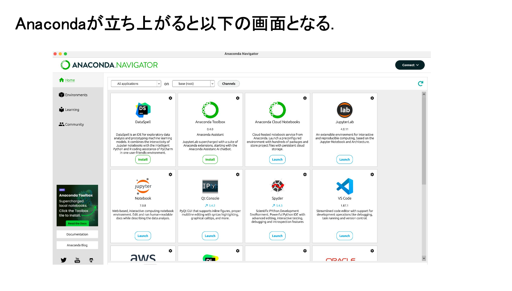
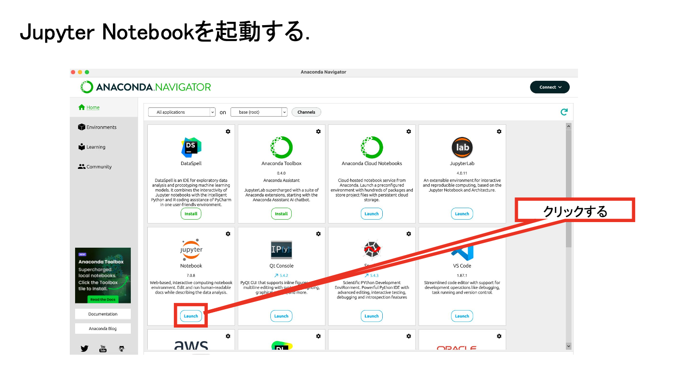
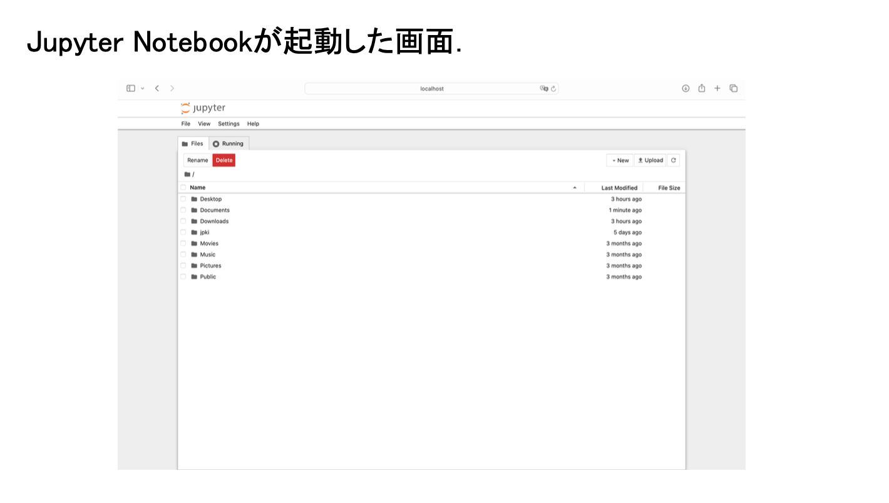
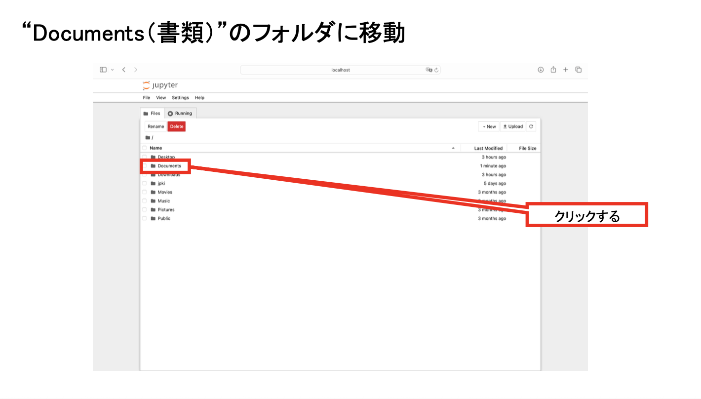
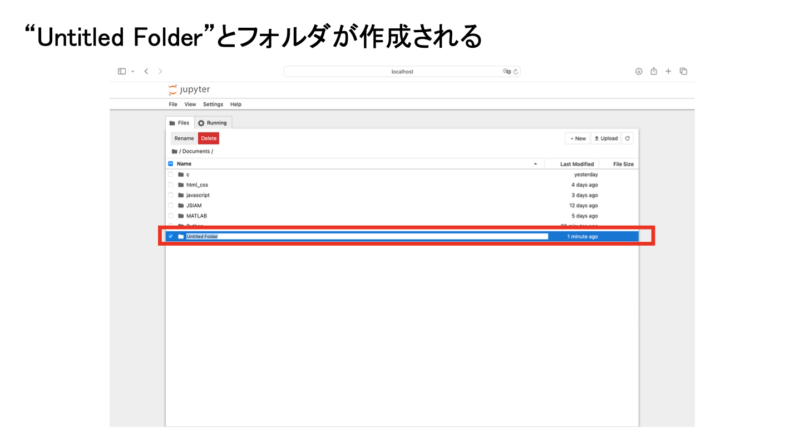
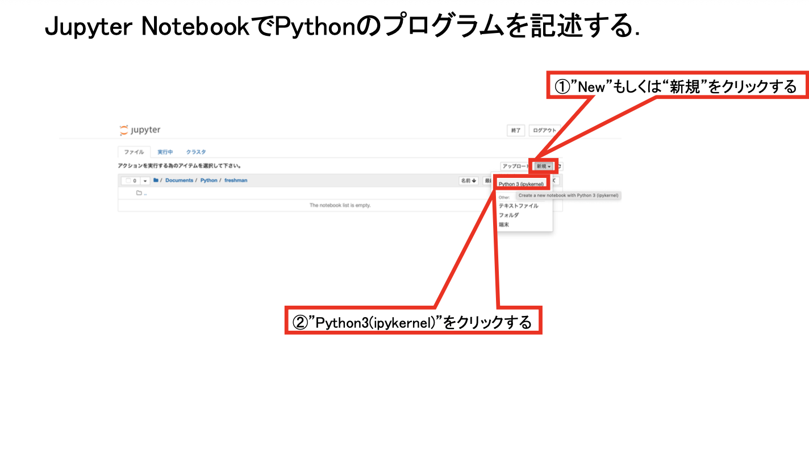
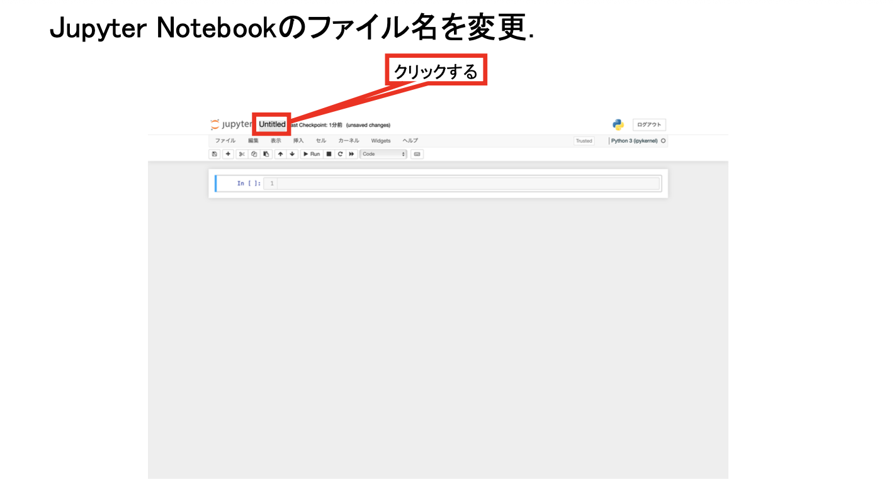
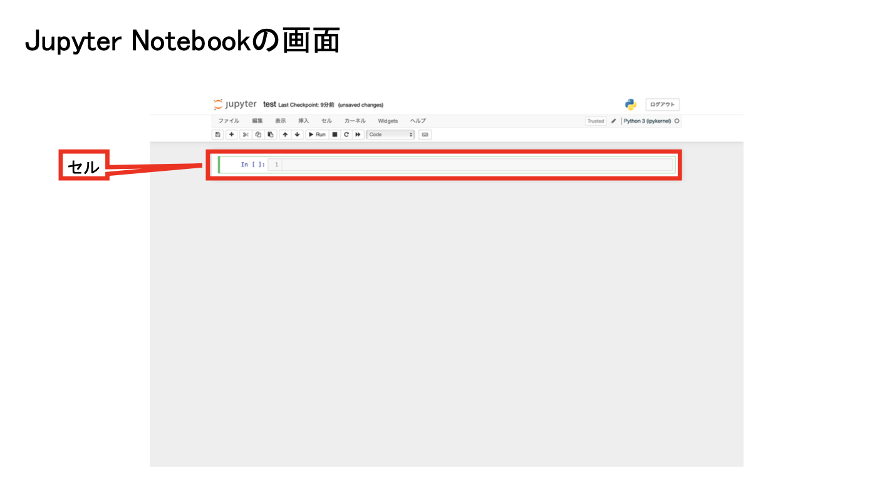

# 第4回　ファイル操作

### 到達目標

- **変数**に保存したデータと**ファイル**に保存したデータの違いを説明できる．
- リスト・辞書・文字列の代表的なメソッドを使用できる．
- `with open(...)`を使い，テキストファイルを安全に開ける．
- テキストファイルへ文字列を書き込み，保存した内容を読み込める．
- CSVファイルの構造を理解し，`csv`モジュールを使って読み書きできる．
- ファイル操作を関数にまとめられる．

### 前回の復習

前回：処理を**関数**としてまとめ，引数と戻り値を使って再利用した．

- **関数**：一連の処理をひとまとまりにし，名前を付けたもの．
- **引数**：関数へ渡す値．
- **戻り値**：関数が呼び出し元へ返す処理結果．

第3回の演習4では，実数のリストを受け取り，各要素の絶対値を並べた新しいリストを返す関数を作成した．

```python
def absolute_values(numbers):
    results = []

    for number in numbers:
        if number >= 0:
            results.append(number)
        else:
            results.append(-number)
    
    return results

numbers = [-3.5, 2.0, -1.2, 0.0, 4.8]
values = absolute_values(numbers)
print(values)
```

````{dropdown} コードの解説
- 次の部分で，実数のリストを受け取る関数を定義する．

  ```python
  def absolute_values(numbers):
  ```

- 空のリストを用意し，計算した絶対値を順番に追加する．

  ```python
  results = []
  ```

- for文で要素を一つずつ調べる．負の値にはマイナスを付け，正の値へ変換してから追加する．

  ```python
  for number in numbers:
      if number >= 0:
          results.append(number)
      else:
          results.append(-number)
  ```

- すべての要素を処理した後，結果のリストを返す．

  ```python
  return results
  ```
````

````{dropdown} 出力例
```text
[3.5, 2.0, 1.2, 0.0, 4.8]
```
````

### 前回の課題の解答例

**課題1：得点を評価へ分類する関数**

得点を受け取り，指定された基準に対応する評価を返す関数を作成した．

```python
def classify_score(score):
    if not (0 <= score <= 100):
        return "範囲外"

    if score >= 95:
        return "S"
    elif score >= 80:
        return "A"
    elif score >= 70:
        return "B"
    elif score >= 60:
        return "C"
    else:
        return "F"

scores = [-1, 0, 59, 60, 69, 70, 79, 80, 94, 95, 100, 101]

for score in scores:
    grade = classify_score(score)
    print(f"{score}点：{grade}")
```

````{dropdown} コードの解説
- 最初のif文はガード節である．得点が0点から100点までの範囲外なら，その場で文字列を返して関数を終了する．`not (想定する範囲)`で想定範囲外かどうかを判定する．

  ```{code-block} python
  :linenos:
  :emphasize-lines: 2-3
  :class: code-focus

  def classify_score(score):
      if not (0 <= score <= 100):
          return "範囲外"

      if score >= 95:
          return "S"
      elif score >= 80:
          return "A"
      elif score >= 70:
          return "B"
      elif score >= 60:
          return "C"
      else:
          return "F"

  scores = [-1, 0, 59, 60, 69, 70, 79, 80, 94, 95, 100, 101]

  for score in scores:
      grade = classify_score(score)
      print(f"{score}点：{grade}")
  ```

- 高い評価の条件から順番に判定する．一つの条件が成立すると，対応する評価を返して関数を終了する．

  ```{code-block} python
  :linenos:
  :emphasize-lines: 5-14
  :class: code-focus

  def classify_score(score):
      if not (0 <= score <= 100):
          return "範囲外"

      if score >= 95:
          return "S"
      elif score >= 80:
          return "A"
      elif score >= 70:
          return "B"
      elif score >= 60:
          return "C"
      else:
          return "F"

  scores = [-1, 0, 59, 60, 69, 70, 79, 80, 94, 95, 100, 101]

  for score in scores:
      grade = classify_score(score)
      print(f"{score}点：{grade}")
  ```

- for文で複数の得点を一つずつ関数へ渡し，返された評価を表示する．

  ```{code-block} python
  :linenos:
  :emphasize-lines: 18-20
  :class: code-focus

  def classify_score(score):
      if not (0 <= score <= 100):
          return "範囲外"

      if score >= 95:
          return "S"
      elif score >= 80:
          return "A"
      elif score >= 70:
          return "B"
      elif score >= 60:
          return "C"
      else:
          return "F"

  scores = [-1, 0, 59, 60, 69, 70, 79, 80, 94, 95, 100, 101]

  for score in scores:
      grade = classify_score(score)
      print(f"{score}点：{grade}")
  ```
````

````{dropdown} 出力例
```text
-1点：範囲外
0点：F
59点：F
60点：C
69点：C
70点：B
79点：B
80点：A
94点：A
95点：S
100点：S
101点：範囲外
```
````

**課題2：合格者数を数える関数**

得点のリストを受け取り，60点以上の得点の個数を返す関数を作成した．

```python
def count_passes(scores):
    count = 0

    for score in scores:
        if score >= 60:
            count = count + 1

    return count

scores = [45, 60, 72, 58, 90, 81]
passed = count_passes(scores)
print(f"合格者は{passed}人です．")
```

````{dropdown} コードの解説
- 合格者数を数える変数を0で初期化する．

  ```python
  count = 0
  ```

- for文で得点を一つずつ取り出す．得点が60点以上の場合だけ，合格者数へ1を加える．

  ```python
  for score in scores:
      if score >= 60:
          count = count + 1
  ```

- すべての得点を調べた後，合格者数を返す．

  ```python
  return count
  ```

- 関数の戻り値を変数へ代入し，f-stringを使って文章として表示する．

  ```python
  passed = count_passes(scores)
  print(f"合格者は{passed}人です．")
  ```
````

````{dropdown} 出力例
```text
合格者は4人です．
```
````

今回は，プログラムの実行が終了した後にもデータを残すため，データを**ファイル**へ保存する方法を学ぶ．

### Jupyter Notebookの準備

1. Anaconda NavigatorからJupyter Notebookを起動する．
2. `Documents（書類）/Fresh2`フォルダを開く．
3. Python 3のNotebookを新規作成する．
4. ファイル名を`第4回_<学籍番号>_<氏名>.ipynb`へ変更する．
5. Notebookと，これから作成するテキストファイルやCSVファイルを同じ`Fresh2`フォルダへ保存する．

```{dropdown} 忘れた人のためのJupyter Notebookの準備手順
**Jupyter Notebookを起動する**

1. Spotlight検索（`command`+`Space`）でAnaconda Navigatorを起動する．
2. Anaconda Navigatorが表示されるまで待つ．
3. Jupyter Notebookの「Launch」をクリックする．
4. WebブラウザにJupyter Notebookのファイル一覧が表示されたことを確認する．







**Fresh2フォルダを開く**

1. Jupyter Notebookのファイル一覧で`Documents`または`書類`フォルダをクリックする．
2. `Fresh2`フォルダをクリックして開く．
3. `Fresh2`フォルダがない場合は，画面右上の「New」から「New Folder」を選択する．
4. 作成された`Untitled Folder`を選択し，「Rename」をクリックする．
5. フォルダ名を`Fresh2`へ変更し，そのフォルダを開く．





**Notebookファイルを新規作成する**

1. `Fresh2`フォルダを開いた状態で，画面右上の「New」をクリックする．
2. 「Python 3 (ipykernel)」をクリックする．
3. 新しく開いたNotebook上部のファイル名をクリックする．
4. ファイル名を`第4回_<学籍番号>_<氏名>.ipynb`へ変更する．
5. `<学籍番号>`と`<氏名>`を自分の学籍番号と氏名へ置き換える．
6. Codeセルが表示されていることを確認する．







**注意：** Jupyter Notebookのバージョンによって，ボタンの名称や配置が画像と異なる場合がある．Notebookを作成したら，コードを入力する前に保存場所とファイル名を確認する．
```

## メソッド

- **オブジェクト**：Pythonで扱うデータを表す値．数値，文字列，リストなどもオブジェクトである．
- **メソッド**：特定の種類のオブジェクトに結び付いた関数．

メソッドは，`オブジェクト.メソッド名()`の形で呼び出す．ピリオド`.`の左側に操作するオブジェクト，右側に実行するメソッドを書く．

```text
オブジェクト.メソッド名(引数)
```

次の例では，文字列`text`に結び付いた`upper`メソッドを呼び出している．

```python
text = "hello"
upper_text = text.upper()
print(upper_text)
```

````{dropdown} コードの解説
- 文字列に対してupperメソッドを呼び出すと，英小文字を英大文字へ変換した新しい文字列が返される．

  ```python
  upper_text = text.upper()
  ```

- 元の文字列は変更されないため，変換結果を別の変数へ代入して表示する．
````

````{dropdown} 出力例
```text
HELLO
```
````

```{tip} 注意：関数とメソッドの呼び出し方
一般の関数は`print(value)`のように関数名へ丸括弧を付けて呼び出す．メソッドは`text.upper()`のように，操作するオブジェクト，ピリオド`.`，メソッド名の順に書いて呼び出す．
```

### リストのメソッド

リストには，要素の追加，削除，並べ替えなどを行うメソッドが用意されている．

| メソッド | 説明 | 例 |
| --- | --- | --- |
| `.append(value)` | 末尾へ要素を追加する | `numbers.append(10)` |
| `.insert(index, value)` | 指定した位置へ要素を追加する | `numbers.insert(1, 5)` |
| `.remove(value)` | 指定した値と等しい最初の要素を削除する | `numbers.remove(3)` |
| `.pop(index)` | 指定した位置の要素を取り出して削除する | `numbers.pop(0)` |
| `.sort()` | リスト自体を昇順に並べ替える | `numbers.sort()` |
| `.reverse()` | リスト自体の順番を逆にする | `numbers.reverse()` |

```python
numbers = [3, 1, 4]
numbers.append(2)
numbers.sort()
print(numbers)
```

````{dropdown} コードの解説
- appendメソッドは，リストの末尾へ要素を一つ追加する．

  ```python
  numbers.append(2)
  ```

- sortメソッドは，新しいリストを作らず，呼び出したリスト自体を昇順に並べ替える．

  ```python
  numbers.sort()
  ```
````

````{dropdown} 出力例
```text
[1, 2, 3, 4]
```
````

````{note} 演習1
リスト`scores = [70, 85, 90, 100, 60]`を大きい順に並べ替えよ．

次のコードをCodeセルへ入力し，2か所の`_____`を適切なメソッド名へ書き換えよ．コードを実行し，`[100, 90, 85, 70, 60]`と表示されることを確認せよ．

```python
scores = [70, 85, 90, 100, 60]
scores._____()
scores._____()
print(scores)
```
````

`````{hidden-answer} 解答例
```python
scores = [70, 85, 90, 100, 60]
scores.sort()
scores.reverse()
print(scores)
```

**コードの解説**

- sortメソッドは，リスト自体を小さい順に並べ替える．

  ```{code-block} python
  :linenos:
  :emphasize-lines: 2
  :class: code-focus

  scores = [70, 85, 90, 100, 60]
  scores.sort()
  scores.reverse()
  print(scores)
  ```

- reverseメソッドは，リスト自体の要素の順序を反転する．昇順に並べ替えた直後に実行すると，降順になる．

  ```{code-block} python
  :linenos:
  :emphasize-lines: 3
  :class: code-focus

  scores = [70, 85, 90, 100, 60]
  scores.sort()
  scores.reverse()
  print(scores)
  ```

- 最後にリストを表示し，最大値から最小値の順になったことを確認する．

  ```{code-block} python
  :linenos:
  :emphasize-lines: 4
  :class: code-focus

  scores = [70, 85, 90, 100, 60]
  scores.sort()
  scores.reverse()
  print(scores)
  ```

````{dropdown} 出力例
```text
[100, 90, 85, 70, 60]
```
````
`````

### 辞書と辞書のメソッド

- **辞書**：キーと値の組をまとめて管理するデータ型．
- **キー**：辞書内の値を特定するための名前．
- **値**：キーに対応して保存されるデータ．

辞書は波括弧`{}`を使い，`キー: 値`の形で作る．複数の組はカンマ`,`で区切る．

```python
scores = {"国語": 70, "数学": 85, "英語": 90}

print(scores["数学"])

scores["数学"] = 95
scores["理科"] = 88
print(scores)
```

````{dropdown} コードの解説
- 波括弧の中へキーと値の組を書き，辞書を作る．

  ```python
  scores = {"国語": 70, "数学": 85, "英語": 90}
  ```

- 角括弧へキーを指定すると，対応する値を取り出せる．

  ```python
  print(scores["数学"])
  ```

- 既存のキーへ値を代入すると値が更新され，新しいキーへ代入するとキーと値の組が追加される．

  ```python
  scores["数学"] = 95
  scores["理科"] = 88
  ```
````

````{dropdown} 出力例
```text
85
{'国語': 70, '数学': 95, '英語': 90, '理科': 88}
```
````

辞書は，教科名と点数，商品名と価格，学生番号と氏名のように，名前と値を対応させる場合に適している．

| メソッド | 説明 |
| --- | --- |
| `.keys()` | すべてのキーを取り出す |
| `.values()` | すべての値を取り出す |
| `.items()` | キーと値の組を取り出す |
| `.get(key, default)` | キーに対応する値を取り出す．キーがなければ既定値を返す |

```python
scores = {"国語": 80, "数学": 90}

print(scores.keys())
print(scores.values())
print(scores.items())
print(scores.get("英語", "データなし"))
```

````{dropdown} コードの解説
- keysメソッドはキー，valuesメソッドは値，itemsメソッドはキーと値の組を取り出す．

  ```python
  print(scores.keys())
  print(scores.values())
  print(scores.items())
  ```

- getメソッドでは，指定したキーが存在しない場合に返す値も指定できる．

  ```python
  print(scores.get("英語", "データなし"))
  ```
````

````{dropdown} 出力例
```text
dict_keys(['国語', '数学'])
dict_values([80, 90])
dict_items([('国語', 80), ('数学', 90)])
データなし
```
````

````{note} 演習2
教科名と点数を保存した辞書から，教科名と点数を1行ずつ表示せよ．

次のコードをCodeセルへ入力し，1か所の`_____`を適切なメソッド名へ書き換えよ．コードを実行し，「国語：78点」の形式で3教科が表示されることを確認せよ．

```python
scores = {"国語": 78, "数学": 92, "英語": 84}

for subject, score in scores._____():
    print(f"{subject}：{score}点")
```
````

````{hidden-answer} 解答例
```python
scores = {"国語": 78, "数学": 92, "英語": 84}

for subject, score in scores.items():
    print(f"{subject}：{score}点")
```

**コードの解説**

- itemsメソッドを使うと，for文の各回でキーと値を同時に受け取れる．この例では，キーを変数subject，値を変数scoreへ代入する．

  ```python
  for subject, score in scores.items():
  ```

- f-stringへ教科名と点数を埋め込み，指定された形式で表示する．

  ```python
  print(f"{subject}：{score}点")
  ```
````

### 文字列のメソッド

文字列には，大文字・小文字の変換，置換，分割などを行うメソッドが用意されている．

| メソッド | 説明 | 例 |
| --- | --- | --- |
| `.upper()` | 英小文字を英大文字へ変換する | `text.upper()` |
| `.lower()` | 英大文字を英小文字へ変換する | `text.lower()` |
| `.replace(old, new)` | 指定した文字列を置き換える | `text.replace("A", "B")` |
| `.split(separator)` | 区切り文字で分割し，リストを返す | `text.split(",")` |
| `.strip()` | 文字列の先頭と末尾にある空白や改行を取り除く | `text.strip()` |

```python
text = "Python,Math,Data"
words = text.split(",")
print(words)
```

````{dropdown} コードの解説
- splitメソッドへカンマを指定し，文字列をカンマの位置で分割する．

  ```python
  words = text.split(",")
  ```

- 分割された各文字列は，一つのリストにまとめて返される．
````

````{dropdown} 出力例
```text
['Python', 'Math', 'Data']
```
````

````{note} 演習3
文字列`"apple,banana,orange"`をカンマで分割し，各単語を<span style="color:red">大文字で</span>1行ずつ表示せよ．

次のコードをCodeセルへ入力し，2か所の`_____`を適切なメソッド名へ書き換えよ．コードを実行し，3種類の果物が大文字で1行ずつ表示されることを確認せよ．

```python
text = "apple,banana,orange"
fruits = text._____(",")

for fruit in fruits:
    print(fruit._____())
```

**出力例**

```text
APPLE
BANANA
ORANGE
```
````

````{hidden-answer} 解答例
```python
text = "apple,banana,orange"
fruits = text.split(",")

for fruit in fruits:
    print(fruit.upper())
```

**コードの解説**

- splitメソッドでカンマの位置から文字列を分割し，果物名のリストを作る．

  ```{code-block} python
  :linenos:
  :emphasize-lines: 2
  :class: code-focus

  text = "apple,banana,orange"
  fruits = text.split(",")

  for fruit in fruits:
      print(fruit.upper())
  ```

- for文で果物名を一つずつ取り出す．upperメソッドで大文字へ変換してから表示する．

  ```{code-block} python
  :linenos:
  :emphasize-lines: 4-5
  :class: code-focus

  text = "apple,banana,orange"
  fruits = text.split(",")

  for fruit in fruits:
      print(fruit.upper())
  ```

````

## 変数とファイル

- **変数**：プログラムの実行中に値を保持するため，値へ名前を付けたもの．
- **ファイル**：文字や数値などのデータをストレージへ記録したもの．
- **ファイル操作**：プログラムからファイルへデータを書き込んだり，ファイルからデータを読み込んだりすること．

変数に代入した値は，Notebookのカーネルを終了すると失われる．一方，ファイルへ書き込んだデータは，ファイルを削除または上書きするまで残る．保存したファイルは，後から別のプログラムで読み込むこともできる．

| 保存先 | データが残る期間 | 例 |
| --- | --- | --- |
| 変数 | プログラムやカーネルの実行中 | `message = "こんにちは"` |
| ファイル | ファイルを削除または上書きするまで | `message.txt` |

```{tip} 注意：ファイルはNotebookと同じフォルダへ保存する
この回では，Notebookと作成するファイルをすべて`Documents（書類）/Fresh2`フォルダへ保存する．保存場所が異なると，正しいファイル名を書いてもPythonがファイルを見つけられない場合がある．
```

## テキストファイル

- **テキストファイル**：文字として読めるデータを保存するファイル．一般に`.txt`などの拡張子を使う．
- **文字コード**：コンピュータで文字と数値を対応付ける規則．この講義では`UTF-8`を使用する．
- **エンコーディング**：文字とバイト列を相互に変換する方法．`encoding="utf-8"`で使用する文字コードを指定する．

````{tip} 文字コード（コンピュータ上での文字の扱い）
コンピュータがファイルへ直接保存するのは，文字そのものではなく，0と1からなる**ビット列**である．8ビットをまとめた単位を**バイト**という．文字をファイルへ保存するときは文字をバイト列へ変換し，読み込むときはバイト列を文字へ戻す．この変換方法が一致しないと，文字が正しく表示されない．

- **Unicode**：世界中の文字を共通の体系で扱うための規格．各文字には**符号位置**（コードポイント）と呼ばれる番号が割り当てられている．例えば，英大文字`A`の符号位置は`U+0041`である．
- **UTF-8**：Unicodeの符号位置をバイト列として保存する代表的な方式．一つの文字を1バイトから4バイトで表す．
- **ASCII**：英字，数字，基本的な記号などを扱う古い規格．UTF-8ではASCIIと同じ文字を同じ1バイトで表すため，ASCIIだけで書かれたファイルはUTF-8としても読める．

**文字化け**

保存時と読み込み時に異なるエンコーディングを使うと，同じバイト列が別の文字として解釈されたり，対応する文字を見つけられずエラーになったりする．これが**文字化け**の主な原因である．例えば，UTF-8で保存した日本語をShift_JISとして読み込むと，正しく表示できないことがある．出所の分からないファイルを開くときは，UTF-8，Shift_JISなど，保存時に使われたエンコーディングを確認する必要がある．
````

Pythonでファイルを操作するときは，`open`関数でファイルを開く．この講義では，ファイルを確実に閉じるためにwith文と組み合わせる．

```text
with open(ファイル名, モード, encoding="utf-8") as ファイルを表す変数:
    ファイルを使う処理
```

- **ファイル名**：開くファイルの名前を文字列で指定する．
- **モード**：読み込みや書き込みなど，ファイルを開く目的を指定する．
- **ファイルオブジェクト**：開いたファイルをプログラムから操作するための値．`as`の後ろの変数で受け取る．
- **with文**：ブロック内の処理が終わったときに，開いたファイルを自動的に閉じる構文．

| モード | 目的 | ファイルがない場合 | ファイルがある場合 |
| --- | --- | --- | --- |
| `"r"` | 読み込む | エラーになる | 内容を読み込む |
| `"w"` | 書き込む | 新しく作成する | 元の内容を消して上書きする |
| `"a"` | 末尾へ追記する | 新しく作成する | 元の内容を残して追加する |

### テキストファイルへの書き込み

書き込みモード`"w"`でファイルを開き，`write`メソッドで文字列を書き込む．

```python
with open("message.txt", "w", encoding="utf-8") as file:
    file.write("Pythonを学習しています．\n")
    file.write("ファイルへ文字列を書き込みました．\n")
```

````{dropdown} コードの解説
- open関数へ書き込みモードを指定し，message.txtを開く．with文の処理が終わると，ファイルは自動的に閉じられる．

  ```python
  with open("message.txt", "w", encoding="utf-8") as file:
  ```

- writeメソッドで文字列を書き込む．末尾の改行文字によって，次の文字列は新しい行へ書き込まれる．

  ```python
  file.write("Pythonを学習しています．\n")
  ```
````

````{dropdown} 出力例
```text
（画面には何も表示されない）
```
````

**改行文字`\n`**：文字列内で行の終わりを表す特殊な文字．コードではバックスラッシュと英小文字の`n`を続けて書く．

```{tip} 注意：書き込みモードは元の内容を消す
書き込みモード`"w"`で既存のファイルを開くと，元の内容は消去される．残しておきたいファイルを誤って`"w"`で開かないように，ファイル名とモードを実行前に確認する．
```

```{tip} 注意：writeメソッドには文字列を渡す
`write`メソッドには文字列を渡す．数値を書き込む場合は，`str(80)`やf-stringを使って文字列へ変換する．例えば`file.write(f"{score}\n")`のように書く．
```

### テキストファイルからの読み込み

読み込みモード`"r"`でファイルを開き，`read`メソッドで内容全体を読み込む．

```python
with open("message.txt", "r", encoding="utf-8") as file:
    text = file.read()

print(text)
```

````{dropdown} コードの解説
- 読み込みモードでmessage.txtを開く．

  ```python
  with open("message.txt", "r", encoding="utf-8") as file:
  ```

- readメソッドは，ファイルの内容全体を一つの文字列として返す．読み込んだ文字列は，with文の外でも変数textから利用できる．

  ```python
  text = file.read()
  ```
````

````{dropdown} 出力例
```text
Pythonを学習しています．
ファイルへ文字列を書き込みました．
```
````

```{tip} 注意：存在しないファイルは読み込めない
読み込みモード`"r"`で指定したファイルが存在しない場合は，`FileNotFoundError`が発生する．ファイル名，拡張子，大文字と小文字，保存場所を確認する．
```

### テキストファイルへの追記

既存の内容を残したまま末尾へ文字列を追加する場合は，追記モード`"a"`を使う．

```python
with open("message.txt", "a", encoding="utf-8") as file:
    file.write("この行を後から追加しました．\n")
```

````{dropdown} コードの解説
- 追記モードを指定すると，既存の内容を残したままファイルの末尾へ文字列を追加できる．

  ```python
  with open("message.txt", "a", encoding="utf-8") as file:
  ```

- このセルを繰り返し実行すると，実行した回数だけ同じ行が追加される．
````

````{dropdown} 出力例
```text
（画面には何も表示されない）
```
````

````{note} 演習4
subjects.txtへの書き込み，読み込み，追記を順番に行え．

次のコードをCodeセルへ入力し，8か所の`_____`を適切なモード，メソッド名または関数名へ書き換えよ．コードを実行し，最初に3行，追記後に4行の内容が表示されることを確認せよ．

```python
with open("subjects.txt", "_____", encoding="utf-8") as file:
    file._____("条件分岐\n")
    file._____("繰り返し\n")
    file._____("関数\n")

with open("subjects.txt", "_____", encoding="utf-8") as file:
    text = file._____()

print(text)

with open("subjects.txt", "_____", encoding="utf-8") as file:
    file._____("ファイル操作\n")

with open("subjects.txt", "r", encoding="utf-8") as file:
    text = file.read()

print(text)
```

**出力例**

```text
条件分岐
繰り返し
関数

条件分岐
繰り返し
関数
ファイル操作
```
````

````{hidden-answer} 解答例
```python
with open("subjects.txt", "w", encoding="utf-8") as file:
    file.write("条件分岐\n")
    file.write("繰り返し\n")
    file.write("関数\n")

with open("subjects.txt", "r", encoding="utf-8") as file:
    text = file.read()

print(text)

with open("subjects.txt", "a", encoding="utf-8") as file:
    file.write("ファイル操作\n")

with open("subjects.txt", "r", encoding="utf-8") as file:
    text = file.read()

print(text)
```

**コードの解説**

- 最初のwith文では書き込みモードを使用し，subjects.txtを3行の内容で作成する．

  ```{code-block} python
  :linenos:
  :emphasize-lines: 1-4
  :class: code-focus

  with open("subjects.txt", "w", encoding="utf-8") as file:
      file.write("条件分岐\n")
      file.write("繰り返し\n")
      file.write("関数\n")

  with open("subjects.txt", "r", encoding="utf-8") as file:
      text = file.read()

  print(text)

  with open("subjects.txt", "a", encoding="utf-8") as file:
      file.write("ファイル操作\n")

  with open("subjects.txt", "r", encoding="utf-8") as file:
      text = file.read()

  print(text)
  ```

- 読み込みモードで内容を表示した後，追記モードで「ファイル操作」を追加する．

  ```{code-block} python
  :linenos:
  :emphasize-lines: 6-13
  :class: code-focus

  with open("subjects.txt", "w", encoding="utf-8") as file:
      file.write("条件分岐\n")
      file.write("繰り返し\n")
      file.write("関数\n")

  with open("subjects.txt", "r", encoding="utf-8") as file:
      text = file.read()

  print(text)

  with open("subjects.txt", "a", encoding="utf-8") as file:
      file.write("ファイル操作\n")

  with open("subjects.txt", "r", encoding="utf-8") as file:
      text = file.read()

  print(text)
  ```

- 最後にファイルを開き直し，追記後の4行を表示する．

  ```{code-block} python
  :linenos:
  :emphasize-lines: 15-18
  :class: code-focus

  with open("subjects.txt", "w", encoding="utf-8") as file:
      file.write("条件分岐\n")
      file.write("繰り返し\n")
      file.write("関数\n")

  with open("subjects.txt", "r", encoding="utf-8") as file:
      text = file.read()

  print(text)

  with open("subjects.txt", "a", encoding="utf-8") as file:
      file.write("ファイル操作\n")

  with open("subjects.txt", "r", encoding="utf-8") as file:
      text = file.read()

  print(text)
  ```

````

## ファイル操作を関数にまとめる

ファイル名や書き込む内容を引数として受け取ると，同じファイル操作を異なるデータに再利用できる．

```python
def write_lines(filename, lines):
    with open(filename, "w", encoding="utf-8") as file:
        for line in lines:
            file.write(f"{line}\n")

topics = ["条件分岐", "繰り返し", "関数", "ファイル操作"]
write_lines("topics.txt", topics)
```

````{dropdown} コードの解説
- filenameで保存先，linesで書き込む文字列のリストを受け取る関数を定義する．

  ```python
  def write_lines(filename, lines):
  ```

- for文で文字列を一つずつ取り出し，改行文字を付けてファイルへ書き込む．

  ```python
  for line in lines:
      file.write(f"{line}\n")
  ```

- 関数を呼び出すと，topics.txtへリストの内容が保存される．
````

````{dropdown} 出力例
```text
（画面には何も表示されない）
```
````

## CSVファイル

- **CSV（Comma-Separated Values）**：一つの行に複数の値をカンマで区切って記録するファイル形式．
- **行**：横方向に並ぶ一組のデータ．
- **列**：同じ種類の値が縦方向に並ぶまとまり．
- **ヘッダー**：各列の意味を示す先頭行．

例えば，次のCSVファイルには，氏名と二つの科目の点数が保存されている．

```text
氏名,国語,数学
佐藤,80,90
鈴木,75,85
高橋,90,70
```

CSVはテキストファイルの一種であるが，値にカンマや改行が含まれる場合も正しく扱うため，手作業で文字列を組み立てずに標準ライブラリの`csv`モジュールを使う．

### CSVファイルへの書き込み

```python
import csv

rows = [
    ["氏名", "国語", "数学"],
    ["佐藤", 80, 90],
    ["鈴木", 75, 85],
    ["高橋", 90, 70],
]

with open("scores.csv", "w", encoding="utf-8", newline="") as file:
    writer = csv.writer(file)
    writer.writerows(rows)
```

````{dropdown} コードの解説
- 標準ライブラリのcsvモジュールを読み込む．

  ```python
  import csv
  ```

- 一つの内側のリストがCSVの1行に対応する二次元のリストを作る．

  ```python
  rows = [
      ["氏名", "国語", "数学"],
      ["佐藤", 80, 90],
      ["鈴木", 75, 85],
      ["高橋", 90, 70],
  ]
  ```

- writerowsメソッドで，複数の行をまとめてCSVファイルへ書き込む．

  ```python
  writer.writerows(rows)
  ```
````

````{dropdown} 出力例
```text
（画面には何も表示されない）
```
````

- **`csv.writer(file)`**：CSVファイルへ行を書き込むためのwriterオブジェクトを作る．
- **`writer.writerow(row)`**：一つのリストをCSVの1行として書き込む．
- **`writer.writerows(rows)`**：複数のリストを複数行としてまとめて書き込む．
- **`newline=""`**：CSVファイルを余分な空行なしで正しく書き込むための指定．

```{tip} 注意：CSVを書き込むときはnewlineを指定する
`csv`モジュールでCSVファイルを書き込むときは，`open`関数に`newline=""`を指定する．OSによる改行方法の違いを`csv`モジュールに任せ，余分な空行が入ることを防ぐためである．
```

### CSVファイルからの読み込み

```python
import csv

with open("scores.csv", "r", encoding="utf-8") as file:
    reader = csv.reader(file)

    for row in reader:
        print(row)
```

````{dropdown} コードの解説
- csv.readerへ開いたファイルを渡し，CSVを1行ずつ読み込むreaderオブジェクトを作る．

  ```python
  reader = csv.reader(file)
  ```

- for文でreaderオブジェクトから行を一つずつ取り出す．各行は文字列のリストとして得られる．

  ```python
  for row in reader:
      print(row)
  ```
````

````{dropdown} 出力例
```text
['氏名', '国語', '数学']
['佐藤', '80', '90']
['鈴木', '75', '85']
['高橋', '90', '70']
```
````

```python
with open("scores.csv", "r", encoding="utf-8") as file:
    reader = csv.reader(file)
    next(reader)

    for row in reader:
        name = row[0]
        japanese = int(row[1])
        mathematics = int(row[2])
        print(f"{name}：国語{japanese}点，数学{mathematics}点")
```

````{dropdown} コードの解説
- next関数を1回呼び出し，先頭行にあるヘッダーを読み飛ばす．

  ```python
  next(reader)
  ```

- CSVから読み込んだ値は文字列であるため，点数をint関数で整数へ変換する．

  ```python
  japanese = int(row[1])
  mathematics = int(row[2])
  ```

- リストの位置0から氏名，位置1と2から各科目の点数を取り出して表示する．
````

````{dropdown} 出力例
```text
佐藤：国語80点，数学90点
鈴木：国語75点，数学85点
高橋：国語90点，数学70点
```
````

````{note} 演習5
次の内容を`temperatures.csv`へ書き込み，再度読み込んで表示せよ．

| 曜日 | 最高気温 |
| --- | --- |
| 月 | 21.5 |
| 火 | 23.0 |
| 水 | 19.8 |

次のコードをCodeセルへ入力し，6か所の`_____`を適切なモジュール名，モード，関数名またはメソッド名へ書き換えよ．コードを実行し，ヘッダーを含む4行が表示されることを確認せよ．

```python
import csv

rows = [
    ["曜日", "最高気温"],
    ["月", 21.5],
    ["火", 23.0],
    ["水", 19.8],
]

with open("temperatures.csv", "_____", encoding="utf-8", newline="") as file:
    writer = csv._____(file)
    writer._____(rows)

with open("temperatures.csv", "_____", encoding="utf-8") as file:
    reader = csv._____(file)

    for row in _____:
        print(row)
```

**出力例**

```text
['曜日', '最高気温']
['月', '21.5']
['火', '23.0']
['水', '19.8']
```
````

````{hidden-answer} 解答例
```python
import csv

rows = [
    ["曜日", "最高気温"],
    ["月", 21.5],
    ["火", 23.0],
    ["水", 19.8],
]

with open("temperatures.csv", "w", encoding="utf-8", newline="") as file:
    writer = csv.writer(file)
    writer.writerows(rows)

with open("temperatures.csv", "r", encoding="utf-8") as file:
    reader = csv.reader(file)

    for row in reader:
        print(row)
```

**コードの解説**

- ヘッダーと3日分のデータを二次元のリストとして用意する．

  ```python
  rows = [
      ["曜日", "最高気温"],
      ["月", 21.5],
      ["火", 23.0],
      ["水", 19.8],
  ]
  ```

- writerowsメソッドでCSVへ書き込み，その後readerオブジェクトで同じファイルを読み込む．
- 読み込み時には，各行が文字列のリストとして表示される．
````

## エラーが出たときにチェックすること

- ファイル名と拡張子が正しいか確認する．
- Notebookとファイルが同じ`Fresh2`フォルダにあるか確認する．
- 読み込みには`"r"`，上書きには`"w"`，追記には`"a"`を指定したか確認する．
- `with open(...) as file:`の行末にコロン`:`があるか確認する．
- with文の中の処理がインデントされているか確認する．
- 日本語を扱うときに`encoding="utf-8"`を指定したか確認する．
- CSVを書き込むときに`newline=""`を指定したか確認する．
- CSVから読み込んだ文字列を，計算前に`int`または`float`で数値へ変換したか確認する．
- 同じ追記用セルを複数回実行し，同じ内容を重複して追加していないか確認する．

## 課題

````{warning} 課題1
文字列のリストをテキストファイルへ保存する関数`save_plan`を作成せよ．

1. Markdownセルに`# 課題1`と記入せよ．
2. for文とwriteメソッドを使い，予定を1項目につき1行で`plan.txt`へ保存せよ．
3. 保存後に`plan.txt`を読み込み，3行が正しく保存されたことを表示して確認せよ．

次のテンプレートを基に完成させよ．`【　】`は，引数全体または1行以上の処理を記述する箇所を表す．

```python
def save_plan(【必要な引数をすべて記入】):
    【予定をファイルへ保存する処理をまとめて記入】

plans = ["授業の復習をする", "課題を期限までに提出する", "毎週本を読む"]
save_plan("plan.txt", plans)

【plan.txtを読み込んで表示する処理をまとめて記入】
```

**出力例**

```text
授業の復習をする
課題を期限までに提出する
毎週本を読む
```
````

````{hidden-answer} 解答例
```python
def save_plan(filename, plans):
    with open(filename, "w", encoding="utf-8") as file:
        for plan in plans:
            file.write(f"{plan}\n")

plans = ["授業の復習をする", "課題を期限までに提出する", "毎週本を読む"]
save_plan("plan.txt", plans)

with open("plan.txt", "r", encoding="utf-8") as file:
    text = file.read()

print(text)
```

**コードの解説**

- ファイル名と予定のリストを受け取る関数を定義する．

  ```python
  def save_plan(filename, plans):
  ```

- for文で予定を一つずつ取り出し，改行文字を付けてファイルへ書き込む．

  ```python
  for plan in plans:
      file.write(f"{plan}\n")
  ```

- 関数を呼び出してplan.txtを作成した後，読み込みモードで開き直して保存内容を確認する．
````

````{warning} 課題2
CSVファイルに保存された最高気温の平均を返す関数`average_temperature`を作成せよ．

1. Markdownセルに`# 課題2`と記入し，平日5日分の最高気温を`week_temperature.csv`へ保存せよ．
2. ヘッダーを除く最高気温を実数へ変換し，その平均を返す関数を完成させよ．
3. 関数を呼び出し，`平均最高気温は20.5度です．`と表示されることを確認せよ．

次のテンプレートを基に完成させよ．`【　】`は，引数全体または1行以上の処理を記述する箇所を表す．

```python
import csv

rows = [
    ["曜日", "最高気温"],
    ["月", 18.5],
    ["火", 20.0],
    ["水", 21.5],
    ["木", 19.0],
    ["金", 23.5],
]

【rowsをweek_temperature.csvへ書き込む処理をまとめて記入】

def average_temperature(【必要な引数をすべて記入】):
    【CSVファイルを読み込み，平均を求めて返す処理をまとめて記入】

average = average_temperature("week_temperature.csv")
print(f"平均最高気温は{average}度です．")
```

**出力例**

```text
平均最高気温は20.5度です．
```
````

````{hidden-answer} 解答例
```python
import csv

rows = [
    ["曜日", "最高気温"],
    ["月", 18.5],
    ["火", 20.0],
    ["水", 21.5],
    ["木", 19.0],
    ["金", 23.5],
]

with open("week_temperature.csv", "w", encoding="utf-8", newline="") as file:
    writer = csv.writer(file)
    writer.writerows(rows)

def average_temperature(filename):
    total = 0.0
    count = 0

    with open(filename, "r", encoding="utf-8") as file:
        reader = csv.reader(file)
        next(reader)

        for row in reader:
            temperature = float(row[1])
            total = total + temperature
            count = count + 1

    return total / count

average = average_temperature("week_temperature.csv")
print(f"平均最高気温は{average}度です．")
```

**コードの解説**

- 最初に，ヘッダーと平日5日分の最高気温をweek_temperature.csvへ書き込む．
- 関数内で，合計を保存する変数とデータ数を数える変数を0で初期化する．

  ```python
  total = 0.0
  count = 0
  ```

- ヘッダーを読み飛ばし，各行の最高気温を実数へ変換して，合計とデータ数を更新する．

  ```python
  for row in reader:
      temperature = float(row[1])
      total = total + temperature
      count = count + 1
  ```

- 合計をデータ数で割った平均値を返し，f-stringで表示する．

  ```python
  return total / count
  ```
````

### 提出方法

- WebClassの「第4回課題」からNotebookファイル（`第4回_<学籍番号>_<氏名>.ipynb`）を提出する．
- 提出前にファイル名，Markdownセル，関数の定義，ファイルを作成するCodeセル，読み込んだ結果を確認するCodeセルを確認する．
- すべてのCodeセルの出力を表示した状態で保存する．
- Notebookを上から順番に再実行し，`plan.txt`と`week_temperature.csv`を作成できることを確認する．

### 提出期限

<span style="color: red; ">10月23日(金)23:59まで</span>

質問等がある場合には

- メール kkagawa@josai.ac.jp
- Teamsのチャット
- WebClassのメッセージ

などで連絡してください．

## まとめ

1. **メソッドはデータに応じた操作である**：リスト，辞書，文字列では，使用できるメソッドが異なる．

2. **ファイルへ保存すると実行後にもデータが残る**：ファイルはwith文とopen関数を組み合わせて開き，`encoding="utf-8"`を指定する．

3. **モードによってファイル操作が変わる**

   | モード | 操作 | 特に注意すること |
   | --- | --- | --- |
   | `"r"` | 読み込み | ファイルがないとエラーになる |
   | `"w"` | 書き込み | 既存の内容を消して上書きする |
   | `"a"` | 追記 | 既存の内容を残して末尾へ追加する |

4. **CSVはcsvモジュールで扱う**：csv.writerで書き込み，csv.readerで読み込む．読み込んだ値は文字列なので，計算前に数値へ変換する．

5. **繰り返す処理は関数にまとめる**：ファイル名やデータを引数にすると，同じ処理を別のファイルにも再利用できる．

- 次回は条件分岐，繰り返し，関数を組み合わせて整数の問題を解く．
