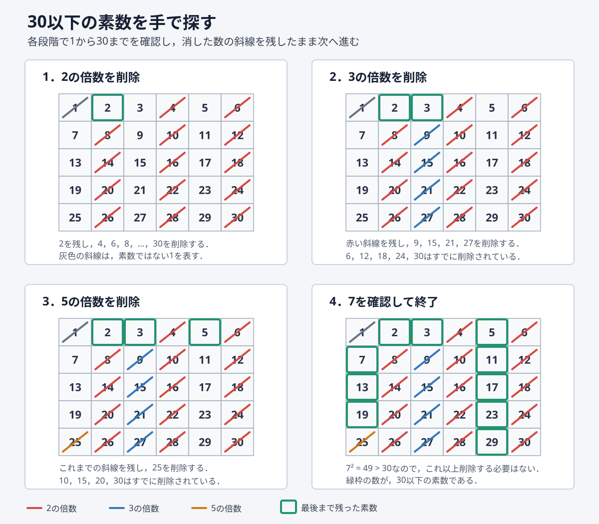

# 第5回　整数を扱う計算

### 到達目標

- 剰余を使って約数や素数を調べられる．
- 素数判定を関数として実装できる．
- エラトステネスの篩を使って複数の素数を効率よく求められる．
- 整数を素因数分解し，結果をリストで返せる．
- ユークリッドの互除法で最大公約数を求められる．
- 複数の整数に対してアルゴリズムを適用できる．

### 前回の復習

前回：データ型ごとの**メソッド**と，テキストファイル・CSVファイルの読み書きを学んだ．

- **メソッド**：特定の種類のオブジェクトに結び付いた関数．
- **ファイル操作**：プログラムからファイルへデータを書き込んだり，ファイルからデータを読み込んだりすること．
- **CSV**：一つの行に複数の値をカンマで区切って記録するファイル形式．

第4回の演習5では，csvモジュールを使って気温データを書き込み，同じファイルを読み込んだ．

```python
import csv

rows = [
    ["曜日", "最高気温"],
    ["月", 21.5],
    ["火", 23.0],
    ["水", 19.8],
]

with open("temperatures.csv", "w", encoding="utf-8", newline="") as file:
    writer = csv.writer(file)
    writer.writerows(rows)

with open("temperatures.csv", "r", encoding="utf-8") as file:
    reader = csv.reader(file)

    for row in reader:
        print(row)
```

writerowsメソッドは二次元のリストを複数行として書き込む．csv.readerで読み込むと，各行は文字列のリストとして得られる．

### 前回の課題の解答例

**課題1：文字列のリストをファイルへ保存する関数**

ファイル名と文字列のリストを引数として受け取り，各要素を1行ずつ保存する関数を作成した．

```python
def save_plan(filename, plans):
    with open(filename, "w", encoding="utf-8") as file:
        for plan in plans:
            file.write(f"{plan}\n")

plans = ["授業の復習をする", "課題を期限までに提出する", "毎週本を読む"]
save_plan("plan.txt", plans)

with open("plan.txt", "r", encoding="utf-8") as file:
    text = file.read()

print(text)
```

関数の中では，for文でリストの要素を一つずつ取り出している．各文字列に改行文字`\n`を付けることで，1項目につき1行で保存できる．ファイル名も引数にしているため，別のファイルへ保存するときにも同じ関数を再利用できる．

**課題2：CSVファイルに保存された最高気温の平均**

CSVファイルから数値を読み込み，平均を戻り値として返す関数を作成した．

```python
import csv

rows = [
    ["曜日", "最高気温"],
    ["月", 18.5],
    ["火", 20.0],
    ["水", 21.5],
    ["木", 19.0],
    ["金", 23.5],
]

with open("week_temperature.csv", "w", encoding="utf-8", newline="") as file:
    writer = csv.writer(file)
    writer.writerows(rows)

def average_temperature(filename):
    total = 0.0
    count = 0

    with open(filename, "r", encoding="utf-8") as file:
        reader = csv.reader(file)
        next(reader)

        for row in reader:
            temperature = float(row[1])
            total = total + temperature
            count = count + 1

    return total / count

average = average_temperature("week_temperature.csv")
print(f"平均最高気温は{average}度です．")
```

`next(reader)`でヘッダーを読み飛ばし，データ行だけを計算に使っている．CSVから読み込んだ値は文字列であるため，`float`関数で実数へ変換してから合計した．すべての行を処理した後で，合計をデータ数で割った値を返している．

今回は，条件分岐，繰り返し，関数，リストを組み合わせ，整数に関するアルゴリズムを実装する．

### Jupyter Notebookの準備

1. Anaconda NavigatorからJupyter Notebookを起動する．
2. `Documents（書類）/Fresh2`フォルダを開く．
3. Python 3のNotebookを新規作成する．
4. ファイル名を`第5回_<学籍番号>_<氏名>.ipynb`へ変更する．

```{dropdown} 忘れた人のためのJupyter Notebookの準備手順
**Jupyter Notebookを起動する**

1. Spotlight検索（`command`+`Space`）でAnaconda Navigatorを起動する．
2. Anaconda Navigatorが表示されるまで待つ．
3. Jupyter Notebookの「Launch」をクリックする．
4. WebブラウザにJupyter Notebookのファイル一覧が表示されたことを確認する．


**Fresh2フォルダを開く**

1. Jupyter Notebookのファイル一覧で`Documents`または`書類`フォルダをクリックする．
2. `Fresh2`フォルダをクリックして開く．
3. `Fresh2`フォルダがない場合は，画面右上の「New」から「New Folder」を選択する．
4. 作成された`Untitled Folder`を選択し，「Rename」をクリックする．
5. フォルダ名を`Fresh2`へ変更し，そのフォルダを開く．


**Notebookファイルを新規作成する**

1. `Fresh2`フォルダを開いた状態で，画面右上の「New」をクリックする．
2. 「Python 3 (ipykernel)」をクリックする．
3. 新しく開いたNotebook上部のファイル名をクリックする．
4. ファイル名を`第5回_<学籍番号>_<氏名>.ipynb`へ変更する．
5. `<学籍番号>`と`<氏名>`を自分の学籍番号と氏名へ置き換える．
6. Codeセルが表示されていることを確認する．


**注意：** Jupyter Notebookのバージョンによって，ボタンの名称や配置が画像と異なる場合がある．Notebookを作成したら，コードを入力する前に保存場所とファイル名を確認する．
```

## 整数の計算とアルゴリズム

- **アルゴリズム**：問題を解くための有限の処理手順．
- **整数除算`//`**：割り算の商について，小数部分を切り下げた整数を求める演算．
- **剰余`%`**：割り算の余りを求める演算．

```python
print(17 // 5)
print(17 % 5)
```

17を5で割ると，商は3，余りは2である．したがって，`17 // 5`は`3`，`17 % 5`は`2`となる．

整数`number`が整数`divisor`で割り切れるかは，余りが0であるかによって判定できる．

```text
number % divisor == 0
```

```{tip} 注意：0では割れない
0を別の整数で割ることはできるが，整数を0で割ることはできない．`number % 0`や`number // 0`を実行すると`ZeroDivisionError`が発生する．
```

## 約数

**約数**：ある整数を余りなく割り切る整数．例えば，12の正の約数は1，2，3，4，6，12である．

1から`number`までの整数を順番に調べ，割り切れる数だけを表示する．

```python
number = 12

for divisor in range(1, number + 1):
    if number % divisor == 0:
        print(divisor)
```

結果を後から利用できるように，約数をリストとして返す関数へまとめる．

```python
def divisors(number):
    result = []

    for divisor in range(1, number + 1):
        if number % divisor == 0:
            result.append(divisor)

    return result

print(divisors(12))
```

````{note} 演習1
正の整数の約数をリストとして返す関数`divisors(number)`を完成させ，18と24の約数を表示せよ．

`【　】`には，1から`number`までの整数を順番に調べ，約数だけを`result`へ追加する処理を記入せよ．`【　】`は複数行の処理をまとめて表している．

```python
def divisors(number):
    result = []

    【約数を調べてresultへ追加する処理】

    return result

print(divisors(18))
print(divisors(24))
```

**出力例**

```text
[1, 2, 3, 6, 9, 18]
[1, 2, 3, 4, 6, 8, 12, 24]
```
````

````{hidden-answer} 解答例
```python
def divisors(number):
    result = []

    for divisor in range(1, number + 1):
        if number % divisor == 0:
            result.append(divisor)

    return result

print(divisors(18))
print(divisors(24))
```
````

## 素数

**素数**：2以上の整数のうち，正の約数が1とその数自身だけである数．2，3，5，7，11などが素数である．

整数が素数かを判定するには，2以上の整数で割り切れるかを調べる．約数が見つかった時点で`False`を返せば，残りの候補を調べる必要はない．

```python
def is_prime(number):
    if number < 2:
        return False

    for divisor in range(2, number):
        if number % divisor == 0:
            return False

    return True

print(is_prime(17))
print(is_prime(18))
```

この関数では，2未満の整数をガード節で先に除外している．for文の途中で約数が見つかった場合は`False`を返して関数を終了する．どの候補でも割り切れなかった場合だけ，最後の`return True`まで処理が進む．

### 平方根まで調べる素数判定

整数`number`が合成数なら，少なくとも一つの約数は$\sqrt{number}$以下に存在する．したがって，2から`number - 1`までのすべてを調べる必要はなく，平方根以下の整数まで調べればよい．

```python
def is_prime(number):
    if number < 2:
        return False

    limit = int(number ** 0.5)

    for divisor in range(2, limit + 1):
        if number % divisor == 0:
            return False

    return True
```

例えば，1000に近い整数を調べる場合，999まで調べる代わりに31程度まで調べればよいため，繰り返し回数を減らせる．

````{note} 演習2
`is_prime(number)`を使い，1から100までに存在するすべての素数をリストとして表示するコードを完成させよ．

`【　】`には，1から100までの各整数を`is_prime(number)`で判定し，素数だけを`primes`へ追加する処理を記入せよ．`【　】`はfor文とif文を含む処理全体を表している．

```python
primes = []

【1から100までの素数をprimesへ追加する処理】

print(primes)
print(f"100以下の素数の個数は{len(primes)}個です．")
```

**出力例**

```text
[2, 3, 5, 7, 11, 13, 17, 19, 23, 29, 31, 37, 41, 43, 47, 53, 59, 61, 67, 71, 73, 79, 83, 89, 97]
100以下の素数の個数は25個です．
```
````

````{hidden-answer} 解答例
```python
primes = []

for number in range(1, 101):
    if is_prime(number):
        primes.append(number)

print(primes)
print(f"100以下の素数の個数は{len(primes)}個です．")
```
````

## エラトステネスの篩

**エラトステネスの篩**：ある整数以下の素数をまとめて求めるアルゴリズム．一つの整数が素数かを個別に判定する代わりに，素数の倍数を候補から順番に除外する．

整数$N$以下の素数は，次の手順で求める．

1. 0から$N$までの各整数について，素数候補であることを表す`True`を用意する．
2. 0と1は素数ではないため，`False`にする．
3. 2から順番に素数候補を調べる．
4. 素数候補の倍数を`False`にする．
5. 最後まで`True`のまま残った整数を取り出す．

### 30以下の素数を手で探す

30以下の素数を手で探す場合は，1を除外して2から30までを並べる．斜線が付いていない最小の数を素数として残し，その数の倍数を斜線で削除する．

1. **2を残す**：$2^2=4$から，4，6，8，$ldots$，30を削除する．
2. **3を残す**：$3^2=9$から，まだ削除されていない9，15，21，27を削除する．
3. **5を残す**：$5^2=25$から，まだ削除されていない25を削除する．
4. **7を確認する**：$7^2=49$は30より大きいため，これ以上は調べない．



2の段階で削除した6や12を，3の段階でもう一度削除する必要はない．同様に，5より小さい素数の倍数はすでに削除されているため，5の倍数は$5^2=25$から調べればよい．最後まで斜線が付かなかった2，3，5，7，11，13，17，19，23，29が30以下の素数である．

この手順では，次に調べる数の2乗が30を超えた時点で終了する．これは，合成数には平方根以下の約数が少なくとも一つ存在するためである．

```python
def sieve(limit):
    is_prime_number = [True] * (limit + 1)
    is_prime_number[0] = False
    is_prime_number[1] = False

    for number in range(2, int(limit ** 0.5) + 1):
        if is_prime_number[number]:
            for multiple in range(number ** 2, limit + 1, number):
                is_prime_number[multiple] = False

    primes = []

    for number in range(2, limit + 1):
        if is_prime_number[number]:
            primes.append(number)

    return primes

print(sieve(30))
```

`[True] * (limit + 1)`は，`True`を`limit + 1`個並べたリストを作る．リストの添字と整数を一致させることで，`is_prime_number[10]`が10の判定結果を表す．

```{tip} 注意：0と1は素数ではない
0と1は素数ではないため，`is_prime_number[0]`と`is_prime_number[1]`を`False`にする．この実装は`limit`が2以上であることを前提とする．
```

```{tip} 発展：倍数の削除を2乗から始める理由
`number`より小さい素数を使って取り除ける倍数は，すでに処理済みである．そのため，`number`の倍数を取り除く処理は`number ** 2`から始めればよい．また，$\sqrt{N}$より大きな合成数には$\sqrt{N}$以下の約数があるため，外側の繰り返しも$\sqrt{N}$までで十分である．
```

````{note} 演習3
エラトステネスの篩を使う関数`sieve(limit)`を完成させ，100以下の素数を求めよ．

`【　】`には，素数候補の倍数を`False`へ変更する二重のfor文を記入せよ．その後，`True`のまま残った整数を`primes`へ追加する処理を記入せよ．一つの`【　】`が複数行の処理を表している．

```python
def sieve(limit):
    is_prime_number = [True] * (limit + 1)
    is_prime_number[0] = False
    is_prime_number[1] = False

    【素数候補の倍数をFalseにする処理】

    primes = []

    【Trueのまま残った整数をprimesへ追加する処理】

    return primes

primes = sieve(100)
print(primes)
print(f"100以下の素数の個数は{len(primes)}個です．")
```

**出力例**

```text
[2, 3, 5, 7, 11, 13, 17, 19, 23, 29, 31, 37, 41, 43, 47, 53, 59, 61, 67, 71, 73, 79, 83, 89, 97]
100以下の素数の個数は25個です．
```
````

````{hidden-answer} 解答例
```python
def sieve(limit):
    is_prime_number = [True] * (limit + 1)
    is_prime_number[0] = False
    is_prime_number[1] = False

    for number in range(2, int(limit ** 0.5) + 1):
        if is_prime_number[number]:
            for multiple in range(number ** 2, limit + 1, number):
                is_prime_number[multiple] = False

    primes = []

    for number in range(2, limit + 1):
        if is_prime_number[number]:
            primes.append(number)

    return primes

primes = sieve(100)
print(primes)
print(f"100以下の素数の個数は{len(primes)}個です．")
```
````

## 素因数分解

- **素因数**：ある整数の約数となる素数．
- **素因数分解**：2以上の整数を素数の積として表すこと．

例えば，$60 = 2 \times 2 \times 3 \times 5$である．小さい素数から順番に割り，同じ数で割り切れる間は割り算を繰り返す．

```python
def prime_factorize(number):
    factors = []
    divisor = 2

    while divisor ** 2 <= number:
        while number % divisor == 0:
            factors.append(divisor)
            number = number // divisor

        divisor = divisor + 1

    if number > 1:
        factors.append(number)

    return factors

print(prime_factorize(60))
```

内側のwhile文は，同じ数で割り切れる間，素因数をリストへ追加している．例えば60は2で2回割り切れるため，`2`が2回追加される．最後に1より大きな数が残った場合，その数も素因数として追加する．

````{note} 演習4
整数を素因数分解する関数`prime_factorize(number)`を完成させ，360を素因数分解せよ．

`【　】`には，`divisor`で割り切れる間，素因数を`factors`へ追加して`number`を更新する処理を記入せよ．さらに，次に調べる整数へ`divisor`を更新せよ．

```python
def prime_factorize(number):
    factors = []
    divisor = 2

    while divisor ** 2 <= number:
        【divisorで割り切れる間の処理】

        【次のdivisorへ更新する処理】

    if number > 1:
        factors.append(number)

    return factors

factors = prime_factorize(360)
print(factors)
```

**出力例**

```text
[2, 2, 2, 3, 3, 5]
```
````

````{hidden-answer} 解答例
```python
def prime_factorize(number):
    factors = []
    divisor = 2

    while divisor ** 2 <= number:
        while number % divisor == 0:
            factors.append(divisor)
            number = number // divisor

        divisor = divisor + 1

    if number > 1:
        factors.append(number)

    return factors

factors = prime_factorize(360)
print(factors)
```
````

### 素因数の個数と文字列の結合

同じ素因数が何回現れるかを調べると，$2 \times 2 \times 2$を$2^3$のように指数を使って表せる．

**`count`メソッド**：リスト内に指定した値と等しい要素が何個あるかを返す．

```python
factors = [2, 2, 2, 3, 3, 5]

print(factors.count(2))
print(factors.count(3))
print(factors.count(5))
```

複数の文字列を区切り文字で結合するときは，文字列の`join`メソッドを使う．

**`join`メソッド**：文字列のリストを，指定した文字列を区切りとして一つの文字列へ結合する．

```python
parts = ["2^3", "3^2", "5"]
expression = " × ".join(parts)
print(expression)
```

出力は`2^3 × 3^2 × 5`となる．`join`メソッドで結合する要素は文字列でなければならないため，整数は`str`関数やf-stringを使って文字列へ変換する．

## 最大公約数

- **公約数**：複数の整数に共通する約数．
- **最大公約数**：複数の整数に共通する正の約数のうち，最も大きい数．英語のgreatest common divisorを略してGCDとも呼ぶ．
- **ユークリッドの互除法**：割り算の余りを繰り返し計算して，二つの整数の最大公約数を求めるアルゴリズム．

```{tip} 定理：ユークリッドの互除法
二つの正の整数$a$，$b$について，$a$を$b$で割った余りを$r$とする．このとき，$a$と$b$の最大公約数は，$b$と$r$の最大公約数に等しい．
```

42と30にユークリッドの互除法を適用すると，整数の組は次のように変化する．

$$
(42,30)\rightarrow(30,12)\rightarrow(12,6)\rightarrow(6,0)
$$

余りが0になったときの6が最大公約数である．

```python
def gcd(a, b):
    while b != 0:
        remainder = a % b
        a = b
        b = remainder

    return a

print(gcd(42, 30))
```

### 多重代入を使った書き方

**多重代入**：一つの代入文で複数の変数へ値を代入する書き方．右辺の値を先に計算してから，左辺の変数へ同時に代入する．

```python
def gcd(a, b):
    while b != 0:
        a, b = b, a % b

    return a
```

`a, b = b, a % b`では，更新前の`a`と`b`を使って右辺を計算する．その後，`a`へ更新前の`b`，`b`へ余りを代入する．

````{note} 演習5
ユークリッドの互除法を使う関数`gcd(a, b)`を完成させ，複数の例で動作を確認せよ．

`【　】`には，`b`が0になるまで，`a`と`b`を多重代入で更新する処理を記入せよ．

```python
def gcd(a, b):
    while b != 0:
        【aとbを多重代入で更新する処理】

    return a

print(gcd(48, 18))
print(gcd(35, 7))
print(gcd(8, 15))
```

**出力例**

```text
6
7
1
```
````

````{hidden-answer} 解答例
```python
def gcd(a, b):
    while b != 0:
        a, b = b, a % b

    return a

print(gcd(48, 18))
print(gcd(35, 7))
print(gcd(8, 15))
```
````

## 最小公倍数

- **公倍数**：複数の整数に共通する倍数．
- **最小公倍数**：複数の正の整数に共通する正の倍数のうち，最も小さい数．英語のleast common multipleを略してLCMとも呼ぶ．

二つの正の整数$a$，$b$の最小公倍数は，最大公約数を使って次の式で求められる．

$$
\operatorname{lcm}(a,b)=\frac{ab}{\operatorname{gcd}(a,b)}
$$

Pythonでは，整数の結果を得るために整数除算`//`を使う．

```python
def lcm(a, b):
    return a * b // gcd(a, b)

print(lcm(12, 18))
```

````{note} 演習6
最小公倍数を返す関数`lcm(a, b)`を完成させ，最大公約数と最小公倍数の関係を確認せよ．

最初の`【　】`には，`gcd(a, b)`を使って最小公倍数を計算する式を記入せよ．次の`【　】`には，最大公約数と最小公倍数の積を表示する式を記入せよ．最後の二つの結果が等しいことを確認せよ．

```python
def lcm(a, b):
    return 【最小公倍数を計算する式】

a = 24
b = 36

print(gcd(a, b))
print(lcm(a, b))
print(【最大公約数と最小公倍数の積を計算する式】)
print(a * b)
```

**出力例**

```text
12
72
864
864
```
````

````{hidden-answer} 解答例
```python
def lcm(a, b):
    return a * b // gcd(a, b)

a = 24
b = 36

print(gcd(a, b))
print(lcm(a, b))
print(gcd(a, b) * lcm(a, b))
print(a * b)
```
````

## エラーが出たときにチェックすること

- 割る数が0になっていないか確認する．
- `range`の終点は含まれないことを確認する．
- 素数判定では，0と1を素数として扱っていないか確認する．
- `return True`がfor文の内側に入っていないか確認する．
- while文の中で，繰り返し条件に使う値が更新されているか確認する．
- エラトステネスの篩では，判定用リストの長さが`limit + 1`になっているか確認する．
- 素因数分解では，同じ素因数で割り切れる間は処理を繰り返しているか確認する．
- ユークリッドの互除法では，余りが0になったときに繰り返しが終了するか確認する．
- 小さく結果が分かる値を使い，手計算とプログラムの結果を比較する．

## 課題

````{warning} 課題1
整数を素因数分解し，素因数の指数を使った式として表示する関数`show_factorization`を作成せよ．

1. Markdownセルに`# 課題1`と記入し，`prime_factorize`関数も同じNotebook内へ用意せよ．
2. 素因数ごとの個数を数え，指数が1なら`5`，2以上なら`2^3`の形式の文字列を作成せよ．
3. 作成した文字列を`×`で結び，整数とともに表示せよ．

次のテンプレートを基に完成させよ．`【　】`は，引数全体または1行以上の処理を記述する箇所を表す．

```python
def show_factorization(【必要な引数をすべて記入】):
    【素因数の個数を数え，式を組み立てて表示する処理を記入】

show_factorization(360)
```

**出力例**

```text
360 = 2^3 × 3^2 × 5
```
````

````{hidden-answer} 解答例
```python
def show_factorization(number):
    factors = prime_factorize(number)
    parts = []
    processed = []

    for factor in factors:
        if factor not in processed:
            count = factors.count(factor)

            if count == 1:
                parts.append(str(factor))
            else:
                parts.append(f"{factor}^{count}")

            processed.append(factor)

    expression = " × ".join(parts)
    print(f"{number} = {expression}")

show_factorization(360)
```
````

````{warning} 課題2
正の整数のリストに含まれるすべての要素の最大公約数を返す関数`gcd_list`を作成せよ．

1. Markdownセルに`# 課題2`と記入し，`gcd`関数も同じNotebook内へ用意せよ．
2. リストの先頭要素を初期値とし，残りの要素との最大公約数を順番に求めよ．
3. すべての要素を処理した後の最大公約数をreturn文で返せ．

次のテンプレートを基に完成させよ．`【　】`は，引数全体または1行以上の処理を記述する箇所を表す．

```python
def gcd_list(【必要な引数をすべて記入】):
    【リスト内のすべての整数の最大公約数を求めて返す処理を記入】

print(gcd_list([15, 10, 5]))
print(gcd_list([210, 147, 90, 63]))
```

**出力例**

```text
5
3
```
````

````{hidden-answer} 解答例
```python
def gcd_list(numbers):
    result = numbers[0]

    for number in numbers[1:]:
        result = gcd(result, number)

    return result

print(gcd_list([15, 10, 5]))
print(gcd_list([210, 147, 90, 63]))
```
````

### 提出方法

- WebClassの「第5回課題」からNotebookファイル（`第5回_<学籍番号>_<氏名>.ipynb`）を提出する．
- 提出前にファイル名，Markdownセル，関数の定義，関数の呼び出し，Codeセルの実行結果を確認する．
- すべてのCodeセルの出力を表示した状態で保存する．
- 課題1では，`360 = 2^3 × 3^2 × 5`と表示されることを確認する．
- 課題2では，`gcd_list`関数の中で`gcd`関数を呼び出していることを確認する．

### 提出期限

<span style="color: red; ">10月30日(金)23:59まで</span>

質問等がある場合には

- メール kkagawa@josai.ac.jp
- Teamsのチャット
- WebClassのメッセージ

などで連絡してください．

## まとめ

1. **剰余は整数の性質を調べる基本である**：`number % divisor == 0`で割り切れるかを判定できる．
2. **探索範囲を工夫すると計算量を減らせる**：素数判定は平方根まで調べればよい．
3. **目的に応じてアルゴリズムを選ぶ**：複数の素数にはエラトステネスの篩，最大公約数にはユークリッドの互除法を利用できる．
4. **既存の関数を組み合わせる**：最大公約数から最小公倍数を求めるなど，小さな関数を再利用できる．

- 次回は方程式の近似解を数値的に求める．
