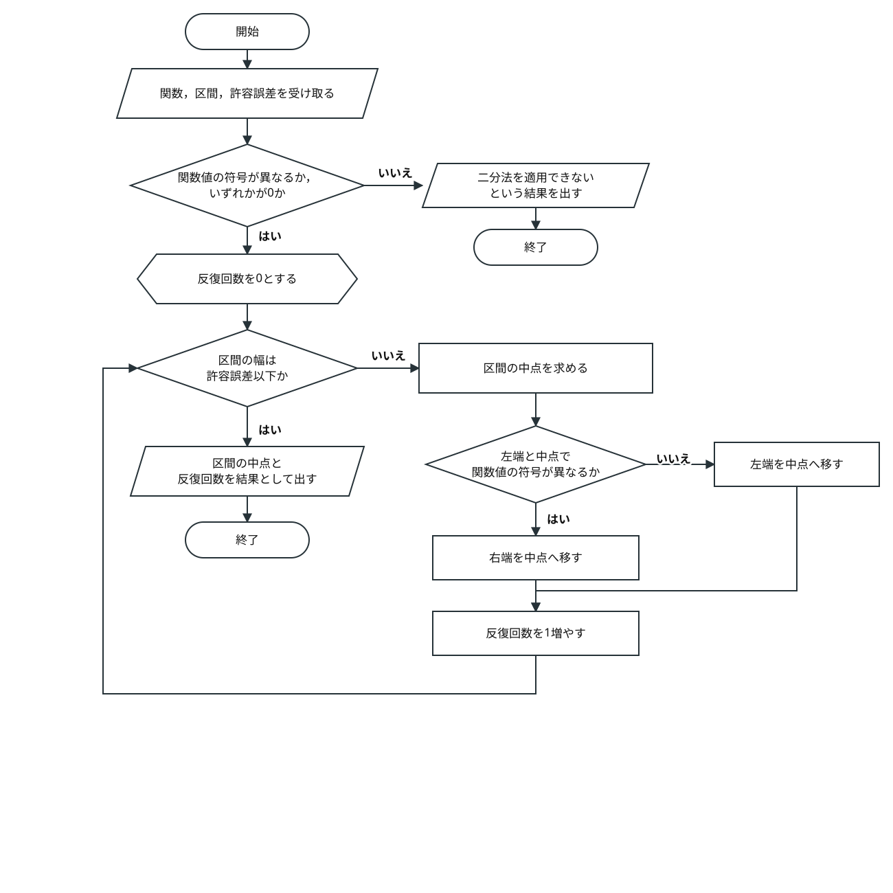
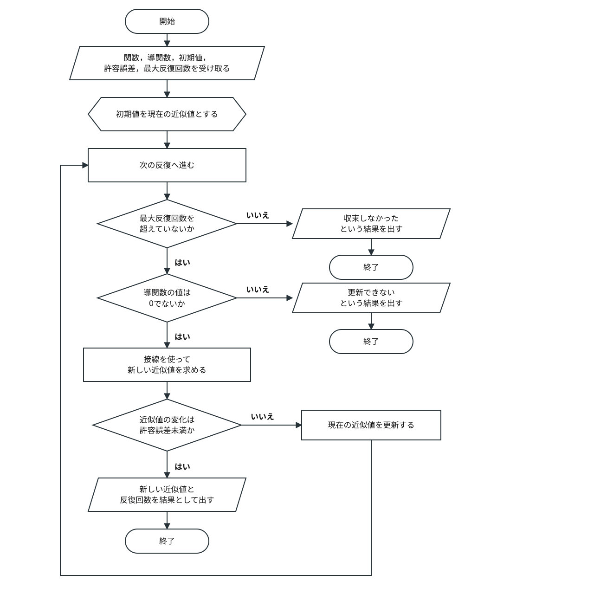

# 第6回　数値計算1

### 到達目標

- 方程式の解を関数の根として捉えられる．
- 近似解，許容誤差，収束，残差の意味を説明できる．
- 二分法の手続きを理解し，Pythonで近似解を求められる．
- ニュートン法の更新式を理解し，Pythonで近似解を求められる．
- 二分法とニュートン法の特徴を比較できる．

### 前回の復習

前回は，整数に関するアルゴリズムをフローチャートで整理し，条件分岐や繰り返しを使って実装した．第5回の演習5では，ユークリッドの互除法を使って最大公約数を求めた．

```python
def gcd(a, b):
    while b != 0:
        a, b = b, a % b

    return a

print(gcd(48, 18))
```

````{dropdown} コードの補足
- `b`が0でない間，while文の処理を繰り返す．
- `a, b = b, a % b`では，現在の`b`と，`a`を`b`で割った余りを次の値として使う．
- 余りが0になるとwhile文が終了し，最後に残った`a`を最大公約数として返す．
````

````{dropdown} 出力例
```text
6
```
````

今回も，計算結果を新しい値として使いながら処理を繰り返す．ただし，整数を扱った前回とは異なり，実数の近似値を少しずつ解へ近づける．

### 前回の課題の解答例

1. [課題1「素因数分解を式として表示する関数」の解答例](./5_integer.md#assignment-5-1-answer)
2. [課題2「整数のリストの最大公約数を求める関数」の解答例](./5_integer.md#assignment-5-2-answer)

### Jupyter Notebookの準備

1. Anaconda NavigatorからJupyter Notebookを起動する．
2. `Documents（書類）/Fresh2`フォルダを開く．
3. Python 3のNotebookを新規作成する．
4. ファイル名を`第6回_<学籍番号>_<氏名>.ipynb`へ変更する．

```{dropdown} 忘れた人のためのJupyter Notebookの準備手順
**Jupyter Notebookの起動**

1. Spotlight検索（`command`+`Space`）でAnaconda Navigatorを起動する．
2. Anaconda Navigatorが表示されるまで待つ．
3. Jupyter Notebookの「Launch」をクリックする．
4. WebブラウザにJupyter Notebookのファイル一覧が表示されたことを確認する．


**Fresh2フォルダを開く操作**

1. ファイル一覧で`Documents`または`書類`フォルダをクリックする．
2. `Fresh2`フォルダをクリックして開く．
3. `Fresh2`フォルダがない場合は，画面右上の「New」から「New Folder」を選択して作成する．

**Notebookファイルの新規作成**

1. `Fresh2`フォルダを開いた状態で，画面右上の「New」をクリックする．
2. 「Python 3 (ipykernel)」をクリックする．
3. Notebook上部のファイル名をクリックする．
4. ファイル名を`第6回_<学籍番号>_<氏名>.ipynb`へ変更する．
5. `<学籍番号>`と`<氏名>`を自分の学籍番号と氏名へ置き換える．

**注意：** Jupyter Notebookのバージョンによって，ボタンの名称や配置が異なる場合がある．コードを入力する前に保存場所とファイル名を確認する．
```

## 方程式の解と数値計算

方程式

$$
f(x)=0
$$

を満たす$x$を，方程式の**解**または関数$f$の**根**という．グラフでは，$y=f(x)$と$x$軸が交わる点の$x$座標に対応する．

- **厳密解**：$\sqrt{2}$のように，誤差を含まない形で表した解．
- **近似解**：`1.41421356`のように，厳密解に近い数値で表した解．
- **数値計算**：数値を使った計算によって，数学的な問題の近似的な答えを求める方法．
- **反復法**：同じ形式の計算を繰り返し，近似値を更新する方法．
- **収束**：反復するにつれて，近似値が一定の値へ近づくこと．

### 解を含む区間

$f(x)=x^2-2$について，$x=1$と$x=2$における関数値を調べる．

```python
def f(x):
    return x ** 2 - 2

print(f(1))
print(f(2))
```

````{dropdown} コードの補足
- `f(1)`は$1^2-2=-1$，`f(2)`は$2^2-2=2$を計算する．
- 関数値の符号が負から正へ変化するため，グラフは1と2の間で$x$軸と交わる．
````

````{dropdown} 出力例
```text
-1
2
```
````

```{tip} 定理：中間値の定理
区間$[a,b]$で連続な関数$f$について，$f(a)$と$f(b)$の符号が異なるなら，$a$と$b$の間に$f(c)=0$を満たす実数$c$が少なくとも一つ存在する．

二分法では，この性質を利用して解を含む区間を狭める．関数が連続であることと，区間の両端で関数値の符号が異なることが重要である．
```

````{note} 演習1
$f(x)=x^3-2$について，1と2の間に解が存在することを確認せよ．

`____`を関数$f$の式で置き換え，`f(1)`と`f(2)`の符号を比較せよ．

```python
def f(x):
    return ____

print(f(1))
print(f(2))
```

**出力例**

```text
-1
6
```
````

````{hidden-answer} 解答例
```python
def f(x):
    return x ** 3 - 2

print(f(1))
print(f(2))
```

`f(1)`は負，`f(2)`は正である．関数$f$は1と2の間で連続なので，中間値の定理から，この区間に解が少なくとも一つ存在する．
````

### 近似計算の終了条件

コンピュータで近似値を計算するときは，どの程度まで解へ近づけば計算を終了するかを決める．

- **許容誤差**：十分に正確であると判断するために定める誤差の上限．
- **残差**：近似解$x$を方程式の左辺へ代入した値$f(x)$．`abs(f(x))`が0に近いほど，方程式をよく満たしている．
- **反復回数**：近似値を更新した回数．反復法がどの程度の計算を必要としたかを表す．

```python
approximation = 1.4142
print(abs(approximation ** 2 - 2))
```

`abs`関数は数値の絶対値を返す．この例では，近似値を$f(x)=x^2-2$へ代入したときの残差の絶対値を求めている．

````{dropdown} 出力例
```text
3.836000000046579e-05
```
````

```{tip} 注意：科学的記数法
Pythonでは，`1e-8`を$1\times10^{-8}$の意味で使用する．また，`3.8e-05`は$3.8\times10^{-5}$を表す．非常に小さい数や大きい数を簡潔に表示できる．
```

```{tip} 注意：近似値の変化と残差
近似値の変化が小さくなったことと，残差が小さいことは同じではない．反復の終了には近似値や区間の変化を使い，計算後には`abs(f(root))`を表示して方程式を満たしているか確認する．
```

## 二分法

**二分法**（2分法）：関数値の符号が異なる区間を半分ずつ狭め，方程式の近似解を求める反復法．

二分法を使うには，次の条件を満たす区間$[a,b]$を用意する．

1. 関数$f$が区間$[a,b]$で連続である．
2. $f(a)$と$f(b)$の符号が異なる，または一方が0である．

### 区間を半分にする手順

$f(x)=x^2-2$を区間$[1,2]$で考える．区間の中点$m$を求め，$f(a)$と$f(m)$の符号を比較する．符号が異なれば解は$[a,m]$にあり，同じなら解は$[m,b]$にある．

| 反復 | 左端$a$ | 右端$b$ | 中点$m$ | $f(m)$ | 次の区間 |
| ---: | ---: | ---: | ---: | ---: | --- |
| 1 | 1 | 2 | 1.5 | 0.25 | $[1,1.5]$ |
| 2 | 1 | 1.5 | 1.25 | -0.4375 | $[1.25,1.5]$ |
| 3 | 1.25 | 1.5 | 1.375 | -0.109375 | $[1.375,1.5]$ |
| 4 | 1.375 | 1.5 | 1.4375 | 0.06640625 | $[1.375,1.4375]$ |

区間を半分にするたびに区間の幅が小さくなり，両端と中点が$\sqrt{2}$へ近づく．



フローチャートは，区間の幅を使う基本的な終了条件を示している．次の実装では，誤った設定によって計算が長く続く場合に備え，最大反復回数も終了条件へ加える．

### 二分法の実装

関数そのものを引数`f`として受け取ると，同じ二分法を異なる方程式に再利用できる．

```python
def bisection(f, a, b, tolerance=1e-8, max_iterations=100):
    if f(a) == 0:
        return a, 0
    if f(b) == 0:
        return b, 0
    if f(a) * f(b) > 0:
        return None

    count = 0

    while b - a > tolerance and count < max_iterations:
        midpoint = (a + b) / 2

        if f(a) * f(midpoint) <= 0:
            b = midpoint
        else:
            a = midpoint

        count = count + 1

    return (a + b) / 2, count

def f(x):
    return x ** 2 - 2

root, count = bisection(f, 1, 2)
print(root)
print(count)
print(f(root))
```

````{dropdown} コードの補足
- 最初の二つのif文は，区間の端点が解である場合を先に処理する．

  ```python
  if f(a) == 0:
      return a, 0
  if f(b) == 0:
      return b, 0
  ```

- 両端の関数値が同符号なら，二分法の前提を満たさないため`None`を返す．

  ```python
  if f(a) * f(b) > 0:
      return None
  ```

- 区間の幅が許容誤差より大きく，反復回数が上限未満である間，中点を求めて区間を更新する．

  ```python
  while b - a > tolerance and count < max_iterations:
      midpoint = (a + b) / 2
  ```

- 左端と中点で関数値の符号が異なれば右端を中点へ移す．同符号なら左端を中点へ移す．

  ```python
  if f(a) * f(midpoint) <= 0:
      b = midpoint
  else:
      a = midpoint
  ```

- `return (a + b) / 2, count`は，近似解と反復回数を二つの戻り値として返す．呼び出し側では`root, count`へ順番に代入する．
````

````{dropdown} 出力例
```text
1.414213564246893
27
5.29990096254096e-09
```
````

```{tip} 注意：関数を引数として渡す書き方
`bisection(f, 1, 2)`の`f`は関数そのものを渡す書き方である．`f()`と書くと関数をその場で呼び出すことになり，引数`x`がないためエラーになる．
```

````{note} 演習2
演習1の$f(x)=x^3-2$について，二分法で近似解を求めよ．

`____`を呼び出す関数名で置き換えよ．演習1で定義した`f`と，本文で定義した`bisection`を先に実行すること．

```python
root, count = ____(f, 1, 2)
print(root)
print(count)
print(f(root))
```

**出力例**

```text
1.2599210478365421
27
-9.802190614749406e-09
```
````

````{hidden-answer} 解答例
```python
root, count = bisection(f, 1, 2)
print(root)
print(count)
print(f(root))
```

近似解は約1.2599である．残差は絶対値が$10^{-8}$より小さく，近似解が方程式をよく満たしている．
````

````{note} 演習3
許容誤差と二分法の反復回数の関係を調べよ．

`____`を二分法の関数名で置き換えよ．実行後，許容誤差を小さくしたときの近似解と反復回数の変化をMarkdownセルに2文程度で記述せよ．

```python
for tolerance in [1e-2, 1e-4, 1e-6, 1e-8]:
    root, count = ____(f, 1, 2, tolerance)
    print(tolerance, root, count)
```

**出力例**

```text
0.01 1.26171875 7
0.0001 1.259918212890625 14
1e-06 1.259920597076416 20
1e-08 1.2599210478365421 27
```
````

````{hidden-answer} 解答例
```python
for tolerance in [1e-2, 1e-4, 1e-6, 1e-8]:
    root, count = bisection(f, 1, 2, tolerance)
    print(tolerance, root, count)
```

許容誤差を小さくすると近似解の桁が安定する一方で，必要な反復回数は増える．この例では，許容誤差を100分の1にするたびに反復回数が約6回から7回増えている．
````

## ニュートン法

**ニュートン法**：現在の近似値における接線と$x$軸の交点を，次の近似値として使う反復法．ニュートン・ラフソン法とも呼ばれる．

現在の近似値を$x_n$とする．点$(x_n,f(x_n))$における接線は，次の式で表される．

$$
y=f(x_n)+f'(x_n)(x-x_n)
$$

この接線と$x$軸の交点では$y=0$である．交点の$x$座標を$x_{n+1}$とすると，次の更新式が得られる．

$$
x_{n+1}=x_n-\frac{f(x_n)}{f'(x_n)}
$$

- **初期値**：反復計算を始める最初の近似値$x_0$．
- **導関数**：接線の傾きを表す関数$f'(x)$．
- **最大反復回数**：収束しない計算を無限に続けないための上限．
- **発散**：反復しても近似値が解へ近づかないこと．



### ニュートン法の実装

$f(x)=x^2-2$の導関数は$f'(x)=2x$である．初期値を1として，$\sqrt{2}$の近似値を求める．

```python
def newton(f, derivative, initial_value, tolerance=1e-8, max_iterations=100):
    x = initial_value

    for count in range(1, max_iterations + 1):
        slope = derivative(x)

        if slope == 0:
            return None

        new_x = x - f(x) / slope

        if abs(new_x - x) < tolerance:
            return new_x, count

        x = new_x

    return None

def f(x):
    return x ** 2 - 2

def derivative(x):
    return 2 * x

root, count = newton(f, derivative, 1)
print(root)
print(count)
print(f(root))
```

````{dropdown} コードの補足
- `x`へ初期値を代入し，`max_iterations`回を上限としてfor文を実行する．`count`は1から始めるため，そのまま反復回数として使える．

  ```python
  x = initial_value
  for count in range(1, max_iterations + 1):
  ```

- 導関数の値が0の場合は更新式で0による割り算が発生するため，`None`を返して終了する．

  ```python
  slope = derivative(x)
  if slope == 0:
      return None
  ```

- 接線から得られる更新式を使い，次の近似値を計算する．

  ```python
  new_x = x - f(x) / slope
  ```

- 新旧の近似値の差が許容誤差未満なら，近似解と反復回数を返す．収束していなければ，`x`を更新して次の反復へ進む．

  ```python
  if abs(new_x - x) < tolerance:
      return new_x, count

  x = new_x
  ```

- 最大反復回数までに終了条件を満たさなかった場合は，収束しなかったことを表す`None`を返す．
````

````{dropdown} 出力例
```text
1.4142135623730951
5
4.440892098500626e-16
```
````

````{note} 演習4
ニュートン法で$x^3-2=0$の近似解を求めよ．初期値は1とする．

二つの`____`を$f(x)$と$f'(x)$の式で置き換え，最後の`____`を呼び出す関数名で置き換えよ．

```python
def f(x):
    return ____

def derivative(x):
    return ____

root, count = ____(f, derivative, 1)
print(root)
print(count)
print(f(root))
```

**出力例**

```text
1.2599210498948732
5
0.0
```
````

````{hidden-answer} 解答例
```python
def f(x):
    return x ** 3 - 2

def derivative(x):
    return 3 * x ** 2

root, count = newton(f, derivative, 1)
print(root)
print(count)
print(f(root))
```

$f'(x)=3x^2$を`derivative`として定義する．二分法とほぼ同じ近似解が得られ，この例ではニュートン法の反復回数が少ない．
````

### 初期値と収束

ニュートン法は初期値によって計算の進み方が変わる．次の状況では近似解を得られない場合がある．

- 導関数の値が0となり，更新式を計算できない．
- 近似値が解から遠ざかり，絶対値が大きくなる．
- 複数の値を行き来し，同じ計算を繰り返す．
- 目的とは異なる解へ収束する．

```{tip} 注意：収束の保証
二分法は，連続性と符号変化の条件を満たす区間を保てば解を含む区間が狭くなる．ニュートン法には同じ保証がなく，導関数と初期値の選び方に注意が必要である．最大反復回数を設け，計算後には残差を確認する．
```

````{note} 演習5
$f(x)=x^3-2x+2$にニュートン法の更新式を適用し，初期値0から始めた近似値の変化を確認せよ．

`____`をニュートン法の更新式で置き換えよ．実行後，近似値がどのように変化するかをMarkdownセルに1文で記述せよ．

```python
def f(x):
    return x ** 3 - 2 * x + 2

def derivative(x):
    return 3 * x ** 2 - 2

x = 0

for count in range(6):
    print(count, x)
    x = ____
```

**出力例**

```text
0 0
1 1.0
2 0.0
3 1.0
4 0.0
5 1.0
```
````

````{hidden-answer} 解答例
```python
def f(x):
    return x ** 3 - 2 * x + 2

def derivative(x):
    return 3 * x ** 2 - 2

x = 0

for count in range(6):
    print(count, x)
    x = x - f(x) / derivative(x)
```

近似値は0と1を交互に取り，解へ近づかない．ニュートン法では，計算が続いていても収束しているとは限らない．
````

## 二つの方法の比較

| 方法 | 最初に必要なもの | 区間・近似値の更新 | 長所 | 注意点 |
| --- | --- | --- | --- | --- |
| **二分法** | 符号が異なる区間 | 解を含む区間を半分にする | 条件を満たせば安定して解へ近づく | 収束が比較的遅い．符号が異なる区間が必要である． |
| **ニュートン法** | 導関数と初期値 | 接線から次の近似値を求める | 解の近くでは速く収束することが多い | 初期値によっては発散する．導関数が0の点では更新できない． |

````{note} 演習6
$x^2-3=0$の正の近似解を二分法とニュートン法で求め，反復回数と残差を比較せよ．二分法では区間$[1,2]$，ニュートン法では初期値2を使え．

二つの`____`を$f(x)$と$f'(x)$の式で置き換え，`【　】`に二つの方法を実行して結果を表示する処理を記入せよ．

```python
def f(x):
    return ____

def derivative(x):
    return ____

【二分法とニュートン法を実行し，近似解，反復回数，残差を表示する処理】
```

**出力例**

```text
二分法 1.732050810009241 27 8.453668431940287e-09
ニュートン法 1.7320508075688772 4 4.440892098500626e-16
```
````

````{hidden-answer} 解答例
```python
def f(x):
    return x ** 2 - 3

def derivative(x):
    return 2 * x

bisection_root, bisection_count = bisection(f, 1, 2)
newton_root, newton_count = newton(f, derivative, 2)

print("二分法", bisection_root, bisection_count, abs(f(bisection_root)))
print("ニュートン法", newton_root, newton_count, abs(f(newton_root)))
```

どちらの方法からも$\sqrt{3}$に近い値が得られる．この例ではニュートン法の反復回数が少なく，残差も小さい．
````

## エラーが出たときにチェックすること

エラーメッセージの最終行には，エラーの種類と原因を示す情報が表示される．まず最終行を読み，次の表で確認する箇所を絞る．

| エラーの種類 | 主な原因 | 確認すること |
| --- | --- | --- |
| `SyntaxError` | 数式や関数呼び出しの書き方がPythonの文法に合わない | 括弧が閉じているか，関数定義・if文・for文・while文の末尾にコロンがあるか確認する． |
| `IndentationError` | 繰り返しや条件分岐のインデントが揃っていない | while文やif文の内側が半角スペース4個で字下げされているか確認する． |
| `NameError` | 関数や変数を定義する前に使用した | `f`，`derivative`，`bisection`，`newton`を定義したセルが実行済みか確認する． |
| `TypeError` | 関数そのものと関数の戻り値を取り違えた | `bisection(f, ...)`や`newton(f, derivative, ...)`のように，関数名へ括弧を付けずに渡しているか確認する． |
| `ZeroDivisionError` | ニュートン法で導関数の値が0になった | 導関数の式と初期値を確認し，0による割り算を避ける条件分岐があるか確認する． |
| `TypeError: cannot unpack non-iterable NoneType object` | 近似計算の関数が`None`を返した | 二分法の区間が符号変化の条件を満たすか，ニュートン法が最大反復回数までに収束したか確認する． |

### エラーが表示されない誤動作

- **二分法の区間**：両端の関数値を表示し，符号が異なるか確認する．
- **導関数**：手計算した導関数と`derivative`の式が一致するか確認する．
- **終了条件**：許容誤差が正の数か，大小関係の向きが正しいか確認する．
- **値の更新**：二分法では`a`または`b`，ニュートン法では`x`が反復ごとに更新されているか確認する．
- **残差**：近似解だけでなく`abs(f(root))`も表示し，0に近いか確認する．

### 実行が終了しない場合の確認

while文で区間の端点を更新しなかった場合や，許容誤差に0以下の値を指定した場合，処理が終了しないことがある．Jupyter Notebookのメニューで「Kernel」から「Interrupt」を選び，処理を中断してから更新処理と終了条件を確認する．

## 課題

````{warning} 課題1
二分法で方程式$\cos x-x=0$の近似解を求めよ．

1. Markdownセルに`# 課題1`と記入せよ．
2. `math.cos`を使って$f(x)=\cos x-x$を定義し，区間$[0,1]$の両端で関数値の符号を確認せよ．
3. 許容誤差`1e-10`で二分法を実行し，近似解，反復回数，残差を表示せよ．

次のテンプレートを基に完成させよ．`【　】`は，引数全体または1行以上の処理を記述する箇所を表す．

```python
import math

def f(【必要な引数をすべて記入】):
    【math.cosを使って関数値を返す処理】

print(f(0), f(1))

【二分法を実行し，近似解，反復回数，残差を表示する処理】
```

**出力例**

```text
1.0 -0.45969769413186023
0.7390851332165767 34 2.369882068364859e-12
```
````

(assignment-6-1-answer)=
````{hidden-answer} 解答例
**空欄1：関数の引数と関数値**

関数の呼び出しでは実数を一つ渡すため，引数を`x`とする．`math.cos(x)`から`x`を引き，関数値として返す．

```python
def f(x):
    return math.cos(x) - x
```

**空欄2：区間の確認と二分法の実行**

`f(0)`は正，`f(1)`は負なので，区間内に解が存在する．`bisection`へ関数，両端，許容誤差を渡し，戻り値を`root`と`count`へ代入する．残差は絶対値で表示する．

```python
root, count = bisection(f, 0, 1, 1e-10)
print(root, count, abs(f(root)))
```

**完成したコード**

```python
import math

def f(x):
    return math.cos(x) - x

print(f(0), f(1))

root, count = bisection(f, 0, 1, 1e-10)
print(root, count, abs(f(root)))
```

**出力例**

```text
1.0 -0.45969769413186023
0.7390851332165767 34 2.369882068364859e-12
```
````

````{warning} 課題2
ニュートン法で方程式$\cos x-x=0$の近似解を求め，課題1の結果と比較せよ．

1. Markdownセルに`# 課題2`と記入せよ．
2. $f'(x)=-\sin x-1$を表す導関数を定義し，初期値1，許容誤差`1e-10`でニュートン法を実行せよ．
3. 近似解，反復回数，残差，課題1の近似解との差を表示し，二つの方法の違いをMarkdownセルに3文程度で記述せよ．

次のテンプレートを基に完成させよ．`【　】`は，引数全体または1行以上の処理を記述する箇所を表す．課題1の`f`と`root`，本文の`newton`を定義したセルを先に実行すること．

```python
def derivative(【必要な引数をすべて記入】):
    【math.sinを使って導関数の値を返す処理】

【ニュートン法を実行し，指定された四つの結果を表示する処理】
```

**出力例**

```text
0.7390851332151607 5 0.0
1.4159784456069247e-12
```
````

(assignment-6-2-answer)=
````{hidden-answer} 解答例
**空欄1：導関数**

$f'(x)=-\sin x-1$を，`math.sin`を使って定義する．引数は課題1の関数と同じく`x`とする．

```python
def derivative(x):
    return -math.sin(x) - 1
```

**空欄2：ニュートン法の実行と比較**

ニュートン法の戻り値を`newton_root`と`newton_count`へ代入する．課題1の近似解`root`との差は，`abs(root - newton_root)`で求める．

```python
newton_root, newton_count = newton(f, derivative, 1, 1e-10)
print(newton_root, newton_count, abs(f(newton_root)))
print(abs(root - newton_root))
```

**完成したコード**

```python
def derivative(x):
    return -math.sin(x) - 1

newton_root, newton_count = newton(f, derivative, 1, 1e-10)
print(newton_root, newton_count, abs(f(newton_root)))
print(abs(root - newton_root))
```

**出力例**

```text
0.7390851332151607 5 0.0
1.4159784456069247e-12
```

二つの方法からほぼ同じ近似解が得られる．この例ではニュートン法の反復回数が少ない．一方，ニュートン法には導関数と適切な初期値が必要である．
````

### 提出方法

- WebClassの「第6回課題」からNotebookファイル（`第6回_<学籍番号>_<氏名>.ipynb`）を提出する．
- 提出前にファイル名，Markdownセル，関数の定義，関数の呼び出し，Codeセルの実行結果を確認する．
- すべてのCodeセルの出力を表示した状態で保存する．
- 課題1・2について，近似解，反復回数，残差が表示されていることを確認する．
- 課題2の後に，二つの方法を比較したMarkdownセルがあることを確認する．

### 提出期限

<span style="color: red; ">11月6日(金)23:59まで</span>

質問等がある場合には

- メール kkagawa@josai.ac.jp
- Teamsのチャット
- WebClassのメッセージ

などで連絡してください．

## まとめ

1. **方程式の解は関数の根として表せる**：$f(x)=0$を満たす$x$を，数値計算によって近似できる．
2. **二分法は解を含む区間を狭める**：連続性と符号変化を利用し，区間を半分ずつ狭める．
3. **ニュートン法は接線から近似値を更新する**：解の近くでは速く収束することが多いが，導関数と初期値が必要である．
4. **終了条件と検算が必要である**：許容誤差と最大反復回数を設け，最後に残差を確認する．
5. **方法の前提を確認する**：二分法では区間，ニュートン法では導関数と初期値を適切に選ぶ．

- 次回は，微分と積分を数値的に近似する．
