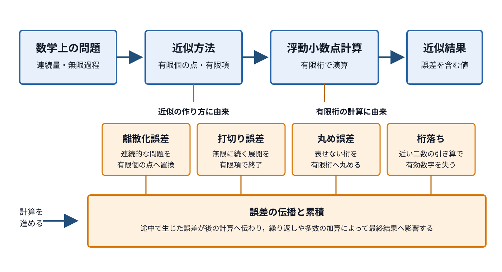
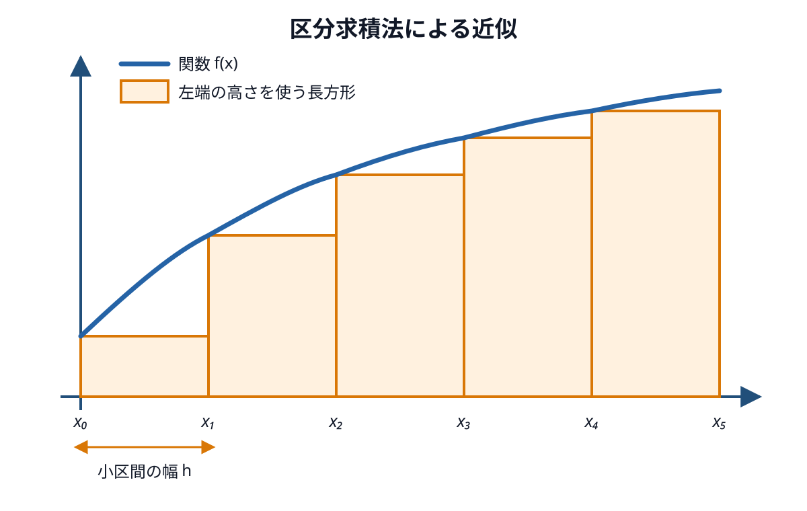
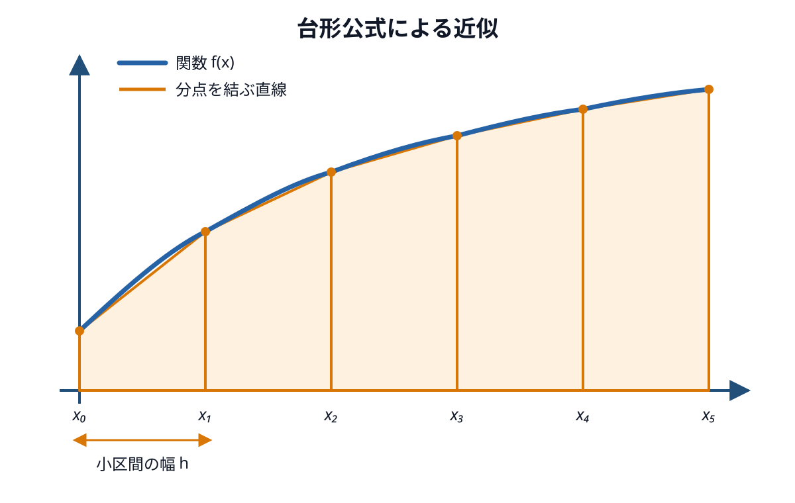

# 第7回　数値計算2

### 到達目標

- 数値計算で生じる主な誤差を区別し，近似値の精度を評価できる．
- Taylor展開から差分公式の誤差の大きさを説明できる．
- 数値微分の考え方を説明できる．
- 前進差分と中心差分を実装し，近似値の誤差を比較できる．
- 数値積分の考え方を説明できる．
- 区分求積法と台形公式を実装し，近似値の誤差を比較できる．
- 刻み幅や分割数が精度と計算量に与える影響を説明できる．

### 前回の復習

第6回では，二分法とニュートン法で方程式の近似解を求めた．第6回の演習6では，二つの方法で$x^2-3=0$の正の近似解を求め，反復回数と残差の絶対値を比較した．

```python
def f(x):
    return x ** 2 - 3

def derivative(x):
    return 2 * x

bisection_root, bisection_count = bisection(f, 1, 2)
newton_root, newton_count = newton(f, derivative, 2)

print("二分法", bisection_root, bisection_count, abs(f(bisection_root)))
print("ニュートン法", newton_root, newton_count, abs(f(newton_root)))
```

````{dropdown} コードの補足
- `f`は方程式の左辺$f(x)=x^2-3$を表す．`derivative`は導関数$f'(x)=2x$を表す．
- `bisection`には関数と区間$[1,2]$を渡す．`newton`には関数，導関数，初期値2を渡す．
- `abs(f(root))`は残差の絶対値を求める．近似解を方程式へ代入した結果が0に近いかを確認できる．

このコードを実行する場合は，第6回のNotebookで`bisection`と`newton`を定義したセルを先に実行する．
````

````{dropdown} 出力例
```text
二分法 1.732050810009241 27 8.453668431940287e-09
ニュートン法 1.7320508075688772 4 4.440892098500626e-16
```
````

今回は，導関数や定積分の正確な式を使わず，有限個の関数値から微分と積分を近似する．

### 前回の課題の解答例

1. [課題1「二分法による方程式の近似解」の解答例](./6_numerical1.md#assignment-6-1-answer)
2. [課題2「ニュートン法による方程式の近似解」の解答例](./6_numerical1.md#assignment-6-2-answer)

### Jupyter Notebookの準備

1. Anaconda NavigatorからJupyter Notebookを起動する．
2. `Documents（書類）/Fresh2`フォルダを開く．
3. Python 3のNotebookを新規作成する．
4. ファイル名を`第7回_<学籍番号>_<氏名>.ipynb`へ変更する．

```{dropdown} 忘れた人のためのJupyter Notebookの準備手順
**Jupyter Notebookの起動**

1. Spotlight検索（`command`+`Space`）でAnaconda Navigatorを起動する．
2. Anaconda Navigatorが表示されるまで待つ．
3. Jupyter Notebookの「Launch」をクリックする．
4. WebブラウザにJupyter Notebookのファイル一覧が表示されたことを確認する．


**Fresh2フォルダを開く操作**

1. ファイル一覧で`Documents`または`書類`フォルダをクリックする．
2. `Fresh2`フォルダをクリックして開く．
3. `Fresh2`フォルダがない場合は，画面右上の「New」から「New Folder」を選択して作成する．

**Notebookファイルの新規作成**

1. `Fresh2`フォルダを開いた状態で，画面右上の「New」をクリックする．
2. 「Python 3 (ipykernel)」をクリックする．
3. Notebook上部のファイル名をクリックする．
4. ファイル名を`第7回_<学籍番号>_<氏名>.ipynb`へ変更する．
5. `<学籍番号>`と`<氏名>`を自分の学籍番号と氏名へ置き換える．

**注意：** 第6回のNotebookへ追記せず，第7回用のNotebookを新規作成する．Jupyter Notebookのバージョンによって，ボタンの名称や配置が異なる場合がある．
```

## 数値計算における誤差

数値計算では，数学的に正確な値そのものではなく，有限桁の数値による近似値を求めることが多い．近似値を利用するときは，**誤差の大きさだけでなく，誤差が生じた原因も区別する必要がある**．

### 誤差の大きさ

正確な値を$x$，数値計算で得た近似値を$\widetilde{x}$とする．

- **誤差**：近似値と正確な値との差．この講義では$e=\widetilde{x}-x$とする．正負の符号から，近似値が正確な値より大きいか小さいかを判断できる．
- **絶対誤差**：誤差の絶対値$|\widetilde{x}-x|$．単位を保ったまま，二つの値がどの程度離れているかを表す．
- **相対誤差**：絶対誤差を正確な値の大きさで割った値$|\widetilde{x}-x|/|x|$．桁の異なる量の精度を比較するときに使う．ただし，$x=0$では定義できない．
- **相対百分率誤差**：相対誤差を百分率で表した値．相対誤差に$100$を掛け，単位を%とする．

たとえば，正確な値が$2$，近似値が$1.98$なら，誤差は$-0.02$，絶対誤差は$0.02$，相対誤差は$0.01$，相対百分率誤差は$1\%$である．

```{tip} 注意：正確な値が分からない場合
実際の数値計算では，正確な値が分からないために近似計算を行うことが多い．その場合は，**誤差の上限，近似値の変化，残差などを使って精度を評価する**．誤差と残差は同じ量ではないが，残差は計算結果を検算する手掛かりになる．

たとえば，方程式$f(x)=(x-1)^3=0$の正確な解は$x^*=1$である．近似値を$\widetilde{x}=1.01$とすると，絶対誤差は

$$
|\widetilde{x}-x^*|=0.01
$$

であるが，残差の絶対値は

$$
|f(\widetilde{x})|=|(1.01-1)^3|=10^{-6}
$$

となる．残差は非常に小さく見えるが，近似値は正確な解から$0.01$離れている．これは，関数のグラフが解の近くで平らであり，$x$が変化しても$f(x)$があまり変化しないためである．したがって，**残差が小さいことだけから，誤差も小さいとは断定できない**．
```

### 誤差が生じる主な原因

次の図は，数値計算の流れと，各誤差が関係する段階を表している．



- **離散化誤差**：連続的な問題を，有限個の点や小区間を使う問題へ置き換えることで生じる誤差．数値微分の刻み幅や数値積分の分割数に関係する．

  例：連続した区間$[1,2]$から方程式$x^2-2=0$の近似解を探す代わりに，区間内へ有限個の候補点を並べ，その中から解に最も近い点を選ぶ．

- **打切り誤差**：無限に続く計算や展開を有限の項で打ち切ることで生じる誤差．差分公式では，Taylor展開の高次の項を省略することで生じる．

  例：無限に続く級数を，第5項までの和で近似する．

- **丸め誤差**：実数をコンピュータで扱える有限桁の浮動小数点数へ丸めることで生じる誤差．`0.1`のような10進小数を2進数で正確に表せない場合にも生じる．

  例：$1/3$を有限桁の小数`0.333333`で表す．

- **桁落ち**：大きさの近い二つの数を引いたとき，有効数字の多くが失われ，相対的に丸め誤差の影響が大きくなる現象．数値微分で刻み幅を極端に小さくすると，`f(x + h) - f(x)`で起こりやすい．

  例：有限桁で表した値の近い`1.234567`と`1.234566`の差を計算する．

- **誤差の伝播と累積**：途中の計算に含まれる誤差が後の計算へ伝わり，繰り返しや多数の加算によって最終結果へ影響する現象．計算手順によっては誤差が拡大する．

  例：丸め誤差を含む`0.1`を繰り返し加算する．

```{tip} 注意：刻み幅と二種類の誤差
数値微分では，差分公式による離散化誤差をTaylor展開の打切り誤差として評価できる．刻み幅を小さくすると，この誤差は小さくなる．一方で，刻み幅を極端に小さくすると丸め誤差や桁落ちの影響が大きくなる．したがって，**刻み幅は小さいほど常に良いわけではない**．
```

````{note} 演習1
次の四つのコードについて，実行前に結果を予想してからCodeセルで実行せよ．実行後，それぞれの値の変化や出力が，どの誤差と関係するかをMarkdownセルに説明せよ．

**A：候補点の個数と近似解**

`grid_root(n)`は，区間$[1,2]$を$n$等分して得られる候補点の中から，$|f(x)|$が最も小さい点を近似解として返す関数である．

```python
def f(x):
    return x ** 2 - 2

def grid_root(n):
    best_x = 1
    best_residual = abs(f(best_x))

    for i in range(n + 1):
        x = 1 + i / n
        residual = abs(f(x))

        if residual < best_residual:
            best_x = x
            best_residual = residual

    return best_x

exact = 2 ** 0.5

for n in [1, 10, 100, 1000]:
    value = grid_root(n)
    print(n, value, abs(value - exact))
```

**B：級数を加える項数と近似値**

`series_sum(n)`は，級数$1/2+1/2^2+1/2^3+\cdots$の第$n$項までを加え，その和を返す関数である．

```python
def series_sum(n):
    total = 0

    for k in range(1, n + 1):
        total = total + 1 / 2 ** k

    return total

for n in [1, 2, 5, 10]:
    value = series_sum(n)
    print(n, value, abs(value - 1))
```

**C：10進小数の計算**

```python
value = 0.1 + 0.2
print(value)
print(value == 0.3)
```

**D：大きさの近い二数の差**

```python
a = 1.000000000000001
b = 1.0
value = a - b
exact = 1e-15

print(value)
print(exact)
print(abs(value - exact) / exact)
```

次の表をMarkdownセルへコピーし，観察結果を記入せよ．

| コード | 主に関係する誤差 | 観察結果と理由 |
| --- | --- | --- |
| A | ____ | ____ |
| B | ____ | ____ |
| C | ____ | ____ |
| D | ____ | ____ |
````

````{visible-answer} 解答例
**A：離散化誤差**

```text
1 1.0 0.41421356237309515
10 1.4 0.014213562373095234
100 1.41 0.004213562373095225
1000 1.414 0.00021356237309522186
```

`grid_root`は，連続した区間$[1,2]$の代わりに，区間を等分して得た有限個の候補点だけを調べている．候補点を増やすと，近似解は正確な値$\sqrt{2}$へ近づき，絶対誤差は小さくなる．**連続区間を有限個の点へ置き換えたことで生じる主な誤差は，離散化誤差である**．

**B：打切り誤差**

```text
1 0.5 0.5
2 0.75 0.25
5 0.96875 0.03125
10 0.9990234375 0.0009765625
```

この級数は，項を無限に加えると1になる．加える項数を増やすと，近似値は1へ近づき，絶対誤差は小さくなる．**無限に続く級数を有限の項で終了したことで生じるため，打切り誤差である**．

**C：丸め誤差**

```text
0.30000000000000004
False
```

Pythonの浮動小数点数では，`0.1`や`0.2`を2進数で正確に表せない．有限桁へ丸めた値を使って計算するため，結果は`0.3`と完全には一致しない．**実数を有限桁で表したことで生じるため，丸め誤差である**．

**D：桁落ち**

```text
1.1102230246251565e-15
1e-15
0.11022302462515646
```

二数の差の正確な値は$10^{-15}$であるが，計算結果の相対誤差は約$0.11$となる．大きさの近い二数を引くと先頭の桁が打ち消され，元の数に含まれていた丸め誤差の影響が相対的に大きくなる．**有効数字の多くが失われるため，桁落ちである**．
````

## Taylor展開

**Taylor展開**：関数を，ある点における関数値と各階の導関数を使った多項式で表す方法．点$x$の周りで十分な回数だけ微分できる関数について，$x$から$h$だけ離れた点の関数値は

$$
\begin{aligned}
f(x+h)
={}&f(x)+f'(x)h+\frac{f''(x)}{2!}h^2
+\frac{f^{(3)}(x)}{3!}h^3\\
&+\frac{f^{(4)}(x)}{4!}h^4+O(h^5)
\end{aligned}
$$

と表せる．$n!$は$n$の階乗，$f^{(n)}(x)$は$n$階導関数を表す．$O(h^5)$は，ここに書かなかった残りの項の絶対値が，$h$を0へ近づけたときに$|h|^5$の定数倍以下に抑えられることを表す．

$h$を$-h$へ置き換えると，奇数乗の項の符号が変わる．

$$
\begin{aligned}
f(x-h)
={}&f(x)-f'(x)h+\frac{f''(x)}{2!}h^2
-\frac{f^{(3)}(x)}{3!}h^3\\
&+\frac{f^{(4)}(x)}{4!}h^4+O(h^5)
\end{aligned}
$$

### 差分公式と打切り誤差

$f(x+h)$のTaylor展開から$f(x)$を引き，$h$で割ると

$$
\frac{f(x+h)-f(x)}{h}
=f'(x)+\frac{f''(x)}{2}h+O(h^2)
$$

となる．右辺の第2項以降を省略したものが前進差分である．省略した最初の項が$h$に比例するため，**前進差分の打切り誤差は$O(h)$である**．

一方，$f(x+h)$の展開から$f(x-h)$の展開を引くと，$h$の偶数乗の項が打ち消される．両辺を$2h$で割ると

$$
\frac{f(x+h)-f(x-h)}{2h}
=f'(x)+\frac{f^{(3)}(x)}{3!}h^2+O(h^4)
$$

となる．右辺の第2項以降を省略したものが中心差分であり，**中心差分の打切り誤差は$O(h^2)$である**．$h$が十分小さい範囲では，$h$を10分の1にすると，前進差分の打切り誤差はおよそ10分の1，中心差分の打切り誤差はおよそ100分の1になる．

```{tip} 用語：誤差の次数
$O(h)$や$O(h^2)$は，刻み幅を小さくしたときの誤差の減り方を表す．$O(h)$の方法を**一次精度**，$O(h^2)$の方法を**二次精度**という．これはTaylor展開から分かる打切り誤差の性質であり，実際の計算では丸め誤差も加わる．
```

## 数値微分

**数値微分**：関数の値から導関数の値を数値的に近似する方法．

導関数は，$h$を0へ近づける極限によって定義される．

$$
f'(x)=\lim_{h\to0}\frac{f(x+h)-f(x)}{h}
$$

コンピュータでは$h$を0へ限りなく近づける操作を直接行う代わりに，0ではない小さな値を使って傾きを計算する．

**刻み幅**：関数値を計算する点の間隔．差分公式では$h$で表す．

### 前進差分

**前進差分**：点$x$と，そこから$h$だけ進んだ点$x+h$の関数値を使って導関数を近似する方法．

$$
f'(x)\approx\frac{f(x+h)-f(x)}{h}
$$

```python
def forward_difference(f, x, h):
    return (f(x + h) - f(x)) / h

def f(x):
    return x ** 2

value = forward_difference(f, 3, 0.001)
print(value)
```

````{dropdown} コードの補足
- `forward_difference`は，関数`f`，微分係数を求める点`x`，刻み幅`h`を受け取る．
- `f(x + h) - f(x)`は，二つの点における関数値の変化を表す．これを点の間隔`h`で割って傾きを求める．
- $f(x)=x^2$の導関数は$f'(x)=2x$なので，$x=3$における正確な値は6である．
````

````{dropdown} 出力例
```text
6.000999999999479
```
````

前進差分による近似値は6に近いが，刻み幅に由来する誤差が残っている．

### 中心差分

**中心差分**：点$x$の前後にある$x-h$と$x+h$の関数値を使って導関数を近似する方法．

$$
f'(x)\approx\frac{f(x+h)-f(x-h)}{2h}
$$

```python
def central_difference(f, x, h):
    return (f(x + h) - f(x - h)) / (2 * h)

value = central_difference(f, 3, 0.001)
print(value)
```

````{dropdown} コードの補足
- 分子は$x-h$から$x+h$までの関数値の変化を表す．
- 二つの点の間隔は$2h$なので，分母を`2 * h`とする．
- 求めたい点$x$を挟んだ二つの点を使うため，一般に同じ刻み幅の前進差分より誤差が小さくなる．
````

````{dropdown} 出力例
```text
5.999999999999339
```
````

````{note} 演習2
$f(x)=x^2$の$x=3$における微分係数を，前進差分と中心差分で近似せよ．

三つの`____`を上から順に刻み幅，前進差分の関数名，中心差分の関数名で置き換えよ．二つの方法について，近似値と絶対誤差を表示せよ．

```python
def f(x):
    return x ** 2

h = ____
forward = ____(f, 3, h)
center = ____(f, 3, h)
print(forward, abs(forward - 6))
print(center, abs(center - 6))
```

**出力例**

```text
6.000999999999479 0.0009999999994789732
5.999999999999339 6.608047442568932e-13
```
````

````{visible-answer} 解答例
```python
def f(x):
    return x ** 2

h = 1e-3
forward = forward_difference(f, 3, h)
center = central_difference(f, 3, h)
print(forward, abs(forward - 6))
print(center, abs(center - 6))
```

どちらの近似値も6に近い．この例では中心差分の絶対誤差が前進差分より小さく，より正確な近似値が得られている．
````

### 刻み幅と誤差

刻み幅を小さくすると，近い二点の関数値を使って傾きを求められるため，はじめは絶対誤差が小さくなる．一方，コンピュータが扱える数値の桁数には限界があるため，**刻み幅を極端に小さくすると関数値の差を正確に表せなくなる**場合がある．

````{note} 演習3
$f(x)=\sin x$の$x=\pi/4$における微分係数を中心差分で近似せよ．

二つの`____`を上から順に`math`モジュールの関数名，中心差分の関数名で置き換えよ．刻み幅ごとの絶対誤差を表示し，その変化を確認せよ．

```python
import math

def f(x):
    return math.____(x)

x = math.pi / 4
exact = math.cos(x)

for h in [1e-1, 1e-2, 1e-3, 1e-4]:
    value = ____(f, x, h)
    print(h, value, abs(value - exact))
```

**出力例**

```text
0.1 0.7059288589999413 0.001177922186606284
0.01 0.7070949961324513 1.1785054096269398e-05
0.001 0.707106663335455 1.1785109255146864e-07
0.0001 0.70710678000796 1.1785875608794072e-09
```
````

````{visible-answer} 解答例
```python
import math

def f(x):
    return math.sin(x)

x = math.pi / 4
exact = math.cos(x)

for h in [1e-1, 1e-2, 1e-3, 1e-4]:
    value = central_difference(f, x, h)
    print(h, value, abs(value - exact))
```

この範囲では，刻み幅を10分の1にするたびに絶対誤差がおよそ100分の1になっている．中心差分では，刻み幅を小さくすることで近似値が正確な値へ近づいている．
````

## 数値積分

**数値積分**：積分区間内の有限個の関数値を使って定積分の値を数値的に近似する方法．

定積分

$$
\int_a^b f(x)\,dx
$$

は，区間$[a,b]$における符号付き面積を表す．数値積分では，区間を小さく分け，各小区間の面積を近似して合計する．

### 区分求積法

**区分求積法**：積分区間を小区間に分け，長方形の面積を合計して定積分を近似する方法．ここでは，各小区間の左端における関数値を長方形の高さとして使う．



**分割数**：積分区間を分ける小区間の個数．コードでは`n`で表す．

**小区間の幅**：各長方形の横幅．区間$[a,b]$を$n$等分すると，幅は$h=(b-a)/n$となる．

左端を使う区分求積法は，次の式で表せる．

$$
\int_a^b f(x)\,dx
\approx
\sum_{i=0}^{n-1} f(a+ih)h
$$

```python
def riemann_sum(f, a, b, n):
    width = (b - a) / n
    area = 0

    for i in range(n):
        x = a + i * width
        area = area + f(x) * width

    return area
```

````{dropdown} コードの補足
- `width`は各小区間の幅，`area`は長方形の面積を順に合計する変数である．
- for文で`i`を0から`n - 1`まで変化させ，`x = a + i * width`によって各小区間の左端を求める．
- `f(x) * width`は一つの長方形の面積を表す．すべての面積を加えた後，`area`を近似値として返す．
````

```python
def f(x):
    return x ** 2

value = riemann_sum(f, 0, 1, 100)
print(value)
```

````{dropdown} コードの補足
$f(x)=x^2$を区間$[0,1]$で100等分し，100個の長方形の面積を合計する．正確な積分値は$1/3$である．
````

````{dropdown} 出力例
```text
0.32835000000000014
```
````

### 台形公式

**台形公式**：各小区間における関数のグラフを直線で近似し，台形の面積を合計する方法．



区間$[a,b]$を$n$等分し，$h=(b-a)/n$とすると，台形公式は次の式で表せる．

$$
\int_a^b f(x)\,dx
\approx
h\left\{
\frac{f(a)+f(b)}{2}
+\sum_{i=1}^{n-1}f(a+ih)
\right\}
$$

```python
def trapezoidal(f, a, b, n):
    h = (b - a) / n
    total = (f(a) + f(b)) / 2

    for i in range(1, n):
        x = a + i * h
        total = total + f(x)

    return h * total
```

````{dropdown} コードの補足
- 区間の両端にある`f(a)`と`f(b)`は，台形公式ではそれぞれ半分の重みで加える．
- for文では両端を除いた分点を扱うため，`range(1, n)`を使う．
- 関数値の合計`total`へ小区間の幅`h`を掛け，台形の面積の合計を返す．
````

```python
value = trapezoidal(f, 0, 1, 100)
print(value)
```

````{dropdown} コードの補足
区分求積法と同じ関数，積分区間，分割数を使う．二つの出力を正確な値$1/3$と比較することで，方法による誤差の違いを確認できる．
````

````{dropdown} 出力例
```text
0.33335000000000004
```
````

````{note} 演習4
$f(x)=x^2$を0から1まで，区分求積法と台形公式で積分せよ．

二つの`____`を上から順に区分求積法の関数名，台形公式の関数名で置き換えよ．二つの方法について，近似値と絶対誤差を表示せよ．

```python
def f(x):
    return x ** 2

exact = 1 / 3
riemann_value = ____(f, 0, 1, 100)
trapezoidal_value = ____(f, 0, 1, 100)
print(riemann_value, abs(riemann_value - exact))
print(trapezoidal_value, abs(trapezoidal_value - exact))
```

**出力例**

```text
0.32835000000000014 0.004983333333333173
0.33335000000000004 1.6666666666720342e-05
```
````

````{visible-answer} 解答例
```python
def f(x):
    return x ** 2

exact = 1 / 3
riemann_value = riemann_sum(f, 0, 1, 100)
trapezoidal_value = trapezoidal(f, 0, 1, 100)
print(riemann_value, abs(riemann_value - exact))
print(trapezoidal_value, abs(trapezoidal_value - exact))
```

どちらの方法からも$1/3$に近い値が得られる．この例では，同じ分割数を使った台形公式の絶対誤差が区分求積法より小さい．
````

### 分割数と誤差

分割数を増やすと，一つの小区間の幅が狭くなり，関数のグラフに沿った面積を近似しやすくなる．一方，分割数に比例して繰り返し回数も増える．**精度だけでなく計算量も考えて分割数を決める必要がある**．

````{note} 演習5
分割数と絶対誤差の関係を調べよ．

二つの`____`を上から順に区分求積法の関数名，台形公式の関数名で置き換えよ．実行後，分割数を10倍にしたときの絶対誤差の変化をMarkdownセルに2文程度で説明せよ．演習4で定義した`f`と`exact`を使うこと．

```python
for n in [10, 100, 1000, 10000]:
    error_r = abs(____(f, 0, 1, n) - exact)
    error_t = abs(____(f, 0, 1, n) - exact)
    print(n, error_r, error_t)
```

**出力例**

```text
10 0.04833333333333323 0.0016666666666667607
100 0.004983333333333173 1.6666666666720342e-05
1000 0.0004998333333333105 1.66666666689963e-07
10000 4.999833333324544e-05 1.6666667490561338e-09
```
````

````{visible-answer} 解答例
```python
for n in [10, 100, 1000, 10000]:
    error_r = abs(riemann_sum(f, 0, 1, n) - exact)
    error_t = abs(trapezoidal(f, 0, 1, n) - exact)
    print(n, error_r, error_t)
```

分割数を10倍にすると，区分求積法の絶対誤差はおよそ10分の1，台形公式の絶対誤差はおよそ100分の1になっている．同じ分割数では，台形公式の絶対誤差が小さい．
````

```{tip} 注意：分割数と計算時間
分割数を増やすと絶対誤差は小さくなるが，for文の繰り返し回数も増える．非常に大きな分割数を指定すると，計算の終了までに時間がかかる．
```

## エラーが出たときにチェックすること

エラーメッセージの最終行には，エラーの種類と原因を示す情報が表示される．**まず最終行を読み**，次の表で確認する箇所を絞る．

| エラーの種類 | 主な原因 | 確認すること |
| --- | --- | --- |
| `SyntaxError` | 関数定義やfor文の書き方がPythonの文法に合わない | 閉じ括弧があるか，関数定義とfor文の末尾にコロンがあるか確認する． |
| `IndentationError` | 関数やfor文の処理範囲を表すインデントが揃っていない | 関数やfor文の内側が半角スペース4個で字下げされているか確認する． |
| `NameError` | 関数や変数を定義する前に使用した | `forward_difference`，`central_difference`，`riemann_sum`，`trapezoidal`を定義したセルが実行済みか確認する． |
| `ZeroDivisionError` | 刻み幅`h`または分割数`n`に0を指定した | `h`が0でないか，`n`が正の整数か確認する． |
| `TypeError: 'float' object cannot be interpreted as an integer` | `range`で使う分割数に小数を指定した | `n`へ10，100のような整数を指定しているか確認する． |
| `TypeError: 'float' object is not callable` | 関数を渡す場所へ関数値を渡した | `central_difference(f, ...)`や`trapezoidal(f, ...)`のように，関数名へ括弧を付けずに渡しているか確認する． |

### エラーが表示されない誤動作

- **数値微分の式**：前進差分の分母が`h`，中心差分の分母が`2 * h`になっているか確認する．
- **積分区間**：関数へ渡す下端`a`と上端`b`の順番を確認する．
- **分割数**：`n`が正の整数になっているか確認する．負の整数ではエラーが表示されず，for文が実行されない場合がある．
- **for文の範囲**：区分求積法は`range(n)`，台形公式は`range(1, n)`を使っているか確認する．
- **正確な値**：絶対誤差の計算に使う微分係数や定積分の正確な値を確認する．
- **Notebookの実行順序**：同じ名前の`f`を定義し直した場合は，使用する関数を定義したセルから順に再実行する．

### 実行に時間がかかる場合の確認

分割数`n`へ非常に大きな整数を指定すると，for文の実行に時間がかかる．Jupyter Notebookのメニューで「Kernel」から「Interrupt」を選ぶと処理を中断できる．中断後は分割数を小さくして再実行する．

## 課題

````{warning} 課題1
$f(x)=\sin x$の$x=\pi/3$における微分係数を調べよ．

1. Markdownセルに`# 課題1`と記入し，$f(x)=\sin x$を定義せよ．
2. 刻み幅`1e-1`，`1e-2`，`1e-3`，`1e-4`，`1e-5`について，前進差分と中心差分の絶対誤差を表示せよ．
3. 二つの方法の精度をMarkdownセルに3文程度で比較せよ．

次のテンプレートを基に完成させよ．`【　】`は，引数全体または1行以上の処理を記述する箇所を表す．本文で定義した`forward_difference`と`central_difference`を先に実行すること．

```python
import math

def f(【必要な引数をすべて記入】):
    【math.sinを使って関数値を返す処理】

x = math.pi / 3
exact = math.cos(x)

【各刻み幅で前進差分と中心差分の絶対誤差を求めて表示する処理】
```

**出力例**

```text
0.1 0.04409811458923907 0.0008329167658590597
0.01 0.004338424226313031 8.333291661943854e-06
0.001 0.00043309599923013753 8.333339540644857e-08
0.0001 4.330210417979874e-05 8.338326695778164e-10
1e-05 4.330132974128542e-06 7.826794767851197e-12
```
````

(assignment-7-1-answer)=
````{visible-answer} 解答例
**空欄1：関数の定義**

微分係数を調べる点を引数`x`として受け取り，`math.sin(x)`を返す．

```python
def f(x):
    return math.sin(x)
```

**空欄2：刻み幅ごとの絶対誤差**

for文で五つの刻み幅を順に取り出す．それぞれの刻み幅で前進差分と中心差分を計算し，正確な値との差の絶対値を表示する．

```python
for h in [1e-1, 1e-2, 1e-3, 1e-4, 1e-5]:
    forward = forward_difference(f, x, h)
    center = central_difference(f, x, h)
    print(h, abs(forward - exact), abs(center - exact))
```

**完成したコード**

```python
import math

def f(x):
    return math.sin(x)

x = math.pi / 3
exact = math.cos(x)

for h in [1e-1, 1e-2, 1e-3, 1e-4, 1e-5]:
    forward = forward_difference(f, x, h)
    center = central_difference(f, x, h)
    print(h, abs(forward - exact), abs(center - exact))
```

**出力例**

```text
0.1 0.04409811458923907 0.0008329167658590597
0.01 0.004338424226313031 8.333291661943854e-06
0.001 0.00043309599923013753 8.333339540644857e-08
0.0001 4.330210417979874e-05 8.338326695778164e-10
1e-05 4.330132974128542e-06 7.826794767851197e-12
```

**同じ刻み幅では，中心差分の絶対誤差が前進差分より小さい**．この範囲では，刻み幅を小さくするとどちらの絶対誤差も小さくなる．ただし，刻み幅を極端に小さくすると丸め誤差の影響が大きくなる場合がある．
````

````{warning} 課題2
$f(x)=x^3$を0から1まで数値積分せよ．

1. Markdownセルに`# 課題2`と記入し，$f(x)=x^3$を定義せよ．
2. 分割数10，100，1000，10000について，区分求積法と台形公式の絶対誤差を表示せよ．
3. 計算結果をcsvモジュールで`numerical_integration.csv`へ保存し，二つの方法をMarkdownセルに3文程度で比較せよ．

次のテンプレートを基に完成させよ．`【　】`は，引数全体または1行以上の処理を記述する箇所を表す．本文で定義した`riemann_sum`と`trapezoidal`を先に実行すること．

```python
import csv

def f(【必要な引数をすべて記入】):
    【xの3乗を返す処理】

exact = 1 / 4
rows = [["n", "riemann_error", "trapezoidal_error"]]

【各分割数の絶対誤差を求め，表示してrowsへ追加する処理】

【rowsをnumerical_integration.csvへ書き込む処理】
```

**出力例**

```text
10 0.04749999999999993 0.0025000000000000577
100 0.004975000000000035 2.5000000000052758e-05
1000 0.0004997500000001875 2.500000000349445e-07
10000 4.9997500000092954e-05 2.5000001513397763e-09
```
````

(assignment-7-2-answer)=
````{visible-answer} 解答例
**空欄1：関数の定義**

積分する点を引数`x`として受け取り，`x ** 3`を返す．

```python
def f(x):
    return x ** 3
```

**空欄2：分割数ごとの絶対誤差**

for文で四つの分割数を順に取り出す．二つの方法の絶対誤差を求め，分割数とともに`rows`へ追加してから表示する．

```python
for n in [10, 100, 1000, 10000]:
    error_r = abs(riemann_sum(f, 0, 1, n) - exact)
    error_t = abs(trapezoidal(f, 0, 1, n) - exact)
    rows.append([n, error_r, error_t])
    print(n, error_r, error_t)
```

**空欄3：CSVファイルへの保存**

書き込みモードでファイルを開き，`csv.writer`で作成したwriterオブジェクトの`writerows`メソッドへ`rows`を渡す．

```python
with open("numerical_integration.csv", "w", encoding="utf-8", newline="") as file:
    writer = csv.writer(file)
    writer.writerows(rows)
```

**完成したコード**

```python
import csv

def f(x):
    return x ** 3

exact = 1 / 4
rows = [["n", "riemann_error", "trapezoidal_error"]]

for n in [10, 100, 1000, 10000]:
    error_r = abs(riemann_sum(f, 0, 1, n) - exact)
    error_t = abs(trapezoidal(f, 0, 1, n) - exact)
    rows.append([n, error_r, error_t])
    print(n, error_r, error_t)

with open("numerical_integration.csv", "w", encoding="utf-8", newline="") as file:
    writer = csv.writer(file)
    writer.writerows(rows)
```

**出力例**

```text
10 0.04749999999999993 0.0025000000000000577
100 0.004975000000000035 2.5000000000052758e-05
1000 0.0004997500000001875 2.500000000349445e-07
10000 4.9997500000092954e-05 2.5000001513397763e-09
```

分割数を増やすと，どちらの絶対誤差も小さくなる．**同じ分割数では，台形公式の絶対誤差が小さい**．CSVファイルへ保存した結果は，表計算や後の可視化に利用できる．
````

### 提出方法

- WebClassの「第7回課題」からNotebookファイル（`第7回_<学籍番号>_<氏名>.ipynb`）と`numerical_integration.csv`を提出する．
- 提出前にファイル名，Markdownセル，関数の定義，関数の呼び出し，Codeセルの実行結果を確認する．
- すべてのCodeセルの出力を表示した状態でNotebookを保存する．
- 課題1について，五つの刻み幅と二つの方法の絶対誤差が表示されていることを確認する．
- 課題2について，四つの分割数と二つの方法の絶対誤差がNotebookとCSVファイルに保存されていることを確認する．
- 課題1・2の後に，二つの方法を比較したMarkdownセルがあることを確認する．

### 提出期限

<span style="color: red; ">11月13日(金)23:59まで</span>

質問等がある場合には

- メール kkagawa@josai.ac.jp
- Teamsのチャット
- WebClassのメッセージ

などで連絡してください．

## まとめ

1. **誤差は大きさと原因を区別する**：絶対誤差と相対誤差で精度を評価し，離散化誤差，打切り誤差，丸め誤差などの原因を考える．
2. **Taylor展開から差分公式の精度が分かる**：前進差分の打切り誤差は$O(h)$，中心差分の打切り誤差は$O(h^2)$である．
3. **数値微分は関数値の差から傾きを近似する**：前進差分は$x$と$x+h$，中心差分は$x-h$と$x+h$の関数値を使う．
4. **数値積分は小区間の面積を合計する**：区分求積法は長方形，台形公式は台形で各小区間の面積を近似する．
5. **精度と計算量の両方を考える**：刻み幅を極端に小さくすると丸め誤差が現れ，分割数を増やすと計算時間が長くなる．

- 次回は，Google Colabを使い，乱数によるシミュレーションを行う．
