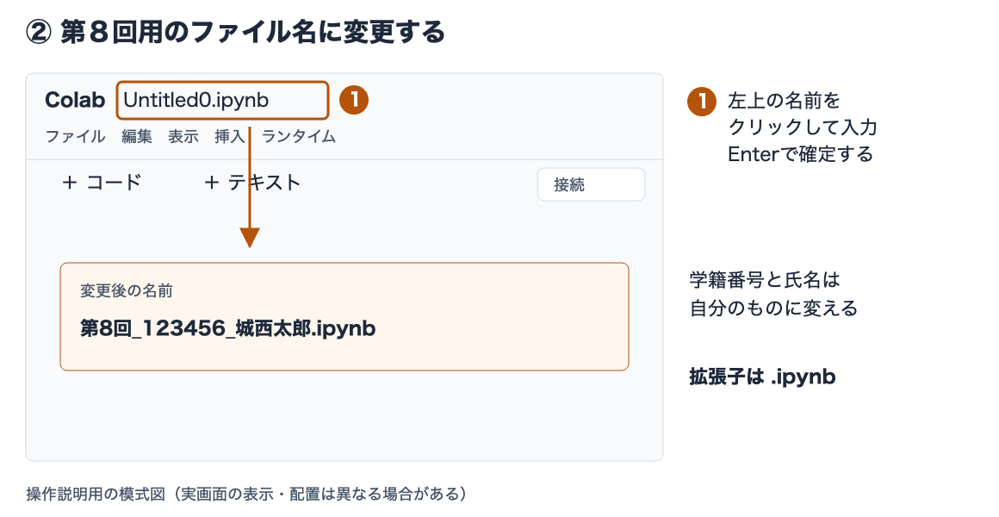
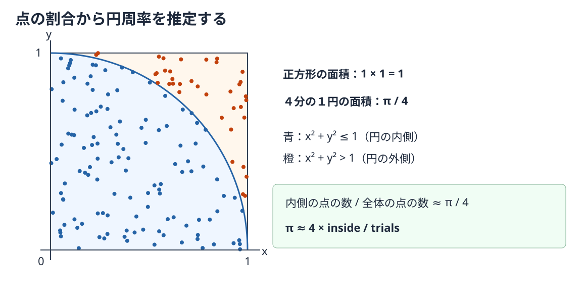
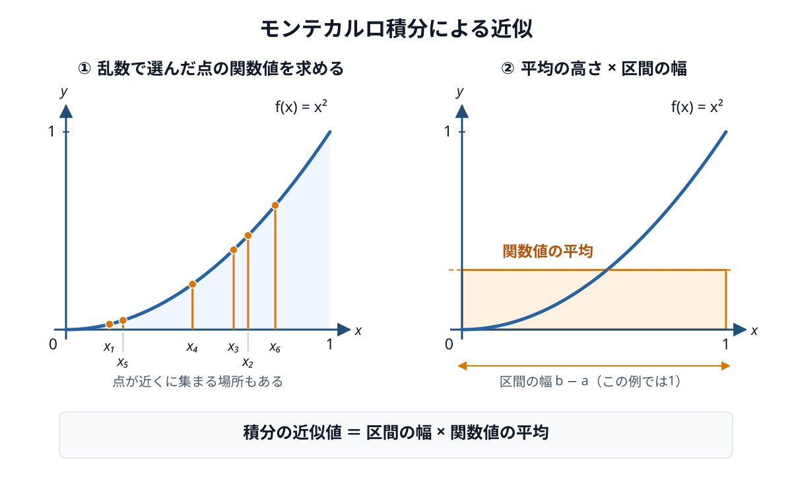

# 第8回　数値計算3：Google Colabによる計算

### 到達目標

- **Google Colabの準備**：Webブラウザ上でPythonのコードを実行し，説明と実行結果をファイルに保存してダウンロードできる（Notebook）．
- **整数と実数の乱数**：Pythonで指定した範囲から整数や実数を不規則に選ぶことができる．
- **シードと再現性**：計算を始めるときの設定と実行順序をそろえ，同じ結果を再び得ることができる．
- **サイコロのシミュレーション**：サイコロを繰り返し振る計算を作り，各出目が出た割合を確率と比較できる（相対度数）．
- **モンテカルロ法・モンテカルロ積分**：不規則に選んだ点を使って円周率や曲線の下の面積をおおよそ求めることができる．
- **試行回数と誤差**：繰り返す回数を変えて正確な値との差を調べ，計算結果を表形式のファイルへ保存できる（絶対誤差・CSV）．

### 前回の復習

第7回では前進差分と中心差分で微分係数を近似し，区分求積法と台形公式で定積分を近似した．

**絶対誤差**：近似値と正確な値との差の絶対値．前回は二つの方法の精度を比較するために使った．

次のコードは台形公式で$\int_0^1x^2\,dx=1/3$を近似し，絶対誤差を求める例である．

```python
def trapezoidal(f, a, b, n):
    h = (b - a) / n
    total = (f(a) + f(b)) / 2

    for i in range(1, n):
        total += f(a + i * h)

    return h * total

def f(x):
    return x ** 2

value = trapezoidal(f, 0, 1, 100)
print(value)
print(abs(value - 1 / 3))
```

````{dropdown} コードの補足
- `f`は積分する関数を表す．`trapezoidal`へは関数，積分区間の両端，分割数を渡す．
- `h`は小区間の幅である．両端の関数値を半分ずつ加え，内側の関数値を加えてから`h`を掛ける．
- `abs(value - 1 / 3)`で数学的に求めた正確な値に対する絶対誤差を計算する．
````

````{dropdown} 出力例
```text
0.33335000000000004
1.6666666666720342e-05
```
````

今回は規則的に並べた点の代わりに**乱数で選んだ点や多数の試行の結果から値を推定する**．前回と同じ積分も扱い，近似の仕組みと誤差の現れ方を比較する．

### 前回の課題の解答例

1. [課題1「数値微分の絶対誤差の比較」の解答例](./7_numerical2.md#assignment-7-1-answer)
2. [課題2「数値積分とCSVファイルへの保存」の解答例](./7_numerical2.md#assignment-7-2-answer)

## Google Colabの準備

**Google Colab**：WebブラウザでPythonのNotebookを作成・実行できるサービス．今回はAnaconda Navigatorを起動せず，Colabで第8回用のNotebookを作成する．

**ランタイム**：Notebookのコードを実行し，変数・関数の定義や計算で作成したファイルを一時的に保持する計算環境．ColabではGoogleが用意するコンピュータ上で動作する．

| 操作・保存場所 | 第7回までのJupyter Notebook | 今回のGoogle Colab |
| --- | --- | --- |
| 起動方法 | Anaconda Navigatorから起動 | WebブラウザでColabを開く |
| Pythonを実行する場所 | 自分のパソコン | Googleが用意する実行環境（ランタイム） |
| Notebookの保存先 | `Documents（書類）/Fresh2` | ログインしたアカウントのGoogle Drive |
| `open`で作成したCSVの保存先 | パソコン上の作業フォルダ | ランタイム内の作業フォルダ（通常は`/content`） |
| WebClassへの提出 | 保存したNotebookを提出 | Notebookをパソコンへダウンロードして提出 |

### Googleアカウントの準備

**個人のGoogleアカウントを持っている場合**

普段使っている個人のGoogleアカウントでColabにログインする．

**Googleアカウントを持っていない場合**

自分の`josai.ac.jp`のメールアドレスを使ってGoogleアカウントを作成する．Gmailのアドレスを新しく取得する必要はない．大学のメールアドレスを持っているだけではGoogleアカウントの登録は完了していないため，次の手順で作成する．

1. 大学のメールを開き，確認メールを受信できる状態にする．
2. [Googleアカウントの作成画面](https://accounts.google.com/signup)を開き，用途を尋ねられたら「個人で使用」を選ぶ．
3. 氏名・生年月日などの基本情報を入力する．
4. メールアドレスを指定する画面で「既存のメールアドレスを使用する」を選び，自分の`josai.ac.jp`のメールアドレスを入力する．
5. 大学のメールに届く確認コードを入力してメールアドレスを確認する．
6. Googleアカウント用のパスワードを設定し，画面の案内に従って作成を完了する．電話番号などによる確認を求められた場合は案内に従う．
7. [Google Colab](https://colab.research.google.com/)を開き，登録した大学のメールアドレスとGoogleアカウント用に設定したパスワードでログインする．

画面の名称や順序が異なる場合は[Google公式ヘルプ「Googleアカウントの作成」](https://support.google.com/accounts/answer/27441?hl=ja)の「既存のメールアドレスを使用する」を参照すること．

### Google Colabの操作動画

次のリンクから操作動画を開き，再生ボタンを押して視聴すること．動画は別の画面で開き，再生・停止・音量を操作できる．

[▶ Google Colabの使い方の動画を見る](./figs/8/googlecolab.mp4)

### Notebookの作成と保存

**1．ログインしてNotebookを新規作成する**

1. Webブラウザで[Google Colab](https://colab.research.google.com/)を開く．
2. ログインを求められたら個人のGoogleアカウント，または上の手順で作成したGoogleアカウントでログインする．右上のアカウントアイコンから使用中のアカウントを確認する．
3. 「ノートブックを開く」画面の「ノートブックを新規作成」をクリックする．
4. すでにNotebookが開いている場合は「ファイル」→「ノートブックを新規作成」から作成する．

<!--  -->

**2．ファイル名を変更する**

1. 画面左上の`Untitled0.ipynb`などのファイル名をクリックする．
2. `第8回_<学籍番号>_<氏名>.ipynb`へ変更し，`Enter`で確定する．`<学籍番号>`と`<氏名>`は自分のものへ置き換える．
3. 変更後の名前が画面左上に表示されていることを確認する．第7回のNotebookへ追記せず，第8回用のNotebookを作ること．

<!--  -->

**3．Codeセルを実行し，Markdownセルを追加する**

1. Codeセルへ次のコードを入力する．セルがない場合は画面上部の「＋ コード」をクリックする．

   ```python
   1 + 2
   ```

2. セル左の実行ボタン（▶）をクリックするか，`Shift`+`Enter`を押す．初回はランタイムへの接続に少し時間がかかるため，完了するまで待つ．接続されない場合は右上の「接続」をクリックする．
3. セルの下に`3`と表示されることを確認する．
4. 「＋ テキスト」をクリックしてMarkdownセルを追加し，次の内容を自分の学籍番号・氏名に置き換えて入力する．

   ```markdown
   # 第8回　数値計算3
   学籍番号：123456　氏名：城西太郎
   ```

5. Markdownセルで`Shift`+`Enter`を押し，見出しと本文が表示されることを確認する．以後は演習・課題の見出しと考察もMarkdownセルへ記入する．

<!--  -->

```{tip} 注意：セルの実行順序
関数を定義したセルや`import`を書いたセルはその関数を使うセルより先に実行する．ランタイムが新しくなると，変数・関数の定義は失われる．画面に以前の出力が残っていても，計算を再開するときは上から順にセルを実行する．今回の計算は標準のCPUで実行できる．
```

**4．Notebookを保存・ダウンロードする**

作成したNotebookはGoogle Driveへ保存される．作業の途中と終了時に「ファイル」→「保存」を選び，保存の完了を確認する．再開するときは同じアカウントでColabを開き，最近使用したNotebookなどから第8回のファイルを開く．

WebClassへ提出するときは次の操作でパソコンへダウンロードする．

1. 提出するCodeセルを実行し，結果が表示されていることを確認して保存する．
2. 「ファイル」→「ダウンロード」→「.ipynbをダウンロード」を選ぶ．
3. パソコンのダウンロードフォルダなどで`第8回_<学籍番号>_<氏名>.ipynb`が保存されたことを確認する．

<!--  -->

**5．計算で作成したCSVをダウンロードする**

課題2では計算結果を`monte_carlo.csv`へ書き込む．**CSVファイルの提出は不要**だが，次回の可視化で使うため手元に保存する．**Notebookを保存しても，ランタイム内のCSVが自動的にGoogle Driveへ保存されるわけではない**．課題2が完成したら，次の操作も行う．

1. CSVへ書き込むCodeセルを実行する．
2. 左側のフォルダアイコンをクリックし，「ファイル」一覧を開く．
3. `monte_carlo.csv`が表示されていることを確認する．表示されない場合は一覧の更新ボタンをクリックする．
4. ファイル名の右側の「⋮」（または右クリックのメニュー）から「ダウンロード」を選ぶ．
5. パソコンに`monte_carlo.csv`が保存されたことを確認する．

<!--  -->

```{tip} 注意：ランタイム内のファイル
ランタイムが削除されると，その中のCSVも失われる．講義終了前にNotebookとCSVの両方をダウンロードする．CSVがなくなった場合は必要な関数の定義から順に実行し，課題2の計算・保存をやり直す．
```

````{dropdown} CSVをコードからダウンロードする方法
CSVを作成した後はファイル一覧からの操作の代わりに，別のCodeセルで次を実行してもよい．このコードはGoogle Colab専用である．

```python
from google.colab import files

files.download("monte_carlo.csv")
```
````

保存場所とランタイムについては[Google Colab公式FAQ](https://research.google.com/colaboratory/intl/ja/faq.html)も参照できる．

## 乱数

サイコロを振るとき，出目は毎回決まっているわけではない．このような試行をプログラムで扱うために乱数を使う．

- **乱数**：各値が現れる確率の規則に従い，不規則に得られる数．
- **疑似乱数**：一定の計算手順によって生成した**乱数のように見える**数列．Pythonの標準ライブラリ`random`モジュールで疑似乱数を生成できる．

### 整数と実数の乱数

```python
import random

print(random.random())
print(random.randint(1, 6))
print(random.uniform(-1, 1))
```

````{dropdown} コードの補足
- `import random`は`random`モジュールを使う準備である．Colabに追加でインストールする必要はない．
- `random.randint(1, 6)`は1から6までのいずれかを返す．`range(1, 6)`は6を含まないため，範囲の扱いを混同しないこと．
- シードを設定せずに実行すると，通常は実行するたびに異なる値が表示される．
````

| 関数 | 生成する値 | 用途の例 |
| --- | --- | --- |
| `random.random()` | 0以上1未満の実数 | 単位正方形内の座標を選ぶ |
| `random.randint(a, b)` | `a`以上`b`以下の整数（両端を含む） | サイコロの出目を選ぶ |
| `random.uniform(a, b)` | 区間`a`から`b`の一様な実数 | 積分区間の点を選ぶ |

※ **一様**：整数なら各値の選ばれやすさが等しく，実数なら同じ長さの小区間に入る確率が等しいこと．
<!-- `random.uniform(a, b)`の上端`b`は浮動小数点数の丸めによって含まれる場合と含まれない場合がある． -->

### シードと再現性

**シード**：疑似乱数の生成を開始するために与える初期値．同じシードを設定し，同じ順序で乱数を生成すると，同じ乱数列を再現できる．

**シードを設定しない場合**

次のコードを一つのCodeセルに入力し，セル全体を2回実行する．

```python
import random

for _ in range(5):
    print(random.randint(1, 6))
```

````{dropdown} 出力例（シードを設定しない場合）
**1回目**

```text
5
5
1
2
3
```

**2回目**

```text
6
1
1
6
2
```
````

シードを設定しない場合，2回目は乱数列の続きが生成されるため，通常は1回目と異なる結果になる．表示される値は実行例であり，自分の結果と一致する必要はない．偶然同じ値や同じ並びが出ることもある．

**シードを設定する場合**

次のコードも一つのCodeセルに入力し，`random.seed(10)`を含むセル全体を2回実行する．

```python
import random

random.seed(10)

for _ in range(5):
    print(random.randint(1, 6))
```

````{dropdown} 出力例（シードを設定する場合）
**1回目**

```text
5
1
4
4
5
```

**2回目**

```text
5
1
4
4
5
```
````

セル全体を実行するたびに`random.seed(10)`で同じ初期状態に戻るため，1回目と2回目で同じ5個の値が表示される．ただし`random.seed(10)`を実行せずにfor文だけを再実行すると，乱数列の続きが生成される．また同じシードでも途中で別の乱数を生成すれば，その後の結果は変わる．

```{tip} for文の仮の変数（アンダースコア）
`for _ in range(5):`はインデントされた処理を**5回繰り返す**．`range(5)`が生成する値は0，1，2，3，4である．

- **値を使う場合**：`for i in range(5):`のように名前を付け，処理の中で`i`を使う．
- **値を使わない場合**：`for _ in range(5):`のように`_`を使う．

このコードでは0，1，2，3，4そのものは必要なく，乱数を生成する処理を5回繰り返せればよい．そこで受け取った値を使わないことを示す**慣用的な名前**として`_`を使っている．`_`はPythonの特別な命令ではなく，通常の変数名である．
```

````{note} 演習1
0以上1未満の実数の乱数を5個生成してリストに保存し，表示する操作を2回行う．各回の乱数生成を始める前にシードを10に設定し，同じ乱数列が2回表示されるように，次のコードの`_____`を埋めよ．

続いてシードを別の整数へ変更し，結果がどう変わるかをMarkdownセルに説明せよ．

```python
import random

for _ in range(2):
    random.seed(_____)
    values = []
    for _ in range(5):
        values.append(random._____())
    print(values)
```

**出力例**

```text
[0.5714025946899135, 0.4288890546751146, 0.5780913011344704, 0.20609823213950174, 0.81332125135732]
[0.5714025946899135, 0.4288890546751146, 0.5780913011344704, 0.20609823213950174, 0.81332125135732]
```
````

````{hidden-answer} 解答例
```python
import random

for _ in range(2):
    random.seed(10)
    values = []
    for _ in range(5):
        values.append(random.random())
    print(values)
```

`seed(10)`を外側のfor文の中で実行するため，5個の乱数を生成する操作を同じ初期状態から2回繰り返している．シードを変えると乱数列は変わるが，新しいシードでも2行は一致する．
````

## サイコロのシミュレーション

**シミュレーション**：現実の現象や試行を規則に基づく計算によって模擬すること．ここでは整数の乱数を使ってサイコロを繰り返し振る試行を模擬する．

公平なサイコロでは各出目の確率は$1/6$である．ただし6000回振ったときに各出目が必ず1000回ずつ現れるわけではない．

```python
import random

random.seed(10)
trials = 6000
counts = [0, 0, 0, 0, 0, 0]

for _ in range(trials):
    value = random.randint(1, 6)
    counts[value - 1] += 1

print(counts)
```

````{dropdown} コードの補足
- `counts`の六つの要素に1から6までの出目の回数を保存する．最初はすべて0にする．
- 出目が1なら添字は0，出目が6なら添字は5なので，`counts[value - 1]`へ1を加える．
- `for _ in range(trials)`でサイコロを振って記録する処理を`trials`回繰り返す．`_`は繰り返しの変数を処理の中で使わないときの慣用的な名前である．
- 六つの回数の合計は試行回数`trials`と一致する．
````

**相対度数**：ある結果が現れた回数を試行回数全体で割った値．

$$
\text{出目が}k\text{の相対度数}=\frac{\rule{0pt}{1.2em}\text{出目が}k\text{の回数}}{\rule{0pt}{1.2em}\text{試行回数}}
$$

公平なサイコロを独立に振る数学的モデルでは，試行回数を増やすと各出目の相対度数が確率$1/6$に収束することが**大数の法則**によって保証される．ただし確率との差が毎回小さくなることを意味するわけではない．

```{tip} 大数の法則（強法則）
独立で同一の分布に従う確率変数列$X_1,X_2,\ldots$がすべての$i$について$\mathbb{E}[|X_i|]<\infty$を満たすとする．共通の期待値を$\mu=\mathbb{E}[X_i]$とすると

$$
\mathbb{P}\left(\lim_{N\to\infty}\frac{1}{N}\sum_{i=1}^{N}X_i=\mu\right)=1
$$

が成り立つ．$\mathbb{E}$は期待値，$\mathbb{P}$は確率を表す．これは標本平均が期待値に収束する確率が1であるという主張であり，単調に近づくことや有限回で一致することの保証ではない．

サイコロでは出目$k$を一つ固定し，$i$回目に$k$が出たら$X_i=1$，それ以外なら$X_i=0$とする．公平なサイコロを独立に振る場合は$\mu=1/6$であり，標本平均$\frac{1}{N}\sum_{i=1}^{N}X_i$は出目$k$の相対度数になる．したがって相対度数は確率1で$1/6$に収束する．
```

### 具体例：試行回数が異なる結果の比較

公平なサイコロで1が出る回数の期待値は，試行回数を$N$として$N/6$である．次の二つの結果を考える．

| 試行回数 | 1が出た回数 | 期待値$N/6$との差の絶対値 | 相対度数 |
| --- | --- | --- | --- |
| 1000 | 159 | 約7.7回 | $159/1000=0.159$ |
| 10000 | 1650 | 約16.7回 | $1650/10000=0.165$ |

10000回の結果は期待値との回数の差が大きい一方，相対度数は確率$1/6\approx0.1667$に近い．回数の差は試行回数にも左右されるため，**試行回数が異なる結果では相対度数と確率との差を比較する**．

**具体例：試行を続けたときの変化**

シードを10に設定して`random.randint(1, 6)`でサイコロを振り続け，途中までの結果を集計すると次のようになる．シードは開始時に一度だけ設定し，回数は最初の試行から累積して数える．

| 試行回数 | 1が出た回数 | 相対度数 | 確率$1/6$との差の絶対値 |
| --- | --- | --- | --- |
| 1000 | 159 | 0.159 | 約0.00767 |
| 3000 | 500 | $500/3000=1/6$ | 0 |
| 5000 | 808 | 0.1616 | 約0.00507 |
| 10000 | 1621 | 0.1621 | 約0.00457 |

3000回では相対度数が確率と一致するが，5000回では再び差が生じている．10000回ではその差が小さくなる．このように試行回数を増やすと相対度数は確率に近づく傾向があるが，毎回必ず近づくわけではない．

````{note} 演習2
1から6までの各出目が等しい確率で現れるサイコロを1000回振り，各出目の回数と相対度数を1から6まで順に表示するシミュレーションを作成せよ．次のコードの`_____`を埋めて実行せよ．

- `counts`：1から6までの各出目が出た回数を順に保存するリスト．`counts[0]`が1の回数，`counts[5]`が6の回数に対応．

```python
import random

random.seed(10)
trials = _____
counts = [0, 0, 0, 0, 0, 0]

for _ in range(trials):
    value = random.randint(_____, _____)
    counts[value - 1] += 1

for face in range(_____, _____):
    print(f"{face}: {counts[face - 1]}回，相対度数 {counts[face - 1] / _____}")
```

**出力例**

```text
1: 159回，相対度数 0.159
2: 170回，相対度数 0.17
3: 141回，相対度数 0.141
4: 198回，相対度数 0.198
5: 165回，相対度数 0.165
6: 167回，相対度数 0.167
```
````

````{hidden-answer} 解答例
```python
import random

random.seed(10)
trials = 1000
counts = [0, 0, 0, 0, 0, 0]

for _ in range(trials):
    value = random.randint(1, 6)
    counts[value - 1] += 1

for face in range(1, 7):
    print(f"{face}: {counts[face - 1]}回，相対度数 {counts[face - 1] / trials}")
```

````

## モンテカルロ法

**モンテカルロ法**：乱数を使った多数の試行から求めたい量を数値的に推定する方法．ここでは一辺の長さが1の正方形$0\leq x\leq1$，$0\leq y\leq1$に点を発生させ，原点を中心とする半径1の円の内側に入った割合から円周率を近似する．

### 円の面積と点の割合



1. 正方形の面積は$1\times1=1$である．
2. 正方形に含まれる四分円の面積は$\pi/4$である．
3. 点を一様に選べば，円の内側に入る確率は面積の比$\pi/4$に等しい．
4. 内側に入った点の相対度数でその確率を近似し，4倍すれば円周率を推定できる．

$$
\frac{\rule{0pt}{1.2em}\text{内側に入った点の数}}{\rule{0pt}{1.2em}\text{全体の点の数}}\approx\frac{\pi}{4},\qquad
\pi\approx4\times\frac{\rule{0pt}{1.2em}\text{内側に入った点の数}}{\rule{0pt}{1.2em}\text{全体の点の数}}
$$

### Pythonによる実装

```python
import random

random.seed(10)
trials = 10000
inside = 0

for _ in range(trials):
    x = random.random()
    y = random.random()

    if x ** 2 + y ** 2 <= 1:
        inside += 1

pi = 4 * inside / trials
print(pi)
```

````{dropdown} コードの補足
- `x`と`y`をそれぞれ`random.random()`で選ぶと，正方形内の点を一様に生成できる．
- 原点からの距離は$\sqrt{x^2+y^2}$である．距離が1以下という条件は`x ** 2 + y ** 2 <= 1`で判定できる．
- `inside`は条件を満たした点の個数である．`inside / trials`は内側に入った点の相対度数になる．
- この例では`pi`を近似値の変数名としている．後の演習では`math.pi`を正確な値の基準として絶対誤差を求める．
````

````{note} 演習3
単位正方形内に点を一様に生成し，原点を中心とする半径1の四分円に入った点の割合から円周率を近似せよ．次のコードの`_____`を埋め，`approximate_pi`を指定された試行回数だけ点を生成して円周率の近似値を返す関数として完成させよ．$x$座標と$y$座標はそれぞれ独立に0以上1未満の乱数で選ぶものとする．

試行回数`1000`，`10000`，`100000`について近似値を求め，`math.pi`を基準とした絶対誤差とともに表示せよ．

実行後は試行回数，近似値，絶対誤差をMarkdownセルの表にまとめよ．

```python
import math
import random

def approximate_pi(trials):
    inside = 0
    for _ in range(trials):
        x = _____
        y = _____
        if x ** 2 + y ** 2 <= 1:
            inside += 1
    return 4 * _____ / _____

random.seed(10)
for trials in [1000, 10000, 100000]:
    value = approximate_pi(trials)
    print(trials, value, abs(value - _____))
```

**出力例**

```text
1000 3.104 0.037592653589793024
10000 3.1604 0.018807346410206982
100000 3.1414 0.00019265358979314584
```
````

````{hidden-answer} 解答例
```python
import math
import random

def approximate_pi(trials):
    inside = 0
    for _ in range(trials):
        x = random.random()
        y = random.random()
        if x ** 2 + y ** 2 <= 1:
            inside += 1
    return 4 * inside / trials

random.seed(10)
for trials in [1000, 10000, 100000]:
    value = approximate_pi(trials)
    print(trials, value, abs(value - math.pi))
```

`approximate_pi`は試行回数を受け取り，円周率の近似値を返す．この例では試行回数を増やすと絶対誤差が小さくなっている．ただし乱数による推定なので，別のシードでも同じ順序で誤差が減るとは限らない．
````

## モンテカルロ積分（Monte Carlo integration）

### 関数値の平均から面積を求める

第7回の区分求積法では等間隔に並べた点の関数値を長方形の高さに使った．モンテカルロ積分では**区間内から乱数で選んだ点の関数値の平均**を使う．関数の平均の高さに区間の幅を掛けて，定積分を近似する．



左図の橙色の線は各点での関数値を表す．右図ではその平均を高さとする長方形の面積で，青い曲線の下の面積を近似する．

**なぜ平均の高さから面積を近似できるのか**

図の曲線の下の領域を，**面積を変えずに平らにならす**ことを考える．高いところの分を低いところへ移すと，同じ横幅の長方形になる．この長方形の高さが「区間全体での平均の高さ」である．

モンテカルロ積分では，区間全体から一様に点を選び，その場所の高さを測る．同じ長さの区間からは同じ確率で点が選ばれるので，集めた高さの平均から全体の平均の高さを見積もれる．独立に選ぶ点を増やすと，この平均は大数の法則によって全体の平均の高さに近づく．

あとは**平均の高さに横幅を掛ければ，ならした長方形の面積**が求まる．区間$[a,b]$から選んだ$N$個の点を$x_1,\ldots,x_N$とすると，次の式になる．

$$
\int_a^b f(x)\,dx\approx(b-a)\frac{1}{N}\sum_{i=1}^{N}f(x_i)
$$

<!-- たとえば$\int_0^1x^2\,dx$では0から1の点を選んで二乗し，その平均を求める．区間の幅が1なので，この平均がそのまま積分の近似値になる．一方$\int_0^\pi\sin x\,dx$では平均に区間の幅$\pi$を掛ける必要がある． -->

### Pythonによる実装

```python
import random

def monte_carlo_integral(f, a, b, trials):
    total = 0
    for _ in range(trials):
        x = random.uniform(a, b)
        total += f(x)
    return (b - a) * total / trials
```

````{dropdown} コードの補足
- `f`は積分する関数，`a`と`b`は積分区間の両端である．ここでは`a < b`とし，`trials`には正の整数を渡す．
- `random.uniform(a, b)`で積分区間から点を選び，その点での関数値`f(x)`を`total`へ加える．
- `total / trials`で関数値の平均を求め，区間の幅`b - a`を掛ける．
- 関数の中でシードを設定せず，呼び出す側で一連の計算を始める前に設定する．
````

````{note} 演習4
$\int_0^1x^2\,dx=1/3$をモンテカルロ法で近似せよ．次のコードの`_____`を埋め，積分する関数を`f`として定義し，本文の`monte_carlo_integral`を使って試行回数`1000`，`10000`，`100000`で近似値と絶対誤差を表示するコードを完成させよ．

※ `monte_carlo_integral`を定義したセルを先に実行すること．

```python
import random

def f(x):
    return x ** _____

random.seed(10)
for trials in [1000, 10000, 100000]:
    value = monte_carlo_integral(_____, _____, _____, _____)
    print(trials, value, abs(value - 1 / 3))
```

**出力例**

```text
1000 0.3337151169125422 0.00038178357920887196
10000 0.3306476291650284 0.0026857041683049365
100000 0.33240785623516284 0.0009254770981704796
```
````

````{hidden-answer} 解答例
```python
import random

def f(x):
    return x ** 2

random.seed(10)
for trials in [1000, 10000, 100000]:
    value = monte_carlo_integral(f, 0, 1, trials)
    print(trials, value, abs(value - 1 / 3))
```

この結果では試行回数10000の絶対誤差は1000のときより大きい．乱数で選んだ点が異なるため，**試行回数を増やすたびに必ず正確になるわけではない**．またこの滑らかな1変数関数では台形公式の分割数100の絶対誤差（約$1.67\times10^{-5}$）が，いずれのモンテカルロ積分の結果よりも小さい．
````

### 試行回数と誤差

```{tip} 注意：モンテカルロ法の誤差
乱数による推定では有限回の試行で生じる**統計的なばらつき**がある．第7回の丸め誤差も含まれるが，今回の例でシードごとに結果が変わる主な理由は選ばれた点や出目が異なることである．

独立な試行で関数値の分散が有限の場合，誤差の典型的な大きさは$1/\sqrt{N}$に比例して小さくなる．目安として誤差を約10分の1にするには約100倍の試行が必要になる．これは多くの試行の統計的な傾向であり，1回ごとの誤差の上限や単調な減少を保証するものではない．
```

| 比較する点 | 第7回の台形公式 | 今回のモンテカルロ積分 |
| --- | --- | --- |
| 点の選び方 | 等間隔に並べる | 乱数で一様に選ぶ |
| 再実行の結果 | 同じ関数・区間・分割数なら同じ値 | 同じシードと乱数の生成順序なら再現できる |
| 誤差の目安 | 十分滑らかな関数では$O(n^{-2})$ | 独立な試行では典型的に$O(N^{-1/2})$ |
| 計算量 | 分割数$n$にほぼ比例 | 試行回数$N$にほぼ比例 |

この授業で扱う滑らかな1変数関数の積分では台形公式は少ない関数評価で高い精度を得やすい．モンテカルロ法は確率的な現象の模擬や多次元の領域など**規則的な分割が難しい問題**にも利用できる．

````{dropdown} 発展：シードによるばらつきを調べる
同じ試行回数でも結果が変わることを確認するには演習4の後で次を実行する．

```python
import random

def f(x):
    return x ** 2

for seed in [10, 20, 30]:
    random.seed(seed)
    value = monte_carlo_integral(f, 0, 1, 10000)
    print(seed, value, abs(value - 1 / 3))
```

シードを変えると，試行回数は同じでも近似値と絶対誤差が変わる．一つのシードの結果だけから一般的な精度を断定しないこと．
````

## エラーが出たときにチェックすること

| 症状 | 確認すること |
| --- | --- |
| `NameError: name 'random' is not defined` | `import random`を書いたセルを先に実行したか |
| `NameError: name 'monte_carlo_integral' is not defined` | 関数を定義したセルを実行したか．ランタイムが新しくなっていないか |
| `IndexError: list index out of range` | 出目`value`を添字へ変換するとき，`value - 1`にしているか |
| `ZeroDivisionError` | 試行回数が0になっていないか．正の整数を指定しているか |
| `SyntaxError` | `_____`や`【　】`を残していないか．全角の括弧・記号を使っていないか |
| `FileNotFoundError`，CSVが見つからない | CSVを作成するセルを実行したか．ファイル名が一致しているか |

### エラーが表示されない誤動作

- すべて同じ出目になる場合はサイコロを振るfor文の内側で毎回`random.seed`を実行していないか確認する．
- 出目の回数の合計が試行回数と一致しない場合は`counts`の初期化と回数へ1を加える処理のインデントを確認する．
- 出力例と異なる場合は指定されたシードからセル全体を再実行したか，途中に別の乱数生成を追加していないか確認する．浮動小数点数の末尾は実行環境によって少し異なる場合がある．
- 積分の値が大きく異なる場合は関数値の平均に区間の幅`b - a`を掛けたか確認する．

## 課題

次の課題に取り組むこと．取り組むソフトウェアはGoogle Colab・Jupyter Notebookの別を問わないが，<span style="color:red">Google Colabで実施した場合は最後にファイルを保存すること</span>を忘れないようにすること．

(assignment-8-1)=
````{warning} 課題1
1から12までの数字が等しい確率で出る12面体サイコロを5000回振り，各出目の回数と相対度数を求めよ．

1. Markdownセルに`# 課題1`と記入し，シードを2026に固定して12面体サイコロを5000回振れ．
2. 各出目の回数と相対度数，最も多く出た目を表示せよ．
3. 各相対度数を$1/12$と比較し，結果をMarkdownセルに2文程度で説明せよ．

次のテンプレートを基に完成させよ．`counts = [0] * 12`は0を12個並べたリストを作る．`【　】`は1行以上の処理を記述する箇所を表す．

```python
import random

random.seed(2026)
trials = 5000
counts = [0] * 12

【12面体サイコロを5000回振り，各出目の回数を数える処理を記入】

【各出目の回数と相対度数を表示する処理を記入】

most_common = counts.index(max(counts)) + 1
print(f"最も多く出た目: {most_common}")
```

**出力例**

```text
1 415 0.083
2 448 0.0896
3 410 0.082
4 381 0.0762
5 443 0.0886
6 432 0.0864
7 420 0.084
8 429 0.0858
9 430 0.086
10 383 0.0766
11 400 0.08
12 409 0.0818
最も多く出た目: 2
```
````

````{hidden-answer} 解答例
以下のコードは設問の順に別々のCodeセルで実行する．Markdownの記入例はMarkdownセルへコピーして使える．

**設問1：シミュレーション**

Markdownセルに次の見出しを記入する．

```markdown
# 課題1
```

```python
import random

random.seed(2026)
trials = 5000
counts = [0] * 12

for _ in range(trials):
    value = random.randint(1, 12)
    counts[value - 1] += 1
```

**設問2：回数・相対度数・最も多い出目の表示**

```python
for face in range(1, 13):
    print(face, counts[face - 1], counts[face - 1] / trials)

most_common = counts.index(max(counts)) + 1
print(f"最も多く出た目: {most_common}")
```

出力は問題文の出力例と同じになる．`counts.index(max(counts))`は最大の回数が最初に現れる添字を返すので，1を加えて出目に戻す．最大の回数が同じ出目が複数ある場合は小さい出目を表示する．

**設問3：相対度数と確率の比較（Markdownの記入例）**

```markdown
### 設問3：考察

各出目の相対度数は0.0762から0.0896の範囲にあり，確率$1/12\approx0.08333$の周りにばらついている．公平な12面体サイコロでも5000回の試行では偶然によるばらつきが残るため，すべての相対度数が$1/12$と一致するわけではない．
```
````

(assignment-8-2)=
````{warning} 課題2
$\int_0^\pi\sin x\,dx$の値を手計算で求め，モンテカルロ積分の結果と比較せよ．

1. Markdownセルに`# 課題2`と記入し，積分値を手計算で求めよ．原始関数と積分区間の両端を代入する過程をMarkdownセルに示すこと．

   次の内容をMarkdownセルへコピーし，`\text{...}`の部分を自分の式や計算結果に置き換えよ．

   Markdownセルでは`$$`で囲んだ部分にTeX記法で数式を記入できる．記法は[フレッシュマンセミナーI 第10回「TeXによる文書作成1」](https://k16kgw.github.io/Class_Josai_FreshmanSeminarI/contents/tex1)の「数式の記法」を参照すること．

   ```markdown
   # 課題2

   ### 設問1：手計算による積分値

   $\sin x$の原始関数を$F(x)$とすると

   $$
   F(x)=\text{原始関数を記入}
   $$

   積分区間の両端を代入すると

   $$
   \begin{aligned}
   \int_0^\pi \sin x\,dx
   &=F(\pi)-F(0)\\
   &=\text{上端を代入した値}-\left(\text{下端を代入した値}\right)\\
   &=\text{計算結果を記入}
   \end{aligned}
   $$
   ```

2. 手計算で求めた値を`exact`に代入し，シードを2026に固定して試行回数`1000`，`3000`，`10000`，`30000`で積分を近似せよ．シードは試行回数を変えるfor文の前で一度だけ設定すること．
3. 試行回数，近似値，手計算の値に対する絶対誤差を表示し，csvモジュールを使って`monte_carlo.csv`へ保存せよ．
4. 試行回数と絶対誤差の関係を統計的なばらつきにも触れてMarkdownセルに3文程度で説明せよ．

次のテンプレートを基に完成させよ．`【　】`は引数全体または1行以上の処理を記述する箇所を表す．本文で定義した`monte_carlo_integral`を先に実行すること．

```python
import csv
import math
import random

def f(【必要な引数をすべて記入】):
    【math.sinを使って関数値を返す処理を記入】

exact = 【手計算で求めた積分値を記入】
random.seed(2026)
rows = [["trials", "value", "error"]]

【各試行回数の近似値と誤差を求め，表示してrowsへ追加する処理を記入】

【rowsをmonte_carlo.csvへ書き込む処理を記入】
```

````

````{hidden-answer} 解答例
本文の`monte_carlo_integral`を定義したセルを先に実行する．以下のコードは設問の順に別々のCodeセルで実行する．

**設問1：手計算による積分値（Markdownの記入例）**

```markdown
# 課題2

### 設問1：手計算による積分値

$\sin x$の原始関数を$F(x)$とすると

$$
F(x)=-\cos x
$$

積分区間の両端を代入すると

$$
\begin{aligned}
\int_0^\pi\sin x\,dx
&=F(\pi)-F(0)\\
&=(-\cos\pi)-(-\cos0)\\
&=1-(-1)\\
&=2
\end{aligned}
$$
```

**設問2：試行回数ごとの近似値**

手計算で求めた値を`exact`へ代入し，近似値を`results`へ保存する．シードはfor文の前で一度だけ設定する．

```python
import math
import random

def f(x):
    return math.sin(x)

exact = 2
results = []
random.seed(2026)

for trials in [1000, 3000, 10000, 30000]:
    value = monte_carlo_integral(f, 0, math.pi, trials)
    results.append([trials, value])
```

**設問3：絶対誤差の表示とCSVへの保存**

```python
import csv

rows = [["trials", "value", "error"]]

for trials, value in results:
    error = abs(value - exact)
    rows.append([trials, value, error])
    print(f"{trials} {value:.12f} {error:.12f}")

with open("monte_carlo.csv", "w", encoding="utf-8", newline="") as file:
    writer = csv.writer(file)
    writer.writerows(rows)
```

**出力例**

```text
1000 2.044193081754 0.044193081754
3000 2.013969214290 0.013969214290
10000 1.998992213202 0.001007786798
30000 2.003228663655 0.003228663655
```

**設問4：試行回数と絶対誤差（Markdownの記入例）**

```markdown
### 設問4：考察

試行回数1000，3000，10000での絶対誤差は約0.0442，0.0140，0.00101と小さくなったが，30000では約0.00323に増えた．乱数で選ばれる点には統計的なばらつきがあるため，試行回数を増やしても毎回必ず絶対誤差が小さくなるわけではない．試行回数と誤差の関係を調べるには，シードを変えて繰り返し計算し，一つの結果だけに依存せずに比較する必要がある．
```
````

````{note} 発展的課題（追加点対象，必ずしも取り組まなくて良い）
欠席などで得点の不足が心配な場合は，この課題に取り組むことを特に薦める．取り組みは任意であり，提出内容に応じて追加点の対象とする．

**テーマ：手計算で積分値を求めにくい関数の数値積分**

次の積分を台形公式とモンテカルロ積分で近似せよ．$e^{-x^2}$の原始関数は初等関数では表せないため，通常の積分公式による手計算で値を求める代わりに数値計算を使う．

$$
I=\int_0^1 e^{-x^2}\,dx
$$

1. Markdownセルに`# 発展的課題`と記入し，積分する関数をPythonで定義せよ．指数関数には`math.exp`を使うこと．冒頭の復習で定義した`trapezoidal`と本文の`monte_carlo_integral`を利用してよい．
2. 台形公式の分割数を`100`，`1000`，`10000`として近似値を求めよ．
3. モンテカルロ積分の試行回数を`100`，`1000`，`10000`として，各試行回数でシード`2026`，`2027`，`2028`の3通りの近似値を求めよ．各計算を始める直前に対応するシードを設定すること．
4. 台形公式の分割数を`100000`と`200000`に増やし，二つの近似値の差の絶対値を求めよ．その結果から近似値の小数第何位までが一致するかを確認し，分割数`200000`の結果を比較のための基準値とせよ．基準値も近似値であり，真の積分値とは区別すること．
5. 手順2・3の近似値と基準値との差の絶対値を表にまとめよ．台形公式では分割数によって結果がどう変わるか，モンテカルロ積分では試行回数とシードによって結果がどう変わるかを比較して説明せよ．

コード，実行結果，比較表，考察を同じNotebookの課題2の後にまとめること．
````

(assignment-8-advanced-answer)=
````{hidden-answer} 発展的課題の解答例
冒頭の復習の`trapezoidal`と本文の`monte_carlo_integral`を定義したセルを先に実行する．以下のコードは設問の順に別々のCodeセルで実行する．

**設問1：積分する関数**

Markdownセルに次の見出しを記入する．

```markdown
# 発展的課題
```

```python
import math
import random

def f(x):
    return math.exp(-x ** 2)
```

**設問2：台形公式による近似値**

```python
trapezoidal_results = []

for n in [100, 1000, 10000]:
    value = trapezoidal(f, 0, 1, n)
    trapezoidal_results.append([n, value])
    print(n, value)
```

**設問3：モンテカルロ積分による近似値**

各計算の直前にシードを設定し，試行回数・シード・近似値を保存する．

```python
monte_carlo_results = []

for trials in [100, 1000, 10000]:
    for seed in [2026, 2027, 2028]:
        random.seed(seed)
        value = monte_carlo_integral(f, 0, 1, trials)
        monte_carlo_results.append([trials, seed, value])
        print(trials, seed, value)
```

**設問4：基準値の設定**

```python
value_100000 = trapezoidal(f, 0, 1, 100000)
reference = trapezoidal(f, 0, 1, 200000)
difference = abs(reference - value_100000)

print("分割数100000:", value_100000)
print("分割数200000:", reference)
print("差の絶対値:", difference)
```

**出力例**

```text
分割数100000: 0.746824132806287
分割数200000: 0.7468241328109052
差の絶対値: 4.618194715533264e-12
```

**Markdownの記入例**

```markdown
### 設問4：基準値

二つの近似値は小数第10位まで一致し，差の絶対値は約$4.62\times10^{-12}$だった．分割数200000の近似値0.7468241328109052を比較のための基準値とする．この一致だけで真の積分値の同じ桁までの正しさが保証されるわけではなく，基準値にも近似誤差が含まれる．
```

**設問5：比較表の作成と考察**

次のコードはMarkdown形式の表を出力する．出力をMarkdownセルへコピーすると表として表示できる．差の絶対値は真値に対する絶対誤差と区別するため「基準値との差」として表示する．

```python
print("| 方法 | 分割数・試行回数 | シード | 近似値 | 基準値との差の絶対値 |")
print("| --- | --- | --- | --- | --- |")

for n, value in trapezoidal_results:
    difference = abs(value - reference)
    print(f"| 台形公式 | {n} | — | {value:.12f} | {difference:.6e} |")

for trials, seed, value in monte_carlo_results:
    difference = abs(value - reference)
    print(f"| モンテカルロ積分 | {trials} | {seed} | {value:.12f} | {difference:.6e} |")
```

**比較表と考察（Markdownの記入例）**

```markdown
### 設問5：比較表と考察

| 方法 | 分割数・試行回数 | シード | 近似値 | 基準値との差の絶対値 |
| --- | --- | --- | --- | --- |
| 台形公式 | 100 | — | 0.746818001468 | 6.131343e-06 |
| 台形公式 | 1000 | — | 0.746824071499 | 6.131172e-08 |
| 台形公式 | 10000 | — | 0.746824132199 | 6.116113e-10 |
| モンテカルロ積分 | 100 | 2026 | 0.726268234057 | 2.055590e-02 |
| モンテカルロ積分 | 100 | 2027 | 0.760621530213 | 1.379740e-02 |
| モンテカルロ積分 | 100 | 2028 | 0.710726639108 | 3.609749e-02 |
| モンテカルロ積分 | 1000 | 2026 | 0.749316362913 | 2.492230e-03 |
| モンテカルロ積分 | 1000 | 2027 | 0.753184222433 | 6.360090e-03 |
| モンテカルロ積分 | 1000 | 2028 | 0.748741308096 | 1.917175e-03 |
| モンテカルロ積分 | 10000 | 2026 | 0.750754528340 | 3.930396e-03 |
| モンテカルロ積分 | 10000 | 2027 | 0.747821691217 | 9.975584e-04 |
| モンテカルロ積分 | 10000 | 2028 | 0.744663544602 | 2.160588e-03 |

台形公式では分割数を10倍にすると基準値との差はおよそ100分の1になった．モンテカルロ積分では同じ試行回数でもシードによって結果が異なり，シード2026では1000回から10000回に増やすと基準値との差が大きくなった．この関数と計算条件では台形公式の方が基準値に近い結果を得たが，モンテカルロ積分では乱数によるばらつきがあるため，一つのシードの結果だけで試行回数による変化を判断できない．
```

浮動小数点数の末尾は実行環境によって少し異なる場合がある．
````

### 提出方法

- WebClassの「第8回課題」からパソコンへダウンロードした次のNotebookを提出する．**CSVファイルの提出は不要**である．

| 提出するファイル | 内容 |
| --- | --- |
| `第8回_<学籍番号>_<氏名>.ipynb` | 課題1・2のコード，実行結果，Markdownセルによる考察 |

- ファイル名の学籍番号・氏名が自分のものになっていることを確認する．
- すべてのCodeセルを上から順に実行し，出力を表示した状態でNotebookを保存・ダウンロードする．
- 課題1については12通りの出目の回数・相対度数と最も多く出た目が表示されていることを確認する．
- 課題2については手計算の過程をMarkdownセルに示し，四つの試行回数・近似値・絶対誤差がNotebookとCSVに保存されていることを確認する．
- 課題1・2の後に結果を説明するMarkdownセルがあることを確認する．
- 発展的課題に取り組んだ場合は，同じNotebookの課題2の後に解答を含める．
- 提出直前にコードや考察を直した場合は再実行・保存し，最新版のNotebookをダウンロードして提出する．

### 提出期限

<span style="color: red; ">11月20日(金)23:59まで</span>

質問等がある場合には

- メール kkagawa@josai.ac.jp
- Teamsのチャット
- WebClassのメッセージ

などで連絡してください．

## まとめ

1. **Colabでは保存場所を区別する**：NotebookはGoogle Driveに保存されるが，計算で作成したCSVはランタイム内にあるため，別にダウンロードする．
2. **疑似乱数で不確実な現象を模擬できる**：サイコロの出目を生成し，相対度数から確率との関係を調べられる．
3. **シードと処理順序が再現性を与える**：同じシードから同じ順序で乱数を生成すると，同じ結果を再現できる．
4. **モンテカルロ法は割合や平均から値を推定する**：点の割合から円周率を，関数値の平均から定積分を近似できる．
5. **統計的なばらつきを考えて精度を評価する**：試行回数を増やすと誤差は小さくなる傾向があるが，毎回単調に減るとは限らない．

- 次回はシミュレーション結果をグラフで可視化する．

## おまけ：疑似乱数の作り方

疑似乱数はシードを出発点として，一定の規則で次の数を計算することで生成できる．ここでは計算の仕組みを追いやすい**線形合同法**を解説する．

### 線形合同法

**線形合同法**：現在の整数に定数を掛けて別の定数を加え，その余りを次の整数とする疑似乱数の生成方法．

初期値を$x_0$として次の計算を繰り返す．

$$
x_{n+1}=(a x_n+c)\bmod m
$$

- $x_0$：シードとなる整数．ここでは$0\leq x_0<m$．
- $a$，$c$：数列の生成規則を決める整数の定数．
- $m$：余りを求めるときの法となる正の整数．
- $\bmod m$：$m$で割った余りを求める演算．Pythonでは`% m`．

たとえば$a=5$，$c=1$，$m=16$，$x_0=10$とすると

$$
x_1=(5\times10+1)\bmod16=3,\qquad
x_2=(5\times3+1)\bmod16=0
$$

となる．以後も直前の値を使って次の値を計算する．

### Pythonによる実装

```python
def linear_congruential(seed, trials):
    a = 5
    c = 1
    m = 16
    state = seed
    values = []

    for _ in range(trials):
        state = (a * state + c) % m
        values.append(state)

    return values

print(linear_congruential(10, 20))
```

````{dropdown} 出力例
```text
[3, 0, 1, 6, 15, 12, 13, 2, 11, 8, 9, 14, 7, 4, 5, 10, 3, 0, 1, 6]
```
````

- `state`：現在の整数を保存する変数．数式の$x_n$に対応．
- `values`：生成した整数を順に保存するリスト．シード自体は含めない．
- `trials`：生成する整数の個数．

生成される整数は0以上15以下である．各値を16で割れば，0以上1未満の値に変換できる．たとえば最初の値3は$3/16=0.1875$になる．ただし得られる値は$0,1/16,\ldots,15/16$の16種類に限られる．

### 再現性と周期

同じシードから同じ規則で計算するため，セル全体を再実行すると同じ数列が得られる．シードを変えると数列の始まり方も変わる．たとえば`linear_congruential(3, 5)`の結果は`[0, 1, 6, 15, 12]`であり，上の数列の途中から始まっている．異なるシードでも無関係な数列になるとは限らない．

**周期**：数列が同じ並びを繰り返すときの繰り返しの長さ．

この例では16個生成した時点で`state`がシードの10に戻り，17個目から最初と同じ並びを繰り返す．したがって周期は16である．現在の値が同じなら次の値も同じなので，一度同じ状態に戻るとその後の数列も繰り返される．

この小さな例は仕組みを学ぶためのものとして使い，本文のシミュレーションには標準ライブラリの`random`を使う．周期が長いことだけでなく，値の偏りや連続する値の関係も疑似乱数の品質に関わる．疑似乱数は決まった規則から生成されるため，数学上の独立な乱数そのものではない．
