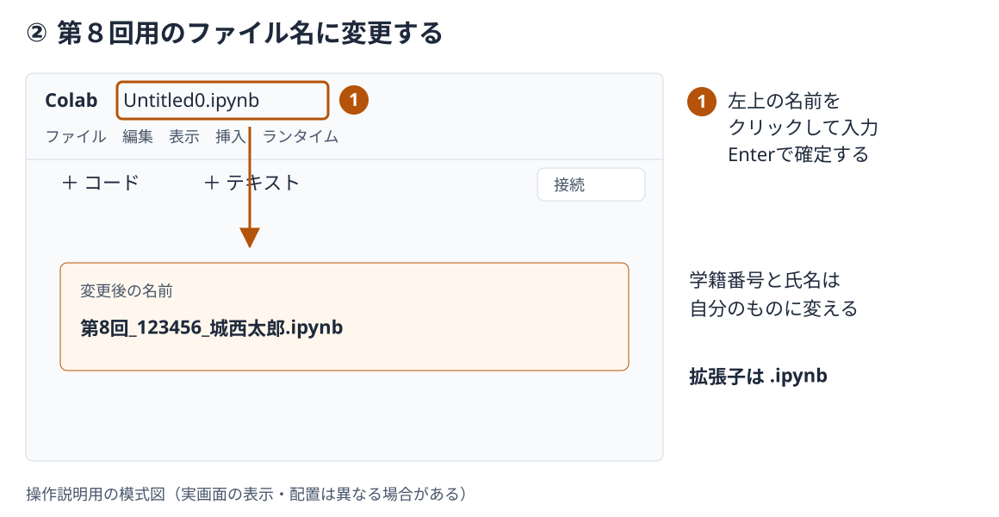
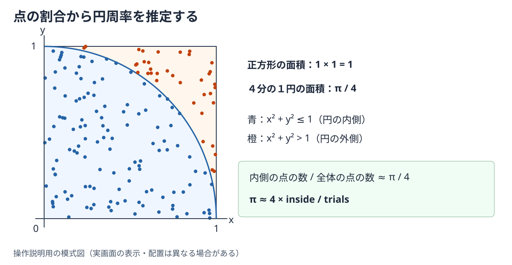

# 第8回　数値計算3：Google Colabによる計算

### 到達目標

- Google ColabでNotebookを作成し，コードの実行，説明の記入，ファイルの保存・ダウンロードができる．
- Pythonで整数と実数の乱数を生成できる．
- シードと実行順序が再現性に与える影響を説明できる．
- サイコロのシミュレーションを作成し，相対度数と確率を比較できる．
- モンテカルロ法で円周率と定積分を近似できる．
- 試行回数と絶対誤差の関係を調べ，計算結果をCSVファイルへ保存できる．

### 前回の復習

第7回では，前進差分と中心差分で微分係数を近似し，区分求積法と台形公式で定積分を近似した．**絶対誤差は，近似値と正確な値との差の絶対値**であり，二つの方法の精度を比較するために使った．

次のコードは，台形公式で$\int_0^1x^2\,dx=1/3$を近似し，絶対誤差を求める例である．

```python
def trapezoidal(f, a, b, n):
    h = (b - a) / n
    total = (f(a) + f(b)) / 2

    for i in range(1, n):
        total = total + f(a + i * h)

    return h * total

def f(x):
    return x ** 2

value = trapezoidal(f, 0, 1, 100)
print(value)
print(abs(value - 1 / 3))
```

````{dropdown} コードの補足
- `f`は積分する関数を表す．`trapezoidal`へは，関数，積分区間の両端，分割数を渡す．
- `h`は小区間の幅である．両端の関数値を半分ずつ加え，内側の関数値を加えてから`h`を掛ける．
- `abs(value - 1 / 3)`で，数学的に求めた正確な値に対する絶対誤差を計算する．
````

````{dropdown} 出力例
```text
0.33335000000000004
1.6666666666720342e-05
```
````

今回は，規則的に並べた点の代わりに，**乱数で選んだ点や，多数の試行の結果から値を推定する**．前回と同じ積分も扱い，近似の仕組みと誤差の現れ方を比較する．

### 前回の課題の解答例

1. [課題1「数値微分の絶対誤差の比較」の解答例](./7_numerical2.md#assignment-7-1-answer)
2. [課題2「数値積分とCSVファイルへの保存」の解答例](./7_numerical2.md#assignment-7-2-answer)

### Google Colabの準備

Google Colabは，WebブラウザでPythonのNotebookを作成・実行できるサービスである．今回はAnaconda Navigatorを起動せず，Colabで第8回用のNotebookを作成する．

| 操作・保存場所 | 第7回までのJupyter Notebook | 今回のGoogle Colab |
| --- | --- | --- |
| 起動方法 | Anaconda Navigatorから起動 | WebブラウザでColabを開く |
| Pythonを実行する場所 | 自分のパソコン | Googleが用意する実行環境（ランタイム） |
| Notebookの保存先 | `Documents（書類）/Fresh2` | ログインしたアカウントのGoogle Drive |
| `open`で作成したCSVの保存先 | パソコン上の作業フォルダ | ランタイム内の作業フォルダ（通常は`/content`） |
| WebClassへの提出 | 保存したファイルを提出 | NotebookとCSVをパソコンへダウンロードして提出 |

以下の画像は，クリックする場所を示した**操作説明用の模式図**である．実画面では，言語設定や更新によって名称・配置が異なる場合がある．

#### 1．ログインしてNotebookを新規作成する

1. Webブラウザで[Google Colab](https://colab.research.google.com/)を開く．
2. ログインを求められたら，大学から指定されたGoogleアカウントでログインする．右上のアカウントアイコンから，使用中のアカウントを確認する．
3. 「ノートブックを開く」画面の「ノートブックを新規作成」をクリックする．
4. すでにNotebookが開いている場合は，「ファイル」→「ノートブックを新規作成」から作成する．


```{tip} 注意：大学のGoogleアカウント
個人用アカウントではなく，大学から指定されたGoogleアカウントでログインする．共有端末ではログインしたままにしない．
```

#### 2．ファイル名を変更する

1. 画面左上の`Untitled0.ipynb`などのファイル名をクリックする．
2. `第8回_<学籍番号>_<氏名>.ipynb`へ変更し，`Enter`で確定する．`<学籍番号>`と`<氏名>`は自分のものへ置き換える．
3. 変更後の名前が画面左上に表示されていることを確認する．第7回のNotebookへ追記せず，第8回用のNotebookを作ること．



#### 3．Codeセルを実行し，テキストセルを追加する

1. Codeセルへ次のコードを入力する．セルがない場合は，画面上部の「＋ コード」をクリックする．

   ```python
   print(1 + 2)
   ```

2. セル左の実行ボタン（▶）をクリックするか，`Shift`+`Enter`を押す．初回はランタイムへの接続に少し時間がかかるため，完了するまで待つ．接続されない場合は，右上の「接続」をクリックする．
3. セルの下に`3`と表示されることを確認する．
4. 「＋ テキスト」をクリックし，次の内容を自分の学籍番号・氏名に置き換えて入力する．Colabの**テキストセルは，第7回までのMarkdownセルに相当する**．

   ```markdown
   # 第8回　数値計算3
   学籍番号：123456　氏名：城西太郎
   ```

5. テキストセルで`Shift`+`Enter`を押し，見出しと本文が表示されることを確認する．以後，演習・課題の見出しと考察もテキストセルへ記入する．


```{tip} 注意：セルの実行順序
関数を定義したセルや`import`を書いたセルは，その関数を使うセルより先に実行する．ランタイムが新しくなると，変数・関数の定義は失われる．画面に以前の出力が残っていても，計算を再開するときは上から順にセルを実行する．今回の計算は標準のCPUで実行できる．
```

#### 4．Notebookを保存・ダウンロードする

作成したNotebookはGoogle Driveへ保存される．作業の途中と終了時に「ファイル」→「保存」を選び，保存の完了を確認する．再開するときは，同じアカウントでColabを開き，最近使用したNotebookなどから第8回のファイルを開く．

WebClassへ提出するときは，次の操作でパソコンへダウンロードする．

1. 提出するCodeセルを実行し，結果が表示されていることを確認して保存する．
2. 「ファイル」→「ダウンロード」→「.ipynbをダウンロード」を選ぶ．
3. パソコンのダウンロードフォルダなどで，`第8回_<学籍番号>_<氏名>.ipynb`が保存されたことを確認する．


#### 5．計算で作成したCSVをダウンロードする

課題2では，計算結果を`monte_carlo.csv`へ書き込む．**Notebookを保存しても，ランタイム内のCSVが自動的にGoogle Driveへ保存されるわけではない**．課題2が完成したら，次の操作も行う．

1. CSVへ書き込むCodeセルを実行する．
2. 左側のフォルダアイコンをクリックし，「ファイル」一覧を開く．
3. `monte_carlo.csv`が表示されていることを確認する．表示されない場合は，一覧の更新ボタンをクリックする．
4. ファイル名の右側の「⋮」（または右クリックのメニュー）から「ダウンロード」を選ぶ．
5. パソコンに`monte_carlo.csv`が保存されたことを確認する．


```{tip} 注意：ランタイム内のファイル
ランタイムが削除されると，その中のCSVも失われる．講義終了前にNotebookとCSVの両方をダウンロードする．CSVがなくなった場合は，必要な関数の定義から順に実行し，課題2の計算・保存をやり直す．
```

````{dropdown} CSVをコードからダウンロードする方法
ファイル一覧からの操作の代わりに，CSVを作成した後，別のCodeセルで次を実行してもよい．このコードはGoogle Colab専用である．

```python
from google.colab import files

files.download("monte_carlo.csv")
```
````

保存場所とランタイムについては，[Google Colab公式FAQ](https://research.google.com/colaboratory/intl/ja/faq.html)も参照できる．

## 乱数

サイコロを振るとき，出目は毎回決まっているわけではない．このような試行をプログラムで扱うために乱数を使う．

- **乱数**：各値が現れる確率の規則に従い，不規則に得られる数．
- **疑似乱数**：一定の計算手順によって生成した，乱数のように見える数列．Pythonの標準ライブラリ`random`モジュールは，疑似乱数を生成する．

### 整数と実数の乱数

```python
import random

print(random.random())
print(random.randint(1, 6))
print(random.uniform(-1, 1))
```

| 関数 | 生成する値 | 用途の例 |
| --- | --- | --- |
| `random.random()` | 0以上1未満の実数 | 単位正方形内の座標を選ぶ |
| `random.randint(a, b)` | `a`以上`b`以下の整数（両端を含む） | サイコロの出目を選ぶ |
| `random.uniform(a, b)` | 区間`a`から`b`の一様な実数 | 積分区間の点を選ぶ |

**一様**とは，整数なら各値の選ばれやすさが等しく，実数なら同じ長さの小区間に入る確率が等しいことをいう．`random.uniform(a, b)`の上端`b`は，浮動小数点数の丸めによって含まれる場合と含まれない場合がある．

````{dropdown} コードの補足
- `import random`は，`random`モジュールを使う準備である．Colabに追加でインストールする必要はない．
- `random.randint(1, 6)`は1から6までのいずれかを返す．`range(1, 6)`は6を含まないため，範囲の扱いを混同しないこと．
- シードを設定せずに実行すると，通常は実行するたびに異なる値が表示される．
````

### シードと再現性

**シード**：疑似乱数の生成を開始するために与える初期値．同じシードを設定し，同じ順序で乱数を生成すると，同じ乱数列を再現できる．

```python
import random

random.seed(10)

for _ in range(5):
    print(random.randint(1, 6))
```

````{dropdown} 出力例
```text
5
1
4
4
5
```
````

このセル全体をもう一度実行すると，`random.seed(10)`からやり直すため，同じ5個の値が表示される．シードを設定せずに乱数を生成する部分だけを実行すると，続きの乱数が生成される．

```{tip} 注意：シードを設定する位置
シードは，一連の試行を始める前に設定する．サイコロを1回振るたびに同じシードを設定すると，毎回乱数列の先頭に戻り，同じ出目ばかりが生成されてしまう．また，同じシードでも，途中で別の乱数を生成すれば，その後の結果は変わる．
```

````{note} 演習1
シードによる再現性を確認せよ．

次のコードにある2か所の`_____`を適切な値または関数名へ書き換え，同じ乱数列が2回表示されることを確認せよ．
続いて，シードを別の整数へ変更し，結果がどう変わるかをテキストセルに説明せよ．

```python
import random

for _ in range(2):
    random.seed(_____)
    values = []
    for _ in range(5):
        values.append(random._____())
    print(values)
```

**出力例**

```text
[0.5714025946899135, 0.4288890546751146, 0.5780913011344704, 0.20609823213950174, 0.81332125135732]
[0.5714025946899135, 0.4288890546751146, 0.5780913011344704, 0.20609823213950174, 0.81332125135732]
```
````

````{hidden-answer} 解答例
```python
import random

for _ in range(2):
    random.seed(10)
    values = []
    for _ in range(5):
        values.append(random.random())
    print(values)
```

`seed(10)`を外側のfor文の中で実行するため，5個の乱数を生成する操作を，同じ初期状態から2回繰り返している．シードを変えると乱数列は変わるが，新しいシードでも2行は一致する．
````

## サイコロのシミュレーション

**シミュレーション**：現実の現象や試行を，規則に基づく計算によって模擬することである．ここでは，整数の乱数を使ってサイコロを繰り返し振る試行を模擬する．

公平なサイコロでは，各出目の確率は$1/6$である．ただし，6000回振ったときに，各出目が必ず1000回ずつ現れるわけではない．

```python
import random

random.seed(10)
trials = 6000
counts = [0, 0, 0, 0, 0, 0]

for _ in range(trials):
    value = random.randint(1, 6)
    counts[value - 1] = counts[value - 1] + 1

print(counts)
```

````{dropdown} コードの補足
- `counts`の六つの要素に，1から6までの出目の回数を保存する．最初はすべて0にする．
- 出目が1なら添字は0，出目が6なら添字は5なので，`counts[value - 1]`へ1を加える．
- `for _ in range(trials)`で，サイコロを振って記録する処理を`trials`回繰り返す．`_`は，繰り返しの変数を処理の中で使わないときの慣用的な名前である．
- 六つの回数の合計は，試行回数`trials`と一致する．
````

**相対度数**：ある結果が現れた回数を，試行回数全体で割った値である．

$$
\text{出目が}k\text{の相対度数}=\frac{\text{出目が}k\text{の回数}}{\text{試行回数}}
$$

たとえば，1000回のうち1が159回出たなら，相対度数は$159/1000=0.159$である．試行回数を増やすと，各出目の相対度数は$1/6\approx0.1667$に近づく傾向がある．回数そのものの差よりも，**全体に対する割合を比較する**ことが大切である．

````{note} 演習2
サイコロを1000回振るシミュレーションを実行せよ．

次のコードにある4か所の`_____`を適切な値，関数名または式へ書き換えよ．
実行後，各出目の回数の合計が1000になることを確認し，相対度数がすべて$1/6$に一致しない理由をテキストセルに説明せよ．

```python
import random

random.seed(10)
trials = _____
counts = [0, 0, 0, 0, 0, 0]

for _ in range(trials):
    value = random._____(1, 6)
    counts[value - 1] = counts[value - 1] + 1

for face in range(1, _____):
    print(f"{face}: {counts[face - 1]}回，相対度数 {counts[face - 1] / _____}")
```

**出力例**

```text
1: 159回，相対度数 0.159
2: 170回，相対度数 0.17
3: 141回，相対度数 0.141
4: 198回，相対度数 0.198
5: 165回，相対度数 0.165
6: 167回，相対度数 0.167
```
````

````{hidden-answer} 解答例
```python
import random

random.seed(10)
trials = 1000
counts = [0, 0, 0, 0, 0, 0]
for _ in range(trials):
    value = random.randint(1, 6)
    counts[value - 1] = counts[value - 1] + 1

for face in range(1, 7):
    print(f"{face}: {counts[face - 1]}回，相対度数 {counts[face - 1] / trials}")
```

六つの回数の合計は1000であり，相対度数の合計は1になる（浮動小数点数では丸め誤差が含まれることがある）．公平なサイコロでも，有限回の試行では偶然によるばらつきが生じるため，各出目の相対度数は$1/6$と完全には一致しない．
````

## モンテカルロ法

**モンテカルロ法**：乱数を使った多数の試行から，求めたい量を数値的に推定する方法である．ここでは，一辺の長さが1の正方形$0\leq x\leq1$，$0\leq y\leq1$に点を発生させ，原点を中心とする半径1の円の内側に入った割合から円周率を近似する．

### 円の面積と点の割合



1. 正方形の面積は$1\times1=1$である．
2. 正方形に含まれる4分の1円の面積は$\pi/4$である．
3. 点を一様に選べば，円の内側に入る確率は面積の比$\pi/4$に等しい．
4. 内側に入った点の相対度数でその確率を近似し，4倍すれば円周率を推定できる．

$$
\frac{\text{内側に入った点の数}}{\text{全体の点の数}}\approx\frac{\pi}{4},\qquad
\pi\approx4\frac{\text{内側に入った点の数}}{\text{全体の点の数}}
$$

### Pythonによる実装

```python
import random

random.seed(10)
trials = 10000
inside = 0

for _ in range(trials):
    x = random.random()
    y = random.random()

    if x ** 2 + y ** 2 <= 1:
        inside = inside + 1

pi = 4 * inside / trials
print(pi)
```

````{dropdown} コードの補足
- `x`と`y`をそれぞれ`random.random()`で選ぶと，正方形内の点を一様に生成できる．
- 原点からの距離は$\sqrt{x^2+y^2}$である．距離が1以下という条件は，`x ** 2 + y ** 2 <= 1`で判定できる．
- `inside`は条件を満たした点の個数である．`inside / trials`は内側に入った点の相対度数になる．
- この例では`pi`を近似値の変数名としている．後の演習では，`math.pi`を正確な値の基準として絶対誤差を求める．
````

````{note} 演習3
試行回数`1000`，`10000`，`100000`について円周率を近似せよ．

次のコードにある4か所の`_____`を適切な関数名または式へ書き換えよ．
実行後，試行回数，近似値，絶対誤差をテキストセルの表にまとめよ．

```python
import math
import random

def approximate_pi(trials):
    inside = 0
    for _ in range(trials):
        x = random._____()
        y = random._____()
        if x ** 2 + y ** 2 <= 1:
            inside = inside + 1
    return _____ * inside / trials

random.seed(10)
for trials in [1000, 10000, 100000]:
    value = approximate_pi(trials)
    print(trials, value, abs(value - math._____))
```

**出力例**

```text
1000 3.104 0.037592653589793024
10000 3.1604 0.018807346410206982
100000 3.1414 0.00019265358979314584
```
````

````{hidden-answer} 解答例
```python
import math
import random

def approximate_pi(trials):
    inside = 0
    for _ in range(trials):
        x = random.random()
        y = random.random()
        if x ** 2 + y ** 2 <= 1:
            inside = inside + 1
    return 4 * inside / trials

random.seed(10)
for trials in [1000, 10000, 100000]:
    value = approximate_pi(trials)
    print(trials, value, abs(value - math.pi))
```

`approximate_pi`は，試行回数を受け取り，円周率の近似値を返す．この例では，試行回数を増やすと絶対誤差が小さくなっている．ただし，乱数による推定なので，別のシードでも同じ順序で誤差が減るとは限らない．
````

## モンテカルロ積分

### 関数値の平均から面積を求める

第7回の区分求積法では，等間隔に並べた点の関数値を長方形の高さに使った．モンテカルロ積分では，**区間内から乱数で選んだ点の関数値の平均**を使う．関数の平均の高さに区間の幅を掛けて，定積分を近似する．

区間$[a,b]$から独立に一様に選んだ$N$個の点を$x_1,x_2,\ldots,x_N$とすると，次の式になる．

$$
\int_a^b f(x)\,dx\approx(b-a)\frac{1}{N}\sum_{i=1}^{N}f(x_i)
$$

たとえば，$\int_0^1x^2\,dx$では，0から1の点を選んで二乗し，その平均を求める．区間の幅が1なので，この平均がそのまま積分の近似値になる．一方，$\int_0^\pi\sin x\,dx$では，平均に区間の幅$\pi$を掛ける必要がある．

### Pythonによる実装

```python
import random

def monte_carlo_integral(f, a, b, trials):
    total = 0
    for _ in range(trials):
        x = random.uniform(a, b)
        total = total + f(x)
    return (b - a) * total / trials
```

````{dropdown} コードの補足
- `f`は積分する関数，`a`と`b`は積分区間の両端である．ここでは`a < b`とし，`trials`には正の整数を渡す．
- `random.uniform(a, b)`で積分区間から点を選び，その点での関数値`f(x)`を`total`へ加える．
- `total / trials`で関数値の平均を求め，区間の幅`b - a`を掛ける．
- 関数の中でシードを設定せず，呼び出す側で一連の計算を始める前に設定する．
````

````{note} 演習4
$\int_0^1x^2\,dx=1/3$をモンテカルロ法で近似せよ．

次のコードにある2か所の`_____`を適切な式または関数名へ書き換えよ．
`monte_carlo_integral`を定義したセルを先に実行すること．実行後，前回の復習で計算した台形公式（分割数100）の絶対誤差とも比較し，気づいたことをテキストセルに記入せよ．

```python
import random

def f(x):
    return _____

random.seed(10)
for trials in [1000, 10000, 100000]:
    value = _____(f, 0, 1, trials)
    print(trials, value, abs(value - 1 / 3))
```

**出力例**

```text
1000 0.3337151169125422 0.00038178357920887196
10000 0.3306476291650284 0.0026857041683049365
100000 0.33240785623516284 0.0009254770981704796
```
````

````{hidden-answer} 解答例
```python
import random

def f(x):
    return x ** 2

random.seed(10)
for trials in [1000, 10000, 100000]:
    value = monte_carlo_integral(f, 0, 1, trials)
    print(trials, value, abs(value - 1 / 3))
```

この結果では，試行回数10000の絶対誤差は1000のときより大きい．乱数で選んだ点が異なるため，**試行回数を増やすたびに必ず正確になるわけではない**．また，この滑らかな1変数関数では，台形公式の分割数100の絶対誤差（約$1.67\times10^{-5}$）が，いずれのモンテカルロ積分の結果よりも小さい．
````

### 試行回数と誤差

```{tip} 注意：モンテカルロ法の誤差
乱数による推定では，有限回の試行で生じる**統計的なばらつき**がある．第7回の丸め誤差も含まれるが，今回の例でシードごとに結果が変わる主な理由は，選ばれた点や出目が異なることである．

独立な試行で関数値の分散が有限の場合，誤差の典型的な大きさは$1/\sqrt{N}$に比例して小さくなる．目安として，誤差を約10分の1にするには約100倍の試行が必要になる．これは多くの試行の統計的な傾向であり，1回ごとの誤差の上限や，単調な減少を保証するものではない．
```

| 比較する点 | 第7回の台形公式 | 今回のモンテカルロ積分 |
| --- | --- | --- |
| 点の選び方 | 等間隔に並べる | 乱数で一様に選ぶ |
| 再実行の結果 | 同じ関数・区間・分割数なら同じ値 | 同じシードと乱数の生成順序なら再現できる |
| 誤差の目安 | 十分滑らかな関数では$O(n^{-2})$ | 独立な試行では典型的に$O(N^{-1/2})$ |
| 計算量 | 分割数$n$にほぼ比例 | 試行回数$N$にほぼ比例 |

この授業で扱う滑らかな1変数関数の積分では，台形公式は少ない関数評価で高い精度を得やすい．モンテカルロ法は，確率的な現象の模擬や，多次元の領域など規則的な分割が難しい問題にも利用できる．

````{dropdown} 発展：シードによるばらつきを調べる
同じ試行回数でも結果が変わることを確認するには，演習4の後で次を実行する．

```python
import random

def f(x):
    return x ** 2

for seed in [10, 20, 30]:
    random.seed(seed)
    value = monte_carlo_integral(f, 0, 1, 10000)
    print(seed, value, abs(value - 1 / 3))
```

シードを変えると，試行回数は同じでも近似値と絶対誤差が変わる．一つのシードの結果だけから，一般的な精度を断定しないこと．
````

## エラーが出たときにチェックすること

| 症状 | 確認すること |
| --- | --- |
| `NameError: name 'random' is not defined` | `import random`を書いたセルを先に実行したか |
| `NameError: name 'monte_carlo_integral' is not defined` | 関数を定義したセルを実行したか．ランタイムが新しくなっていないか |
| `IndexError: list index out of range` | 出目`value`を添字へ変換するとき，`value - 1`にしているか |
| `ZeroDivisionError` | 試行回数が0になっていないか．正の整数を指定しているか |
| `SyntaxError` | `_____`や`【　】`を残していないか．全角の括弧・記号を使っていないか |
| `FileNotFoundError`，CSVが見つからない | CSVを作成するセルを実行したか．ファイル名が一致しているか |

### エラーが表示されない誤動作

- すべて同じ出目になる場合は，サイコロを振るfor文の内側で毎回`random.seed`を実行していないか確認する．
- 出目の回数の合計が試行回数と一致しない場合は，`counts`の初期化と，回数へ1を加える処理のインデントを確認する．
- 出力例と異なる場合は，指定されたシードからセル全体を再実行したか，途中に別の乱数生成を追加していないか確認する．浮動小数点数の末尾は実行環境によって少し異なる場合がある．
- 積分の値が大きく異なる場合は，関数値の平均に区間の幅`b - a`を掛けたか確認する．

## 課題

````{warning} 課題1
サイコロを5000回振り，各出目の回数と相対度数を求めよ．

1. テキストセル（Markdownセル）に`# 課題1`と記入し，シードを2026に固定してサイコロを5000回振れ．
2. 各出目の回数と相対度数，最も多く出た目を表示せよ．
3. 各相対度数を$1/6$と比較し，結果をテキストセルに2文程度で説明せよ．

次のテンプレートを基に完成させよ．`【　】`は，1行以上の処理を記述する箇所を表す．

```python
import random

random.seed(2026)
trials = 5000
counts = [0, 0, 0, 0, 0, 0]

【サイコロを5000回振り，各出目の回数を数える処理を記入】

【各出目の回数と相対度数を表示する処理を記入】

most_common = counts.index(max(counts)) + 1
print(f"最も多く出た目: {most_common}")
```

**出力例**

```text
1 863 0.1726
2 791 0.1582
3 875 0.175
4 849 0.1698
5 813 0.1626
6 809 0.1618
最も多く出た目: 3
```
````

(assignment-8-1-answer)=
````{hidden-answer} 解答例
**空欄1：試行と回数の記録**

`randint(1, 6)`で出目を選び，対応するリストの要素へ1を加える．

```python
for _ in range(trials):
    value = random.randint(1, 6)
    counts[value - 1] = counts[value - 1] + 1
```

**空欄2：回数と相対度数の表示**

出目を1から6まで取り出し，回数と，それを試行回数で割った相対度数を表示する．

```python
for face in range(1, 7):
    print(face, counts[face - 1], counts[face - 1] / trials)
```

**完成したコード**

```python
import random

random.seed(2026)
trials = 5000
counts = [0, 0, 0, 0, 0, 0]
for _ in range(trials):
    value = random.randint(1, 6)
    counts[value - 1] = counts[value - 1] + 1

for face in range(1, 7):
    print(face, counts[face - 1], counts[face - 1] / trials)

most_common = counts.index(max(counts)) + 1
print(f"最も多く出た目: {most_common}")
```

`max(counts)`は最大の回数を返す．`counts.index(...)`はその回数が最初に現れる添字を返すので，1を加えて出目に戻す．最大の回数が同じ出目が複数ある場合は，小さい出目を表示する．

各出目の相対度数はおおむね$1/6$に近いが，5000回の試行ではばらつきが残る．シードを固定しているため，同じコードをセル全体から再実行すると同じ結果を再現できる．
````

````{warning} 課題2
$\int_0^\pi\sin x\,dx=2$をモンテカルロ法で近似せよ．

1. テキストセルに`# 課題2`と記入し，シードを2026に固定して，試行回数`1000`，`3000`，`10000`，`30000`で積分を近似せよ．シードは試行回数を変えるfor文の前で一度だけ設定すること．
2. 試行回数，近似値，絶対誤差を表示し，csvモジュールを使って`monte_carlo.csv`へ保存せよ．
3. 試行回数と絶対誤差の関係を，統計的なばらつきにも触れてテキストセルに3文程度で説明せよ．

次のテンプレートを基に完成させよ．`【　】`は，引数全体または1行以上の処理を記述する箇所を表す．本文で定義した`monte_carlo_integral`を先に実行すること．

```python
import csv
import math
import random

def f(【必要な引数をすべて記入】):
    【math.sinを使って関数値を返す処理を記入】

random.seed(2026)
rows = [["trials", "value", "error"]]

【各試行回数の近似値と誤差を求め，表示してrowsへ追加する処理を記入】

【rowsをmonte_carlo.csvへ書き込む処理を記入】
```

**出力例**

```text
1000 2.04419308175357 0.04419308175357006
3000 2.013969214289819 0.01396921428981912
10000 1.9989922132021545 0.0010077867978455224
30000 2.003228663654541 0.0032286636545411085
```
````

(assignment-8-2-answer)=
````{hidden-answer} 解答例
**空欄1：積分する関数**

引数`x`を受け取り，`math.sin(x)`を返す．

```python
def f(x):
    return math.sin(x)
```

**空欄2：試行回数ごとの近似値と絶対誤差**

四つの試行回数について計算し，結果を`rows`へ追加してから表示する．積分区間は$[0,\pi]$であり，正確な値は2である．

```python
for trials in [1000, 3000, 10000, 30000]:
    value = monte_carlo_integral(f, 0, math.pi, trials)
    error = abs(value - 2)
    rows.append([trials, value, error])
    print(trials, value, error)
```

**空欄3：CSVファイルへの保存**

`csv.writer`の`writerows`へ`rows`を渡し，見出し行と四つの計算結果を書き込む．

```python
with open("monte_carlo.csv", "w", encoding="utf-8", newline="") as file:
    writer = csv.writer(file)
    writer.writerows(rows)
```

**完成したコード**

```python
import csv
import math
import random

def f(x):
    return math.sin(x)

random.seed(2026)
rows = [["trials", "value", "error"]]

for trials in [1000, 3000, 10000, 30000]:
    value = monte_carlo_integral(f, 0, math.pi, trials)
    error = abs(value - 2)
    rows.append([trials, value, error])
    print(trials, value, error)

with open("monte_carlo.csv", "w", encoding="utf-8", newline="") as file:
    writer = csv.writer(file)
    writer.writerows(rows)
```

この結果では，試行回数10000までは絶対誤差が減っているが，30000では増えている．乱数を使うため，試行回数を増やしても，毎回単調に絶対誤差が小さくなるとは限らない．一般的な傾向を調べるには，シードを変えて複数回試すなど，統計的なばらつきも考える必要がある．CSVへ保存した結果は，次回の可視化で利用できる．
````

### 提出方法

- WebClassの「第8回課題」から，パソコンへダウンロードした次の2ファイルを提出する．

| 提出するファイル | 内容 |
| --- | --- |
| `第8回_<学籍番号>_<氏名>.ipynb` | 課題1・2のコード，実行結果，テキストセルによる考察 |
| `monte_carlo.csv` | 見出し`trials,value,error`と，四つの試行回数の計算結果 |

- ファイル名の学籍番号・氏名が自分のものになっていることを確認する．
- すべてのCodeセルを上から順に実行し，出力を表示した状態でNotebookを保存・ダウンロードする．
- 課題1について，六つの出目の回数・相対度数と，最も多く出た目が表示されていることを確認する．
- 課題2について，四つの試行回数・近似値・絶対誤差がNotebookとCSVに保存されていることを確認する．
- 課題1・2の後に，結果を説明するテキストセルがあることを確認する．
- 提出直前にコードや考察を直した場合は，再実行・保存し，最新版のNotebookとCSVをダウンロードする．

### 提出期限

<span style="color: red; ">11月20日(金)23:59まで</span>

質問等がある場合には

- メール kkagawa@josai.ac.jp
- Teamsのチャット
- WebClassのメッセージ

などで連絡してください．

## まとめ

1. **Colabでは保存場所を区別する**：NotebookはGoogle Driveに保存されるが，計算で作成したCSVはランタイム内にあるため，別にダウンロードする．
2. **疑似乱数で不確実な現象を模擬できる**：サイコロの出目を生成し，相対度数から確率との関係を調べられる．
3. **シードと処理順序が再現性を与える**：同じシードから同じ順序で乱数を生成すると，同じ結果を再現できる．
4. **モンテカルロ法は割合や平均から値を推定する**：点の割合から円周率を，関数値の平均から定積分を近似できる．
5. **統計的なばらつきを考えて精度を評価する**：試行回数を増やすと誤差は小さくなる傾向があるが，毎回単調に減るとは限らない．

- 次回はシミュレーション結果をグラフで可視化する．
