# 第9回　可視化

### 到達目標

- **グラフの選択**：変化・関係・分布・項目の比較という目的に合わせてグラフを選べる．
- **Matplotlibの基本**：数値のリストからグラフを描き，軸の意味と図の内容を示せる（軸ラベル・タイトル・凡例）．
- **散布図**：二つの数値を点で表し，どのような関係が見えるかを説明できる．
- **棒グラフとヒストグラム**：項目ごとの大きさや値の集まり方を図で比較できる．
- **複数のデータと対数目盛**：同じ図で結果を比べ，桁が異なる値の変化を読み取れる．
- **CSVの読み込みと図の保存**：前回の計算結果をグラフにし，画像ファイルへ保存できる．

### 前回の復習

第8回では不規則に選んだ数を使ってサイコロを振る計算や積分の近似を行った．課題1では12面体サイコロの各出目の回数を数え，課題2では積分の近似値と絶対誤差をCSVへ保存した．

**可視化**：データをグラフや図で表し，数値だけでは捉えにくい傾向やばらつきを確認しやすくすること．

今回は**計算結果をグラフに変え，図のどこから何が読み取れるかを説明する**．

### 前回の課題の解答例

1. [課題1「12面体サイコロ」の解答例](./8_numerical3_colab.md#assignment-8-1-answer)
2. [課題2「手計算とモンテカルロ積分」の解答例](./8_numerical3_colab.md#assignment-8-2-answer)
3. [発展的課題「台形公式とモンテカルロ積分の比較」の解答例](./8_numerical3_colab.md#assignment-8-advanced-answer)

## 計算環境とファイルの準備

### 第9回のNotebookを作成する

Google ColabまたはJupyter Notebookで第9回用のNotebookを新規作成し，`第9回_<学籍番号>_<氏名>.ipynb`という名前で保存する．Jupyter Notebookでは`Documents（書類）/Fresh2`を作業フォルダとする．

最初のMarkdownセルに次を記入する．

```markdown
# 第9回　可視化
学籍番号：123456　氏名：城西太郎
```

Colabの操作は[第8回の準備手順と操作動画](./8_numerical3_colab.md#google-colab)を参照できる．

### 第8回のCSVを使える状態にする

第8回で保存した`monte_carlo.csv`を用意する．内容は次の3列であり，見出し行の後に四つの試行回数の結果が並ぶ．

| 列 | 内容 | Pythonで取り出す位置 |
| --- | --- | --- |
| `trials` | 試行回数 | `row[0]` |
| `value` | 積分の近似値 | `row[1]` |
| `error` | 手計算の値に対する絶対誤差 | `row[2]` |

- **Google Colab**：左側のフォルダアイコンから「ファイル」を開き，アップロードのボタンで`monte_carlo.csv`を選ぶ．
- **Jupyter Notebook**：第9回のNotebookと同じフォルダへ`monte_carlo.csv`を置く．JupyterLabのファイル一覧へアップロードしてもよい．

**ランタイム**：Notebookのコードを実行し，変数・関数の定義や計算で作成したファイルを一時的に保持する計算環境．Colabで新しいランタイムに接続した場合はCSVを再びアップロードする．

````{dropdown} CSVが手元にない場合
第8回課題2の計算を次のコードで再実行すると，現在の作業フォルダへ`monte_carlo.csv`を作成できる．

```python
import csv
import math
import random

def monte_carlo_integral(f, a, b, trials):
    total = 0
    for _ in range(trials):
        x = random.uniform(a, b)
        total += f(x)
    return (b - a) * total / trials

random.seed(2026)
rows = [["trials", "value", "error"]]

for trials in [1000, 3000, 10000, 30000]:
    value = monte_carlo_integral(math.sin, 0, math.pi, trials)
    rows.append([trials, value, abs(value - 2)])

with open("monte_carlo.csv", "w", encoding="utf-8", newline="") as file:
    writer = csv.writer(file)
    writer.writerows(rows)
```
````

## グラフの選択

**横軸と縦軸が何を表すか，何を比べたいか**を先に決める．

| 確認したいこと | グラフ | この授業での例 |
| --- | --- | --- |
| 時間や順序のある数値に伴う変化 | 折れ線グラフ | 試行回数と絶対誤差 |
| 二つの数値の関係 | 散布図 | 身長と歩幅 |
| 項目ごとの大きさ | 棒グラフ | サイコロの各出目の回数 |
| 値がどの範囲に多く集まるか | ヒストグラム | 不規則に選んだ実数の分布 |

- **折れ線グラフ**：横軸の順に点を線で結び，値の変化を示すグラフ．
- **散布図**：二つの数値を横軸と縦軸に取り，点の位置で関係を示すグラフ．
- **棒グラフ**：項目ごとの値を棒の長さで比較するグラフ．
- **ヒストグラム**：数値の範囲を区間に分け，各区間に含まれるデータの個数を示すグラフ．

## Matplotlibの基本

**Matplotlib**：Pythonでグラフを作成するためのライブラリ．

**ライブラリ**：よく使う機能を再利用できる形でまとめたプログラムの集まり．

### 図と描画領域を作る

```python
import matplotlib.pyplot as plt

x = [1, 2, 3, 4, 5]
y = [1, 4, 9, 16, 25]

fig, ax = plt.subplots()
ax.plot(x, y, marker="o", label="y = x^2")
ax.set_xlabel("x")
ax.set_ylabel("y")
ax.set_title("Square numbers")
ax.legend()
ax.grid()
plt.show()
```

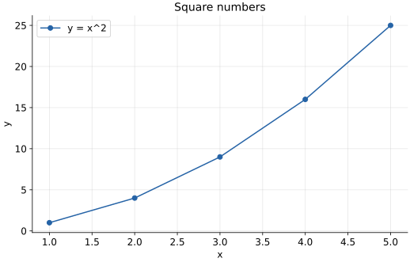

````{dropdown} コードの補足
- `import matplotlib.pyplot as plt`はグラフを描く機能を`plt`という名前で使う準備．
- `fig`：図全体を表す変数．`fig, ax = plt.subplots()`で図と描画領域を作る．
- `ax`：データを描く領域と横軸・縦軸を扱う変数．`ax.plot`などを使って描く内容を指定する．
- `x`と`y`の同じ位置の要素が一つの点になる．この例では`(1, 1)`，`(2, 4)`，…，`(5, 25)`の5点．
- `marker="o"`は各点に丸印を付ける指定．`plt.show()`で図を表示する．
````

### グラフの意味を伝える表示

| 表示 | 意味 | 設定するコード |
| --- | --- | --- |
| 軸ラベル | 横軸・縦軸が表す量と単位 | `ax.set_xlabel(...)`，`ax.set_ylabel(...)` |
| タイトル | 図が何を表すかを示す見出し | `ax.set_title(...)` |
| 凡例 | 線や点とデータの対応を示す説明 | 描画時の`label=...`と`ax.legend()` |
| グリッド | 値の位置を読み取りやすくする補助線 | `ax.grid()` |

図中では`Height (cm)`のように量と単位を合わせて書く．本講義のコードでは英数字のラベルを使う．

````{note} 演習1
$x=-3,-2,-1,0,1,2,3$における$y=x^3$を計算し，点を線で結んだグラフを描け．横軸を`x`，縦軸を`y`とし，タイトルとグリッドを付けて表示せよ．

```python
import matplotlib.pyplot as plt

x = [-3, -2, -1, 0, 1, 2, 3]
y = []
for value in x:
    y.append(value ** _____)

fig, ax = plt.subplots()
ax._____(x, y, marker="o")
ax.set_xlabel("x")
ax.set_ylabel("y")
ax.set_title("y = x^3")
ax._____()
plt._____()
```

**出力例**

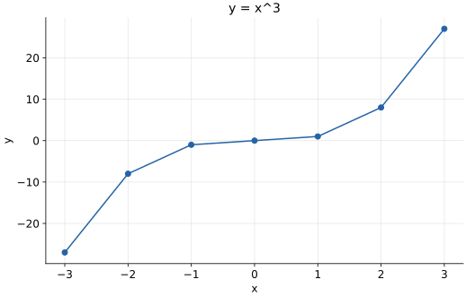
````

````{hidden-answer} 解答例
```python
import matplotlib.pyplot as plt

x = [-3, -2, -1, 0, 1, 2, 3]
y = []
for value in x:
    y.append(value ** 3)

fig, ax = plt.subplots()
ax.plot(x, y, marker="o")
ax.set_xlabel("x")
ax.set_ylabel("y")
ax.set_title("y = x^3")
ax.grid()
plt.show()
```
````

## 散布図

観測した二つの数値の関係を調べるときは`ax.scatter`で点を描く．次の値は描き方を確認するための架空のデータである．

```python
import matplotlib.pyplot as plt

hours = [1, 2, 3, 4, 5, 6]
scores = [48, 55, 63, 70, 78, 84]

fig, ax = plt.subplots()
ax.scatter(hours, scores)
ax.set_xlabel("Study hours")
ax.set_ylabel("Score")
ax.set_title("Study hours and scores")
ax.grid()
plt.show()
```

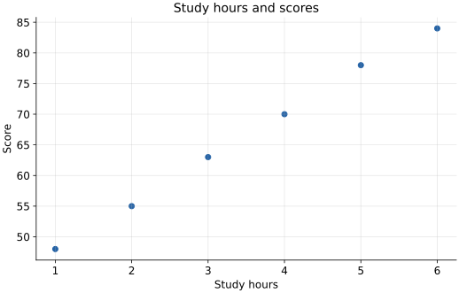

この図では右側ほど点が上にあり，勉強時間が長い人ほど点数が高いという関係が見える．

```{tip} 相関関係と因果関係
**相関関係**：二つの数値が関連して変化する関係．**因果関係**：一方の変化が他方の変化を引き起こす関係．

この散布図で分かるのは勉強時間と点数の対応である．勉強の方法や事前の理解度なども点数に関わるため，勉強時間だけの効果を確かめるには他の条件をそろえるなどの調査が必要になる．
```

````{note} 演習2
身長`[150, 155, 160, 165, 170, 175]`cmと歩幅`[60, 62, 65, 67, 70, 72]`cmの散布図を描け．横軸を身長，縦軸を歩幅とし，それぞれ単位を記入せよ．タイトルを付け，図から読み取れる関係をMarkdownセルに1文で説明せよ．この値は描画用の架空のデータである．

```python
import matplotlib.pyplot as plt

heights = [150, 155, 160, 165, 170, 175]
steps = [60, 62, 65, 67, 70, 72]

fig, ax = plt.subplots()
ax._____(heights, steps)
ax.set_xlabel("_____ (cm)")
ax.set_ylabel("_____ (cm)")
ax.set_title("Height and step length")
ax.grid()
plt.show()
```

- `heights`：身長を保存するリスト．
- `steps`：同じ位置の人の歩幅を保存するリスト．

**出力例**

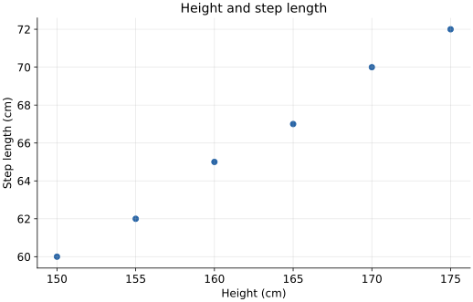
````

````{hidden-answer} 解答例
```python
import matplotlib.pyplot as plt

heights = [150, 155, 160, 165, 170, 175]
steps = [60, 62, 65, 67, 70, 72]

fig, ax = plt.subplots()
ax.scatter(heights, steps)
ax.set_xlabel("Height (cm)")
ax.set_ylabel("Step length (cm)")
ax.set_title("Height and step length")
ax.grid()
plt.show()
```

**Markdownの記入例**

```markdown
身長150cmの人の歩幅は60cm，175cmの人では72cmであり，このデータでは身長が高い人ほど歩幅が長い傾向が見える．
```
````

## 棒グラフとヒストグラム

### 棒グラフ：項目ごとの大きさを比べる

サイコロの各出目やクラスごとの人数のように，項目ごとの値を比べるときは`ax.bar`を使う．

```python
import matplotlib.pyplot as plt

labels = ["A", "B", "C", "D"]
values = [12, 18, 10, 15]

fig, ax = plt.subplots()
bars = ax.bar(labels, values)
ax.bar_label(bars, padding=3)
ax.set_xlabel("Group")
ax.set_ylabel("Count")
ax.set_title("Counts by group")
ax.set_ylim(0, 21)
plt.show()
```

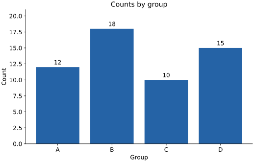

- `bars`：描いた棒をまとめて扱う変数．
- `ax.bar_label(bars, padding=3)`は棒の端に値を表示する指定．`padding`は棒から文字までの間隔．
- `ax.set_ylim(0, 21)`は縦軸の下端を0，上端を21にする指定．数値が図の上端に重ならないよう余白を取る．

````{note} 演習3
公平な6面体サイコロを1000回振り，各出目の回数を棒グラフで表示せよ．シードを9に固定し，横軸には1から6までのすべての出目を表示すること．結果の特徴をMarkdownセルに2文で説明せよ．

- `counts`：各出目の回数を1から6の順に保存するリスト．
- `faces`：棒を描く位置となる1から6までの整数のリスト．

```python
import random
import matplotlib.pyplot as plt

random.seed(9)
counts = [0] * 6
for _ in range(1000):
    value = random.randint(_____, _____)
    counts[value - 1] += 1

faces = [1, 2, 3, 4, 5, 6]
fig, ax = plt.subplots()
ax._____(faces, counts)
ax.set_xticks(_____)
ax.set_xlabel("Face")
ax.set_ylabel("Count")
ax.set_title("Results of 1000 dice rolls")
plt.show()
```

**出力例**

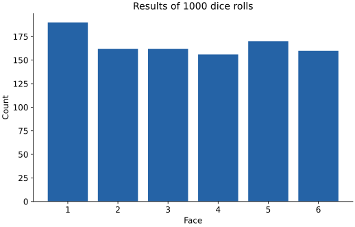
````

````{hidden-answer} 解答例
```python
import random
import matplotlib.pyplot as plt

random.seed(9)
counts = [0] * 6
for _ in range(1000):
    value = random.randint(1, 6)
    counts[value - 1] += 1

faces = [1, 2, 3, 4, 5, 6]
fig, ax = plt.subplots()
ax.bar(faces, counts)
ax.set_xticks(faces)
ax.set_xlabel("Face")
ax.set_ylabel("Count")
ax.set_title("Results of 1000 dice rolls")
plt.show()
```

**Markdownの記入例**

```markdown
最も多い1は190回，最も少ない4は156回であり，各出目の回数にはばらつきが見える．1000回で割った相対度数はそれぞれ0.190と0.156で，確率$1/6\approx0.1667$の周りにばらついている．
```
````

### ヒストグラム：値の集まり方を調べる

身長や測定値のような数値の集まり方を見るには`ax.hist`を使う．

**階級**：ヒストグラムでデータを数えるために分けた数値の区間．

**正規分布**：平均を中心として左右対称な釣鐘形になる確率分布．

**標準偏差**：値が平均の周りにどの程度ばらつくかを表す量．大きいほど分布の広がりも大きくなる．

`random.gauss(0, 1)`は平均0，標準偏差1の正規分布に従う実数を生成する．0の周りの値が多く，0から大きく離れた値は少ない．

```python
import random
import matplotlib.pyplot as plt

random.seed(9)
data = []
for _ in range(1000):
    data.append(random.gauss(0, 1))

fig, ax = plt.subplots()
ax.hist(data, bins=20, edgecolor="white")
ax.set_xlabel("Value")
ax.set_ylabel("Count")
ax.set_title("Histogram: bins=20")
plt.show()
```

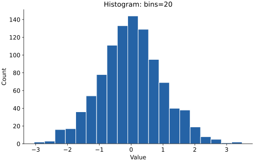

`bins=20`はデータの最小値から最大値までを同じ幅の20区間に分ける指定．横軸には値の範囲，縦軸には各区間に入った個数を取る．**隣り合う棒が数値の区間としてつながる**点が，項目ごとに棒を分ける棒グラフと異なる．

````{note} 演習4
平均0，標準偏差1の正規分布から1000個の値を生成し，同じデータについて階級数10と30のヒストグラムを描け．シードを9に固定し，階級数による見え方の違いをMarkdownセルに2文で説明せよ．

```python
import random
import matplotlib.pyplot as plt

random.seed(9)
data = []
for _ in range(1000):
    data.append(random._____(0, 1))

for bins in [_____, _____]:
    fig, ax = plt.subplots()
    ax.hist(data, bins=bins, edgecolor="white")
    ax.set_xlabel("Value")
    ax.set_ylabel("Count")
    ax.set_title(f"Histogram: bins={bins}")
    plt.show()
```

**出力例**

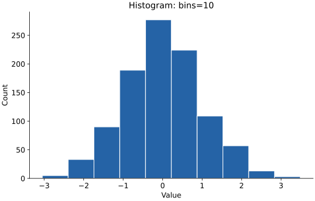

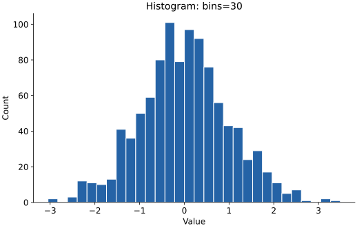
````

````{hidden-answer} 解答例
```python
import random
import matplotlib.pyplot as plt

random.seed(9)
data = []
for _ in range(1000):
    data.append(random.gauss(0, 1))

for bins in [10, 30]:
    fig, ax = plt.subplots()
    ax.hist(data, bins=bins, edgecolor="white")
    ax.set_xlabel("Value")
    ax.set_ylabel("Count")
    ax.set_title(f"Histogram: bins={bins}")
    plt.show()
```

**Markdownの記入例**

```markdown
階級数10では広い範囲を一つの棒にまとめるため，全体が0の周りに集まる形を捉えやすい．階級数30では細かな凹凸が見えるが，同じ1000個の値を分け直した結果なのでデータ自体が変わったわけではない．
```
````

## 複数のデータと対数目盛

### 同じ軸に複数の線を描く

`ax.plot`を複数回呼び出すと同じ軸に線を重ねられる．各線に`label`を指定し，`ax.legend()`で対応を表示する．

```python
import matplotlib.pyplot as plt

x = [0, 0.2, 0.4, 0.6, 0.8, 1]
y_square = []
y_cube = []
for value in x:
    y_square.append(value ** 2)
    y_cube.append(value ** 3)

fig, ax = plt.subplots()
ax.plot(x, y_square, marker="o", label="y = x^2")
ax.plot(x, y_cube, marker="s", label="y = x^3")
ax.set_xlabel("x")
ax.set_ylabel("y")
ax.set_title("Two functions")
ax.legend()
ax.grid()
plt.show()
```

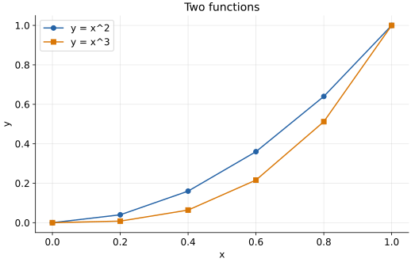

一定の値と比較するときは`ax.axhline(値, label="説明")`で水平線を描ける．たとえば`ax.axhline(2, color="orange", label="Exact value")`は高さ2に線を引く指定である．

### 桁の異なる値を対数目盛で比べる

**対数目盛**：等しい比率の変化を等しい間隔で表す目盛．たとえば1→10，10→100，100→1000という10倍の変化を同じ間隔で示す目盛．

通常の目盛では等しい差を等しい間隔で表す．たとえば0→1000と1000→2000の間隔が等しい．試行回数が1000から30000まで，誤差が0.001程度から0.04程度まで変化する場合は，両方の軸を対数目盛にすると値の違いを読み取りやすい．

- `ax.set_xscale("log")`：横軸を対数目盛にする指定．
- `ax.set_yscale("log")`：縦軸を対数目盛にする指定．
- **両対数グラフ**：横軸と縦軸の両方を対数目盛にしたグラフ．

対数目盛で扱う値は正の数とする．誤差が0の場合は表に記録するなどして示し，正の誤差と分けて確認する．

## CSVの読み込みとグラフの保存

### 計算結果を数値のリストへ読み込む

```python
import csv

trials_values = []
values = []
errors = []

with open("monte_carlo.csv", "r", encoding="utf-8", newline="") as file:
    reader = csv.reader(file)
    next(reader)
    for row in reader:
        trials_values.append(int(row[0]))
        values.append(float(row[1]))
        errors.append(float(row[2]))

print(trials_values)
```

```text
[1000, 3000, 10000, 30000]
```

- `next(reader)`は見出し行を読み進める処理．その後のfor文で四つの計算結果を読む．
- CSVから取り出した各値は文字列なので，試行回数は`int`，近似値と誤差は`float`で数値へ変換する．
- `trials_values`，`values`，`errors`の同じ位置に同じ計算の結果が入る．

### 通常の目盛と対数目盛を比較する

直前のコードで読み込んだ`trials_values`と`errors`を使う．

```python
import matplotlib.pyplot as plt

for scale in ["linear", "log"]:
    fig, ax = plt.subplots()
    ax.plot(trials_values, errors, marker="o")
    ax.set_xlabel("Number of trials")
    ax.set_ylabel("Absolute error")
    ax.set_title(f"Monte Carlo error: {scale} scale")
    ax.set_xscale(scale)
    ax.set_yscale(scale)
    ax.grid()
    plt.show()
```

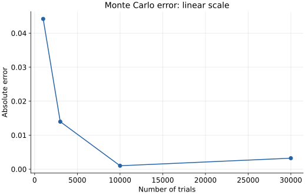

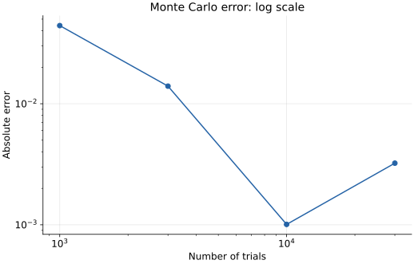

10000回から30000回に増やすと誤差が再び大きくなることは両方の図から読み取れる．対数目盛では1000→3000と10000→30000のような同じ3倍の変化が横軸上で同じ間隔になる．

````{note} 演習5
`monte_carlo.csv`から試行回数と絶対誤差を読み込み，両対数目盛の折れ線グラフを描け．各点を丸印で示し，軸ラベル・タイトル・グリッドを付けよ．誤差が最も小さかった試行回数をMarkdownセルに記入せよ．

```python
import csv
import matplotlib.pyplot as plt

trials_values = []
errors = []

with open("monte_carlo.csv", "r", encoding="utf-8", newline="") as file:
    reader = csv._____(file)
    next(reader)
    for row in reader:
        trials_values.append(int(row[0]))
        errors.append(float(row[_____]))

fig, ax = plt.subplots()
ax.plot(trials_values, errors, marker="o")
ax.set_xlabel("Number of trials")
ax.set_ylabel("Absolute error")
ax.set_title("Monte Carlo integration error")
ax.set_xscale("_____")
ax.set_yscale("_____")
ax.grid()
plt.show()
```

**出力例**


````

````{hidden-answer} 解答例
```python
import csv
import matplotlib.pyplot as plt

trials_values = []
errors = []

with open("monte_carlo.csv", "r", encoding="utf-8", newline="") as file:
    reader = csv.reader(file)
    next(reader)
    for row in reader:
        trials_values.append(int(row[0]))
        errors.append(float(row[2]))

fig, ax = plt.subplots()
ax.plot(trials_values, errors, marker="o")
ax.set_xlabel("Number of trials")
ax.set_ylabel("Absolute error")
ax.set_title("Monte Carlo integration error")
ax.set_xscale("log")
ax.set_yscale("log")
ax.grid()
plt.show()
```

**Markdownの記入例**

```markdown
今回の四つの結果では試行回数10000の絶対誤差が約0.00101で最も小さかった．
```
````

### グラフを画像ファイルへ保存する

`fig.savefig`で図を画像ファイルへ保存できる．`plt.show()`より前に保存すると，作成した図をそのまま出力できる．

```python
fig, ax = plt.subplots()
ax.plot(trials_values, errors, marker="o")
ax.set_xlabel("Number of trials")
ax.set_ylabel("Absolute error")
ax.set_title("Monte Carlo integration error")
ax.set_xscale("log")
ax.set_yscale("log")
ax.grid()
fig.savefig("monte_carlo_error.png", dpi=150, bbox_inches="tight")
plt.show()
```

- `dpi=150`：画像の解像度を指定する値．
- `bbox_inches="tight"`：軸ラベルなども含めて画像の周りの余白を調整する指定．

Colabでは保存した画像もランタイム内のファイル一覧に現れる．手元に残す場合はファイル名のメニューからダウンロードする．

## エラーが出たときにチェックすること

| 症状 | 確認すること |
| --- | --- |
| `NameError: name 'plt' is not defined` | `import matplotlib.pyplot as plt`を先に実行したか |
| `NameError: name 'fig' is not defined` | `fig, ax = plt.subplots()`で図を作ったか |
| `ValueError: x and y must have same first dimension` | 横軸と縦軸のリストの要素数が一致するか |
| `FileNotFoundError` | CSVが現在の作業フォルダにあるか．Colabではアップロードしたか |
| 凡例に線の名前が出ない | 描画時の`label`と`ax.legend()`を指定したか |
| 図の値が表示されない | 対数目盛に0以下の値を渡していないか．正の値だけを対数軸へ描く |
| 日本語のラベルが四角になる | 日本語フォントが使えるか．本講義のコードの英数字のラベルで表示を確認する |

### エラーが表示されない場合の確認

- `ax.plot`はリストの順に点を結ぶ．横軸の値と縦軸の値の対応を保ち，横軸が増える順に並べる．
- CSVの`value`と`error`の列を取り違えると，近似値を誤差として描いてしまう．列名と取り出す位置を確認する．
- 比較するヒストグラムでは同じデータを使う．for文の前に一度だけデータを生成すれば，階級数の違いによる見え方を比較できる．
- 棒の上の数値が切れる場合は`ax.set_ylim`で縦軸の上端を大きくする．

## 課題

Google ColabまたはJupyter Notebookで取り組むこと．コードを実行し，グラフと考察を表示したNotebookを保存する．

````{warning} 課題1
第8回課題1の12面体サイコロを5000回振り，各出目の回数を棒グラフで比較せよ．

1. Markdownセルに`# 課題1`と記入し，シードを2026に固定して各出目の回数を求めよ．
2. 横軸を1から12までの出目，縦軸を回数として棒グラフを描け．各棒の上に回数を表示し，期待される回数`5000 / 12`の水平線を凡例付きで重ねよ．軸ラベルとタイトルも付けること．
3. 図を`dice12_counts.png`へ保存せよ．
4. 棒グラフを選んだ理由と期待される回数との違いをMarkdownセルに3文程度で説明せよ．

- `counts`：1から12までの各出目の回数を順に保存するリスト．
- `faces`：出目を表す1から12までの整数のリスト．

```python
import random
import matplotlib.pyplot as plt

random.seed(2026)
trials = 5000
counts = [0] * 12

【12面体サイコロを5000回振り，各出目の回数を数える】

faces = list(range(1, 13))
fig, ax = plt.subplots()

【棒グラフ，回数の表示，期待される回数の水平線を描く】

ax.set_xticks(faces)
ax.set_xlabel("Face")
ax.set_ylabel("Count")
ax.set_title("Results of 5000 rolls: 12-sided die")
ax.set_ylim(0, 500)
ax.legend()

【dice12_counts.pngへ保存する】

plt.show()
```

**出力例**

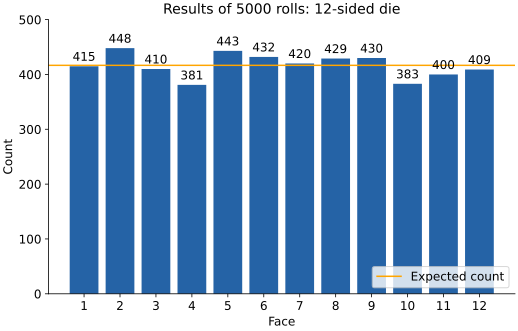
````

(assignment-9-1-answer)=
````{hidden-answer} 解答例
設問の順にコードを実行する．

**設問1：各出目の回数**

```markdown
# 課題1
```

```python
import random
import matplotlib.pyplot as plt

random.seed(2026)
trials = 5000
counts = [0] * 12
for _ in range(trials):
    value = random.randint(1, 12)
    counts[value - 1] += 1
```

**設問2：棒グラフと期待される回数**

```python
faces = list(range(1, 13))
fig, ax = plt.subplots()
bars = ax.bar(faces, counts)
ax.bar_label(bars, padding=3)
ax.axhline(trials / 12, color="orange", label="Expected count")
ax.set_xticks(faces)
ax.set_xlabel("Face")
ax.set_ylabel("Count")
ax.set_title("Results of 5000 rolls: 12-sided die")
ax.set_ylim(0, 500)
ax.legend(loc="lower right")
```

**設問3：図の保存と表示**

```python
fig.savefig("dice12_counts.png", dpi=150, bbox_inches="tight")
plt.show()
```

**設問4：考察（Markdownの記入例）**

```markdown
### 設問4：考察

1から12までの各出目という項目ごとの回数を比較するため，棒グラフを選んだ．期待される回数は約416.7回であり，実際の回数は381回から448回の範囲にあった．公平なサイコロでも有限回の試行ではばらつきが生じるため，すべての棒が期待される回数の線と一致するわけではない．
```
````

````{warning} 課題2
第8回課題2のCSVから積分の近似値と絶対誤差を読み込み，二つの図を作成せよ．

1. Markdownセルに`# 課題2`と記入し，`monte_carlo.csv`から試行回数・近似値・絶対誤差を読み込め．
2. 横軸を試行回数，縦軸を近似値とする折れ線グラフを描け．手計算の積分値2の水平線を重ね，凡例を付けよ．
3. 横軸を試行回数，縦軸を絶対誤差とする両対数グラフを描け．二つの図に軸ラベル・タイトル・丸印・グリッドを付け，それぞれ`integral_values.png`と`integral_errors.png`へ保存せよ．
4. それぞれの図から分かることとグラフの選択理由を，具体的な数値に触れながらMarkdownセルに3文程度で説明せよ．

```python
import csv
import matplotlib.pyplot as plt

trials_values = []
values = []
errors = []

【CSVの3列を数値に変換して各リストへ保存する】

fig, ax = plt.subplots()

【近似値の折れ線と手計算の積分値の水平線を描き，表示項目を設定して保存する】

plt.show()

fig, ax = plt.subplots()

【絶対誤差を両対数グラフで描き，表示項目を設定して保存する】

plt.show()
```

**出力例**

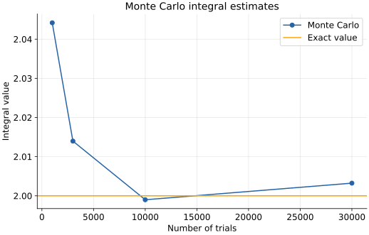


````

(assignment-9-2-answer)=
````{hidden-answer} 解答例
設問の順にコードを実行する．

**設問1：CSVの読み込み**

```markdown
# 課題2
```

```python
import csv
import matplotlib.pyplot as plt

trials_values = []
values = []
errors = []

with open("monte_carlo.csv", "r", encoding="utf-8", newline="") as file:
    reader = csv.reader(file)
    next(reader)
    for row in reader:
        trials_values.append(int(row[0]))
        values.append(float(row[1]))
        errors.append(float(row[2]))
```

**設問2：近似値と手計算の値の比較**

```python
fig_values, ax_values = plt.subplots()
ax_values.plot(trials_values, values, marker="o", label="Monte Carlo")
ax_values.axhline(2, color="orange", label="Exact value")
ax_values.set_xlabel("Number of trials")
ax_values.set_ylabel("Integral value")
ax_values.set_title("Monte Carlo integral estimates")
ax_values.legend()
ax_values.grid()
```

**設問3：絶対誤差の図と二つの図の保存**

```python
fig_values.savefig("integral_values.png", dpi=150, bbox_inches="tight")

fig_errors, ax_errors = plt.subplots()
ax_errors.plot(trials_values, errors, marker="o")
ax_errors.set_xlabel("Number of trials")
ax_errors.set_ylabel("Absolute error")
ax_errors.set_title("Monte Carlo integration error")
ax_errors.set_xscale("log")
ax_errors.set_yscale("log")
ax_errors.grid()
fig_errors.savefig("integral_errors.png", dpi=150, bbox_inches="tight")
plt.show()
```

**設問4：考察（Markdownの記入例）**

```markdown
### 設問4：考察

試行回数に沿った変化を見るため折れ線グラフを使い，近似値の図では手計算の値2に対する上下のずれを，誤差の図ではその大きさを比較した．誤差は1000回で約0.0442，10000回で約0.00101と桁が異なるため，両対数目盛を使うと比率の変化が読み取りやすい．30000回では誤差が約0.00323に増えており，乱数によるばらつきのため試行回数を増やすたびに誤差が小さくなるわけではない．
```
````

````{note} 発展的課題（追加点対象，必ずしも取り組まなくて良い）
欠席などで得点の不足が心配な場合は取り組むことを薦める．提出内容に応じて追加点の対象とする．

第8回の発展的課題で扱った$\int_0^1 e^{-x^2}\,dx$について，台形公式とモンテカルロ積分をグラフで比較せよ．

1. Markdownセルに`# 発展的課題`と記入する．台形公式の分割数とモンテカルロ積分の試行回数を`100`，`1000`，`10000`とし，モンテカルロ積分ではシード`2026`，`2027`，`2028`の結果をそれぞれ求めよ．第8回発展的課題のコードを利用してよい．
2. 分割数`200000`の台形公式の結果を基準値とし，各近似値と基準値との差の絶対値を求めよ．横軸を分割数・試行回数として両対数目盛の同じ図に4本の線を描き，凡例で方法とシードを区別せよ．
3. 図を`integration_comparison.png`へ保存し，方法による違いと同じ方法でもシードで結果が変わることを，図の数値を根拠にMarkdownセルで説明せよ．基準値も近似値であることに触れること．
````

(assignment-9-advanced-answer)=
````{hidden-answer} 発展的課題の解答例
**設問1：計算する関数と近似値**

```markdown
# 発展的課題
```

```python
import math
import random
import matplotlib.pyplot as plt

def trapezoidal(f, a, b, n):
    h = (b - a) / n
    total = (f(a) + f(b)) / 2
    for i in range(1, n):
        total += f(a + i * h)
    return h * total

def monte_carlo_integral(f, a, b, trials):
    total = 0
    for _ in range(trials):
        total += f(random.uniform(a, b))
    return (b - a) * total / trials

def f(x):
    return math.exp(-x ** 2)

sizes = [100, 1000, 10000]
trapezoidal_values = []
for n in sizes:
    trapezoidal_values.append(trapezoidal(f, 0, 1, n))

seeds = [2026, 2027, 2028]
monte_carlo_values = []
for seed in seeds:
    values_for_seed = []
    for trials in sizes:
        random.seed(seed)
        values_for_seed.append(monte_carlo_integral(f, 0, 1, trials))
    monte_carlo_values.append(values_for_seed)
```

**設問2：基準値との差と比較グラフ**

```python
reference = trapezoidal(f, 0, 1, 200000)
trapezoidal_differences = []
for value in trapezoidal_values:
    trapezoidal_differences.append(abs(value - reference))

fig, ax = plt.subplots()
ax.plot(sizes, trapezoidal_differences, marker="o", label="Trapezoidal")
for seed, values_for_seed in zip(seeds, monte_carlo_values):
    differences = []
    for value in values_for_seed:
        differences.append(abs(value - reference))
    ax.plot(sizes, differences, marker="s", label=f"Monte Carlo: seed={seed}")

ax.set_xlabel("Divisions / trials")
ax.set_ylabel("Absolute difference from reference")
ax.set_title("Comparison of numerical integration")
ax.set_xscale("log")
ax.set_yscale("log")
ax.legend()
ax.grid()
```

**設問3：図の保存と考察**

```python
fig.savefig("integration_comparison.png", dpi=150, bbox_inches="tight")
plt.show()
```

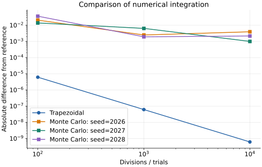

```markdown
### 設問3：考察

台形公式の基準値との差は分割数100で約$6.13\times10^{-6}$，10000で約$6.12\times10^{-10}$となり，この計算条件ではモンテカルロ積分より小さかった．モンテカルロ積分は同じ10000回でもシード2026で約0.00393，2027で約0.000998の差があり，選ぶ点によって結果が変わった．比較に使った基準値も台形公式による近似値なので，縦軸は真値に対する絶対誤差ではなく基準値との差の絶対値を表す．
```
````

### 提出方法

- WebClassの「第9回課題」から`第9回_<学籍番号>_<氏名>.ipynb`を提出する．**CSVと画像ファイルの提出は不要**である．
- 課題1・2のコードを実行し，グラフとMarkdownの考察を表示した状態で保存する．
- 課題1は12通りの出目と回数の表示，期待される回数の線を確認する．課題2は近似値と絶対誤差の両方の図を確認する．
- 発展的課題に取り組んだ場合は同じNotebookの課題2の後に解答をまとめる．
- Colabでは「ファイル」→「保存」で保存し，「ファイル」→「ダウンロード」→「.ipynbをダウンロード」で提出用のファイルを取得する．画像も手元に残す場合は左側のファイル一覧からダウンロードする．

### 提出期限

<span style="color: red; ">11月27日(金)23:59まで</span>

質問等がある場合には

- メール kkagawa@josai.ac.jp
- Teamsのチャット
- WebClassのメッセージ

などで連絡してください．

## まとめ

1. **目的に合わせて図を選ぶ**：変化には折れ線，二つの数値の関係には散布図，項目の比較には棒グラフ，値の集まり方にはヒストグラムを使う．
2. **図の意味を示す**：軸ラベルに量と単位を書き，タイトルと凡例で何を比べているかを伝える．
3. **目盛の間隔を理解する**：通常の目盛は差を，対数目盛は比率を等しい間隔で表す．
4. **図を根拠に説明する**：最も大きい値・小さい値や変化した箇所を挙げ，数値と結び付けて傾向を説明する．
5. **計算結果と図を保存する**：Notebookの出力と考察を保存し，図の画像も必要に応じてダウンロードする．

- 次回は第1回から第9回までの学習内容を確認するテストを行う．

## 参考資料

- [Matplotlib公式：グラフ作成の入門](https://matplotlib.org/stable/tutorials/pyplot.html)
- [Matplotlib公式：ヒストグラム](https://matplotlib.org/stable/api/_as_gen/matplotlib.axes.Axes.hist.html)
- [Matplotlib公式：棒の数値の表示](https://matplotlib.org/stable/api/_as_gen/matplotlib.axes.Axes.bar_label.html)
