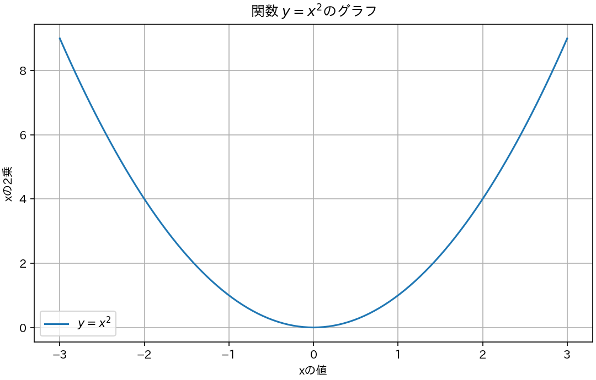
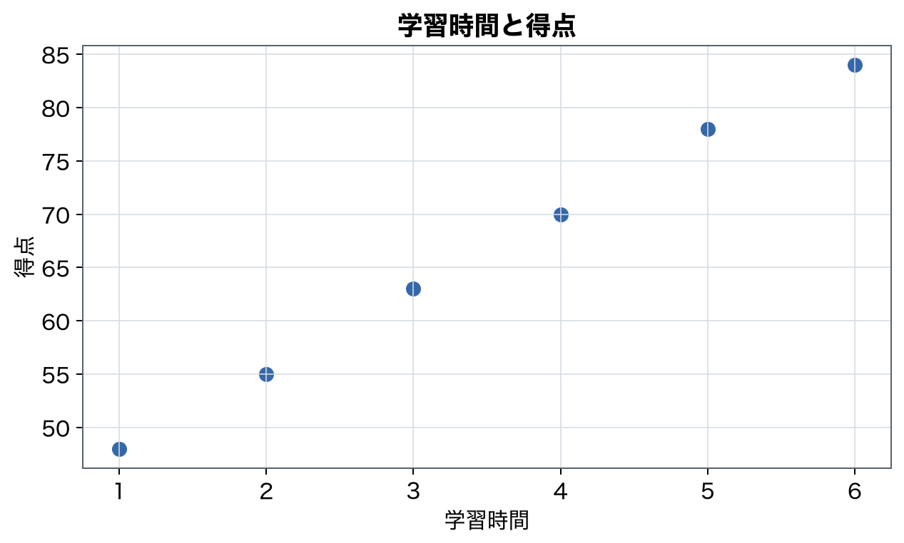
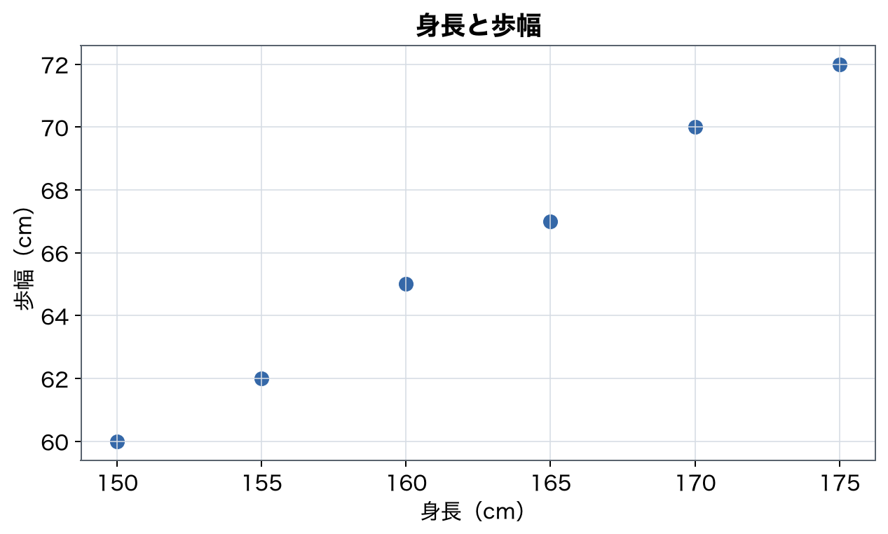
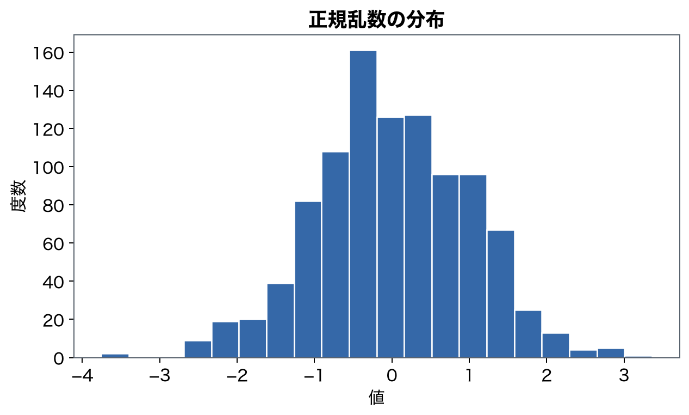
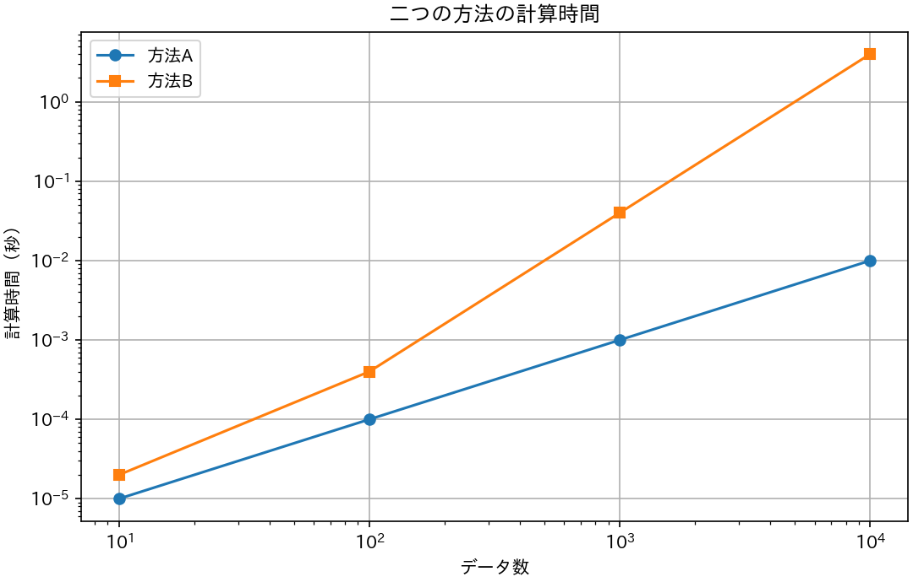
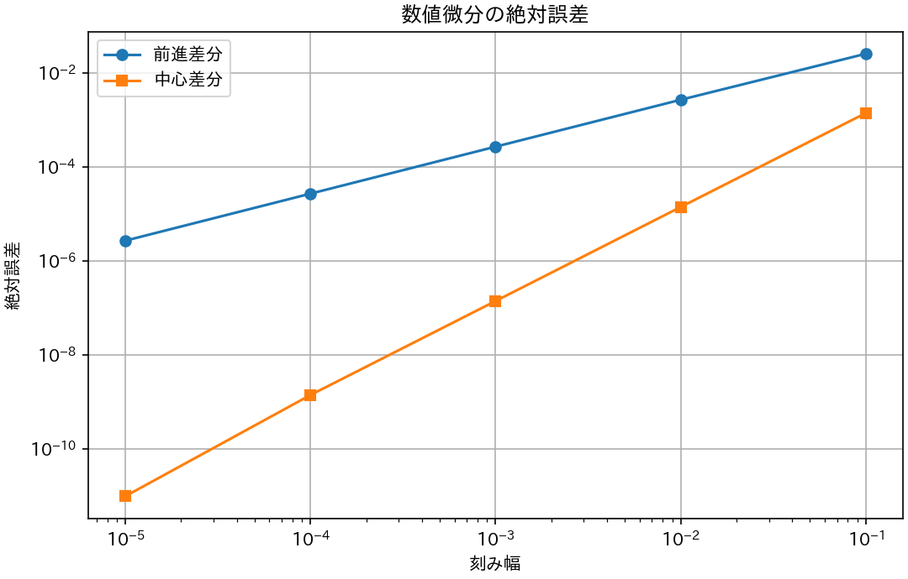
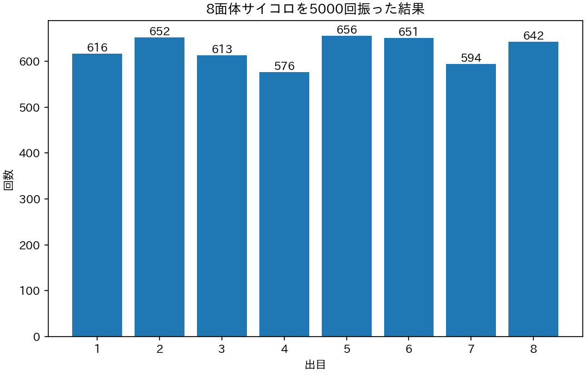
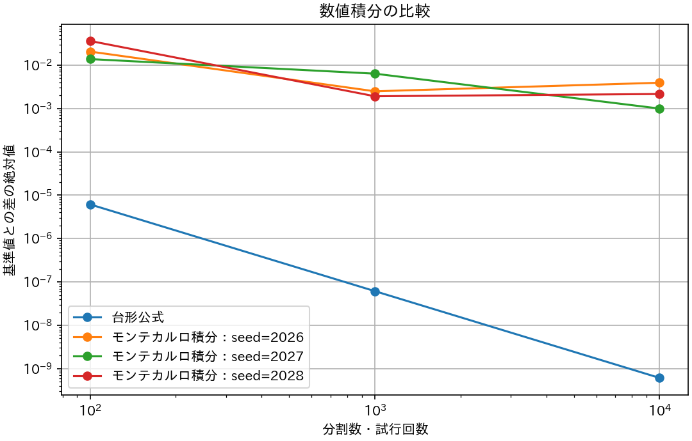

# 第9回　可視化

### 到達目標

- **グラフの選択**：確認したい内容に応じて折れ線グラフ，散布図，棒グラフ，ヒストグラムを選択できる．
- **Matplotlibの基本操作**：データをグラフとして表示し，軸ラベル，タイトル，凡例，グリッドを設定できる．
- **データの比較**：複数のデータを同じ座標上に表示し，対数目盛を使って桁の異なる値を比較できる．
- **グラフの解釈**：グラフから読み取れる傾向を軸が表す量や数値を根拠として説明できる．

### 前回の復習

第8回ではGoogle Colabで乱数とモンテカルロ法を扱った．次のコードはモンテカルロ積分で$\int_0^\pi \sin x\,dx$を近似する．

```python
import math
import random

def monte_carlo_integral(f, a, b, trials):
    total = 0

    for _ in range(trials):
        x = random.uniform(a, b)
        total = total + f(x)

    return (b - a) * total / trials

def f(x):
    return math.sin(x)

random.seed(2026)
value = monte_carlo_integral(f, 0, math.pi, 1000)
error = abs(value - 2)

print(f"{value:.12f}")
print(f"{error:.12f}")
```

````{dropdown} コードの補足
- `monte_carlo_integral`は区間$[a,b]$から`trials`個の点を一様に選び，関数値の標本平均へ区間の幅を掛けて定積分を近似する．
- $\int_0^\pi \sin x\,dx=2$であるため，`abs(value - 2)`は近似値の絶対誤差を表す．
- 同じシードと同じ実行順序を使うと，同じ疑似乱数列から同じ結果を再現できる．
````

````{dropdown} 出力例
```text
2.044193081754
0.044193081754
```
````

数値の一覧だけでも計算結果は確認できる．今回は**数値をグラフへ変換し，変化，関係，分布，項目間の差を読み取る**．

## Jupyter Notebookの準備

### 第8回課題の解説

1. [課題1「12面体サイコロのシミュレーション」](/contents/numerical3-colab#assignment-8-1)
2. [課題2「モンテカルロ積分とCSVファイルへの保存」](/contents/numerical3-colab#assignment-8-2)

### Notebookの作成

1. Anaconda NavigatorからJupyter Notebookを起動する．
2. `Documents（書類）/Fresh2`フォルダを開く．
3. Python 3のNotebookを新規作成する．
4. ファイル名を`第9回_<学籍番号>_<氏名>.ipynb`へ変更する．
5. Markdownセルを追加し，`# 第9回　可視化`，学籍番号，氏名を記入する．

### 日本語表示の準備

Matplotlibのグラフへ日本語を表示するため，最初のCodeセルで次を実行する．

```python
%pip install matplotlib-fontja

import matplotlib.pyplot as plt
import matplotlib_fontja
```

````{dropdown} コードの補足
- `%pip install matplotlib-fontja`は現在使用しているJupyter NotebookのPython環境へ日本語表示用のライブラリをインストールする命令である．インストールは初回のみ必要である．
- `matplotlib.pyplot`はグラフを作成する機能をまとめたモジュールである．この講義では`plt`という短い名前で使用する．
- `matplotlib_fontja`を読み込むと，日本語を表示できるフォントがMatplotlibへ設定される．
````

```{tip} 注意：カーネルを再起動した場合
Jupyter Notebookのカーネルを再起動すると，読み込んだモジュール，変数，関数の状態は失われる．再起動後はimportを含むセルから順に実行する．
```

### CSVファイルの配置

第8回にダウンロードした`monte_carlo.csv`は次の手順でNotebookと同じフォルダへ配置する．

1. Finderで`monte_carlo.csv`を保存したフォルダを開く．
2. `monte_carlo.csv`を`Documents（書類）/Fresh2`フォルダへ移動する．
3. Jupyter Notebookのファイル一覧に`monte_carlo.csv`が表示されたことを確認する．

```{tip} 注意：CSVファイルの保存場所
`open("monte_carlo.csv", ...)`はNotebookと同じフォルダにあるCSVファイルを読み込む．NotebookとCSVファイルの保存場所が異なると，ファイルを見つけられない．
```

## 可視化とグラフの選択

**可視化**：データをグラフや図で表し，数値の変化，関係，分布，項目間の差を読み取りやすくすること．

グラフを選ぶときは最初に**何を確認するのか**を決める．次に横軸と縦軸が表す量を決める．

| 確認したい内容 | 適したグラフ | 例 |
| --- | --- | --- |
| 時間や順序に伴う値の変化 | 折れ線グラフ | 試行回数に対する誤差の変化 |
| 二つの数値の関係 | 散布図 | 身長と歩幅の関係 |
| 項目ごとの値の比較 | 棒グラフ | サイコロの各出目の回数 |
| 数値データの分布 | ヒストグラム | テスト得点の分布 |

- **折れ線グラフ**：順序をもつ点を線で結び，値の変化を表すグラフ．
- **散布図**：二つの数値を横軸と縦軸に取り，各データを点で表すグラフ．
- **棒グラフ**：項目または離散的な値ごとに棒を置き，棒の長さで値を比較するグラフ．
- **ヒストグラム**：数値データを階級に分け，度数分布を長方形で表すグラフ．

### 棒グラフとヒストグラム

**度数**：ある値や階級に入るデータの個数．

**度数分布**：値または階級と，それぞれの度数との対応．度数分布は表，棒グラフ，ヒストグラムなどで表せる．

**ヒストグラム**では数値データの範囲を，互いに重ならない階級へ分ける．各階級を底辺とする長方形を描き，**長方形の面積をその階級の度数または相対度数に比例させる**．階級幅がすべて等しい場合は，長方形の高さが度数に比例する．

| 比較する点 | 棒グラフ | ヒストグラム |
| --- | --- | --- |
| 横軸 | 項目または離散的な値 | 数値の区間である階級 |
| 棒の幅 | データ上の意味をもたない | 階級の幅を表す |
| 棒の間隔 | 項目を区別するために間を空ける | 隣り合う階級を表すために接する |
| 並べる順序 | 目的に応じて変更できる | 数値の小さい階級から並べる |
| 度数の表示 | 棒の長さで表せる | 長方形の面積で表す |

定義の参考：[Australian Bureau of Statistics「Frequency distribution」](https://www.abs.gov.au/statistics/understanding-statistics/statistical-terms-and-concepts/frequency-distribution)，[NIST「Histogram」](https://www.itl.nist.gov/div898/handbook/eda/section3/histogra.htm)．

```{tip} 注意：サイコロの出目と度数
サイコロの出目ごとの回数は**度数**である．出目は1，2，3のような離散的な値であるため，この講義では各出目を一つの項目として棒グラフで比較する．1回ごとの出目を数値データとして階級に分ければヒストグラムも作成できるが，出目ごとの回数を比べる目的には棒グラフが分かりやすい．
```

## Matplotlibの基本

**Matplotlib**：Pythonでグラフを作成するためのライブラリ．

以下のコードを上から順にCodeセルへ入力して実行し，$y=x^2$の折れ線グラフを作成する．

- **横軸と縦軸のデータ**

  ```python
  x = [1, 2, 3, 4, 5]
  y = [1, 4, 9, 16, 25]
  ```

  `x`は横軸に使用する値，`y`は縦軸に使用する値を順番に格納したリストである．同じ位置にある値が一組になるため，最初の点は$(1,1)$，2番目の点は$(2,4)$となる．二つのリストの要素数はそろえる．

- **図と描画領域の作成**

  ```python
  fig, ax = plt.subplots()
  ```

  `plt.subplots()`はFigureとAxesを作成して返す．`fig`は図全体を表すFigure，`ax`は座標軸を含む描画領域を表すAxesである．`fig, ax =`では返された二つのオブジェクトをそれぞれの変数へ代入している．以降は`ax`に対して線，軸ラベル，タイトルなどを追加する．

- **点と線の描画**

  ```python
  ax.plot(x, y, marker="o", label="$y=x^2$")
  ```

  `ax.plot(x, y)`は`x`を横座標，`y`を縦座標として点を配置し，リストの順番に線で結ぶ．`marker="o"`は各点を丸印で表示する指定である．`label="$y=x^2$"`は線に$y=x^2$という名前を付ける指定であり，`$`で囲んだ部分はLaTeX記法で数式として表示される．

- **軸ラベルの設定**

  ```python
  ax.set_xlabel("x軸")
  ax.set_ylabel("y軸")
  ```

  `ax.set_xlabel("x軸")`は横軸のラベルを「x軸」に設定する．`ax.set_ylabel("y軸")`は縦軸のラベルを「y軸」に設定する．引用符内にはグラフへ表示したい文字列を指定するため，Pythonの変数名と一致させる必要はない．軸ラベルには，その軸が表す量や単位を記す．

- **タイトルの設定**

  ```python
  ax.set_title("二乗の値")
  ```

  `ax.set_title`はグラフの上部にタイトルを表示する．タイトルには，グラフが表す内容を簡潔に記す．

- **凡例の表示**

  ```python
  ax.legend()
  ```

  `ax.legend()`は`label`で付けた線の名前を凡例として表示する．複数の線を描いた場合は，凡例によって各線が表すデータを区別できる．

- **グリッドの表示**

  ```python
  ax.grid()
  ```

  `ax.grid()`は縦軸と横軸の目盛に沿ったグリッドを表示する．点の座標や値の変化を読み取りやすくなる．

- **完成した図の表示**

  ```python
  plt.show()
  ```

  `plt.show()`は設定を終えた図をNotebookの出力欄に表示する．この行まで実行すると完成したグラフを確認できる．


**完成したコード**

各Codeセルで実行した処理を一つにまとめると，次のコードになる．

```python
x = [1, 2, 3, 4, 5]
y = [1, 4, 9, 16, 25]

fig, ax = plt.subplots()
ax.plot(x, y, marker="o", label="$y=x^2$")
ax.set_xlabel("x軸")
ax.set_ylabel("y軸")
ax.set_title("二乗の値")
ax.legend()
ax.grid()
plt.show()
```

### 折れ線グラフによる関数の表示

折れ線グラフでは点の間を直線で結ぶ．横軸の値を細かく取ると短い線分が連続するため，関数の形を滑らかな曲線として表示できる．ここではNumPyを使い，$-3$から$3$までの範囲に101個の値を用意する．

**横軸と縦軸のデータ**

```python
import numpy as np

x = np.linspace(-3, 3, 101)
y = x ** 2
```

**NumPy**：数値計算に使用するライブラリ．`import numpy as np`によって，NumPyを`np`という短い名前で使用する．

`np.linspace(-3, 3, 101)`は$-3$から$3$までを等間隔に区切り，両端を含む101個の値を作る．隣り合う値の間隔は$(3-(-3))/(101-1)=0.06$である．作成された`x`はNumPyの配列であるため，`x ** 2`によって各要素をそれぞれ2乗できる．

**関数のグラフの描画**

```python
fig, ax = plt.subplots()
ax.plot(x, y, label="$y=x^2$")
ax.set_xlabel("xの値")
ax.set_ylabel("xの2乗")
ax.set_title("関数 $y=x^2$のグラフ")
ax.legend()
ax.grid()
plt.show()
```

`ax.plot`は101個の点を順番に短い線分で結ぶ．点を5個だけ使用した先ほどのグラフより，放物線の形を細かく表せる．



**完成したコード**

```python
import numpy as np

x = np.linspace(-3, 3, 101)
y = x ** 2

fig, ax = plt.subplots()
ax.plot(x, y, label="$y=x^2$")
ax.set_xlabel("xの値")
ax.set_ylabel("xの2乗")
ax.set_title("関数 $y=x^2$のグラフ")
ax.legend()
ax.grid()
plt.show()
```

````{note} 演習1
$-3\leq x\leq3$における$y=x^3$について，**出力例**のような折れ線グラフを出力するように次のコードの`____`を埋めよ．

```python
x = [-3, -2, -1, 0, 1, 2, 3]
y = []

for value in x:
    y.append(____)

fig, ax = plt.subplots()
ax.plot(____)
ax.set_xlabel("xの値")
ax.set_ylabel("xの3乗")
ax.set_title("三乗の値")
ax.grid()
plt.show()
```

**出力例**


````

````{hidden-answer} 解答例
```python
x = [-3, -2, -1, 0, 1, 2, 3]
y = []

for value in x:
    y.append(value ** 3)

fig, ax = plt.subplots()
ax.plot(x, y, marker="o")
ax.set_xlabel("xの値")
ax.set_ylabel("xの3乗")
ax.set_title("三乗の値")
ax.grid()
plt.show()
```

`x`の各値を3乗して`y`へ追加する．`ax.plot(x, y)`では同じ添字の$x$と$y$を一つの点として表示する．
````

## 散布図

二つの数値の関係を確認するには`ax.scatter`で散布図を作成する．次のコードは学習時間と確認テストの得点を点で表す．

```python
import matplotlib.pyplot as plt

hours = [1, 2, 3, 4, 5, 6]
scores = [48, 55, 63, 70, 78, 84]

fig, ax = plt.subplots()
ax.scatter(hours, scores)
ax.set_xlabel("学習時間")
ax.set_ylabel("得点")
ax.set_title("学習時間と得点")
ax.grid()
plt.show()
```

````{dropdown} コードの補足
- `ax.scatter(hours, scores)`は学習時間と得点の組を一つずつ点として表示する．線では結ばない．
- このデータでは学習時間が長い点ほど得点も高い位置にあり，右上がりの傾向が見られる．
- 散布図は二つの数値の関係を確認するために使う．点の並びだけから一方が他方の原因であるとは断定できない．
````



```{tip} 注意：相関関係と因果関係
- **相関関係**：二つの変数の間に関連が見られる関係．
- **因果関係**：一方の変化が他方の変化を引き起こす関係．
- 散布図から相関関係が読み取れても，因果関係があるとは判断できない．
```

````{note} 演習2
身長`[150, 155, 160, 165, 170, 175]`と歩幅`[60, 62, 65, 67, 70, 72]`について，**出力例**のような散布図を出力するように次のコードの`____`を埋めよ．グラフから読み取れる傾向をMarkdownセルに1文で記述せよ．

```python
import matplotlib.pyplot as plt

heights = [150, 155, 160, 165, 170, 175]
steps = [60, 62, 65, 67, 70, 72]

fig, ax = plt.subplots()
ax.____(heights, steps)  # 散布図を表示する
ax.set_xlabel(____)
ax.set_ylabel(____)
ax.set_title(____)
ax.____()  # グリッドを表示する
plt.show()
```

- `heights`：身長を保存するリスト．
- `steps`：同じ位置の人の歩幅を保存するリスト．

**出力例**


````

````{hidden-answer} 解答例
```python
import matplotlib.pyplot as plt

heights = [150, 155, 160, 165, 170, 175]
steps = [60, 62, 65, 67, 70, 72]


fig, ax = plt.subplots()
ax.scatter(heights, steps)
ax.set_xlabel("身長（cm）")
ax.set_ylabel("歩幅（cm）")
ax.set_title("身長と歩幅")
ax.grid()
plt.show()
```

このデータでは身長が高くなるにつれて歩幅も長くなる傾向が見られる．
````

## 棒グラフ

項目ごとの値を比較するには`ax.bar`で棒グラフを作成する．

```python
subjects = ["国語", "数学", "英語", "理科"]
scores = [72, 88, 76, 84]

fig, ax = plt.subplots()
bars = ax.bar(subjects, scores)
ax.set_xlabel("科目")
ax.set_ylabel("得点")
ax.set_title("科目ごとの得点")
ax.bar_label(bars)
plt.show()
```

````{dropdown} コードの補足
- `ax.bar(subjects, scores)`は科目ごとの得点を棒で表す．横軸の科目は独立した項目であるため，棒を線で結ばない．
- 戻り値を`bars`へ代入し，`ax.bar_label(bars)`へ渡すと，各棒の上へ値を表示できる．
- 棒の高さと数値の両方を示すことで，項目間の差と正確な値を同時に確認できる．
````


````{note} 演習3
第8回課題1で得た12面体サイコロの出目ごとの回数について，**出力例**のような棒グラフを出力するように次のコードの`____`を埋めよ．

```python
faces = [1, 2, 3, 4, 5, 6, 7, 8, 9, 10, 11, 12]
counts = [415, 448, 410, 381, 443, 432, 420, 429, 430, 383, 400, 409]

fig, ax = plt.subplots()
bars = ax.____(faces, counts)  # 棒グラフを表示する
ax.set_xlabel(____)
ax.set_ylabel(____)
ax.set_title(____)
ax.set_xticks(____)
ax.bar_label(____)
plt.show()
```

**出力例**


````

````{hidden-answer} 解答例
```python
faces = [1, 2, 3, 4, 5, 6, 7, 8, 9, 10, 11, 12]
counts = [415, 448, 410, 381, 443, 432, 420, 429, 430, 383, 400, 409]

fig, ax = plt.subplots()
bars = ax.bar(faces, counts)
ax.set_xlabel("出目")
ax.set_ylabel("回数")
ax.set_title("12面体サイコロを5000回振った結果")
ax.set_xticks(faces)
ax.bar_label(bars)
plt.show()
```

横軸には12個の出目という項目，縦軸には各項目の回数を置く．`ax.set_xticks(faces)`は横軸へ1から12までの目盛を明示する．
````

## ヒストグラム

数値データの値域を階級に分けて度数分布を確認するには`ax.hist`でヒストグラムを作成する．次のコードでは平均0，標準偏差1の正規分布に従う疑似乱数を1000個生成する．

- **正規分布**：平均の近くに多くの値が集まり，平均から離れるほど値が現れにくくなる，左右対称の連続確率分布．
- **標準偏差**：値が平均からどの程度離れているかを表す指標．標準偏差が大きいほど，値は広い範囲に分布する．

**データの作成**

```python
import random

random.seed(2026)
data = []

for _ in range(1000):
    data.append(random.gauss(0, 1))
```

````{dropdown} コードの補足
- `random.gauss(0, 1)`は平均0，標準偏差1の正規分布に従う疑似乱数を一つ生成する．
- for文で疑似乱数を1000個生成し，リスト`data`へ順番に追加する．
````

**ヒストグラムの描画**

作成した`data`を`ax.hist`へ渡してヒストグラムを描く．

```python
import matplotlib.pyplot as plt

fig, ax = plt.subplots()
ax.hist(data, bins=20, edgecolor="white")
ax.set_xlabel("値")
ax.set_ylabel("度数")
ax.set_title("正規乱数の分布")
plt.show()
```

````{dropdown} コードの補足
- `ax.hist(data, bins=20)`はデータの範囲を幅の等しい20個の階級へ分ける．この例では階級幅が等しいため，各長方形の高さが度数を表す．
- `bins`は区間の個数である．同じデータでも`bins`を変えると分布の細かさと見え方が変化する．
- `edgecolor="white"`は隣り合う棒の境界を白線で見やすくする指定である．
````



````{note} 演習4
上の`data`を使い，**出力例**のような区間数10と30のヒストグラムを出力するように次のコードの`____`を埋めよ．二つのグラフで分布の見え方がどのように変化するかをMarkdownセルに2文で記述せよ．

```python
for bins in [____]:
    fig, ax = plt.subplots()
    ax.hist(____)  # dataを区間数bins，境界線を白色にして表示する
    ax.set_xlabel("値")
    ax.set_ylabel("度数")
    ax.set_title(f"正規乱数の分布：区間数{bins}")
    plt.show()
```

**出力例**


````

````{hidden-answer} 解答例
```python
for bins in [10, 30]:
    fig, ax = plt.subplots()
    ax.hist(data, bins=bins, edgecolor="white")
    ax.set_xlabel("値")
    ax.set_ylabel("度数")
    ax.set_title(f"正規乱数の分布：区間数{bins}")
    plt.show()
```

区間数10では分布の全体的な形を捉えやすい．区間数30では細かな増減を確認できる一方，各区間の度数のばらつきが目立つ．
````

## 複数のデータと対数目盛

複数のデータを同じ座標上で比較するには`ax.plot`を複数回実行して凡例を付ける．次のコードは第7回で扱った区分求積法と台形公式の絶対誤差を比較する．

```python
n_values = [10, 100, 1000, 10000]
riemann_errors = [0.0483333, 0.00498333, 0.000499833, 0.0000499983]
trapezoidal_errors = [0.00166667, 0.0000166667, 0.000000166667, 0.00000000166667]

fig, ax = plt.subplots()
ax.plot(n_values, riemann_errors, marker="o", label="区分求積法")
ax.plot(n_values, trapezoidal_errors, marker="s", label="台形公式")
ax.set_xlabel("分割数")
ax.set_ylabel("絶対誤差")
ax.set_title("数値積分の絶対誤差")
ax.set_xscale("log")
ax.set_yscale("log")
ax.legend()
ax.grid()
plt.show()
```

````{dropdown} コードの補足
- 2回の`ax.plot`は同じ`ax`へ線を追加する．`label`で各線の説明を設定し，`ax.legend()`で凡例を表示する．
- **対数目盛**は10倍，100倍のように桁が変わる値を比較するための目盛である．`set_xscale("log")`と`set_yscale("log")`で横軸と縦軸を対数目盛にする．
- 分割数は10倍ずつ増え，絶対誤差は複数の桁にわたって小さくなる．両方の軸を対数目盛にすると，二つの方法の誤差の減り方を同じ図で比較しやすい．
````


```{tip} 注意：対数目盛で扱える値
対数目盛では0以下の値を表示できない．誤差を対数目盛で表示するときはデータがすべて正であることを確認する．
```

````{note} 演習5
二つの計算時間について，**出力例**のような両対数グラフを出力するように次のコードの`____`を埋めよ．

```python
sizes = [10, 100, 1000, 10000]
method_a = [0.00001, 0.0001, 0.001, 0.01]
method_b = [0.00002, 0.0004, 0.04, 4.0]

fig, ax = plt.subplots()
ax.plot(sizes, ____, marker="o", label=____)
ax.plot(sizes, ____, marker="s", label=____)
ax.set_xlabel(____)
ax.set_ylabel(____)
ax.set_title(____)
ax.set_xscale(____)
ax.set_yscale(____)
ax.____()  # 凡例を表示する
ax.____()  # グリッドを表示する
plt.show()
```

**出力例**


````

````{hidden-answer} 解答例
```python
sizes = [10, 100, 1000, 10000]
method_a = [0.00001, 0.0001, 0.001, 0.01]
method_b = [0.00002, 0.0004, 0.04, 4.0]

fig, ax = plt.subplots()
ax.plot(sizes, method_a, marker="o", label="方法A")
ax.plot(sizes, method_b, marker="s", label="方法B")
ax.set_xlabel("データ数")
ax.set_ylabel("計算時間（秒）")
ax.set_title("二つの方法の計算時間")
ax.set_xscale("log")
ax.set_yscale("log")
ax.legend()
ax.grid()
plt.show()
```

方法Aの計算時間はデータ数が10倍になると約10倍になる．方法Bの計算時間はデータ数が10倍になると約100倍になり，データ数の増加に対して方法Aより急速に増える．
````

## グラフからの読み取り

グラフの説明では見た目の印象だけでなく，軸と数値を根拠にする．次の順序で記述すると，読み取った内容を整理しやすい．

1. **対象**：横軸と縦軸が何を表すかを示す．
2. **傾向**：増減，ばらつき，最大・最小，項目間の差を示す．
3. **根拠**：具体的な値や範囲を示す．
4. **限界**：グラフだけでは判断できないことを区別する．

```{tip} 例：棒グラフの説明
横軸は12面体サイコロの出目，縦軸は5000回中の出現回数を表す．出現回数は381回から448回までの範囲にあり，2の出目が最も多い．各棒の高さには違いがあるが，一回のシミュレーションだけからサイコロに偏りがあるとは断定できない．


```

## エラーが出たときの確認

- **`NameError`**：`plt`，`random`などを読み込むセルや，使用する変数を定義するセルを先に実行したか確認する．
- **`ModuleNotFoundError`**：`%pip install matplotlib-fontja`を実行したか確認する．インストール後にimportを含むセルを実行する．
- **`FileNotFoundError`**：Notebookと`monte_carlo.csv`が同じ`Fresh2`フォルダにあるか，ファイル名の大文字・小文字や拡張子が一致しているか確認する．
- **`ValueError`**：横軸と縦軸へ渡したリストの要素数が同じか確認する．たとえば`x`が5個，`y`が4個では対応する点を作れない．
- **日本語が四角で表示される場合**：`import matplotlib_fontja`を実行した後で，グラフを作成するセルを再実行する．
- **対数目盛で点が表示されない場合**：横軸と縦軸のデータに0以下の値が含まれていないか確認する．

## 課題

````{warning} 課題1
関数$f(x)=\cos x-x$について，$x=1$における微分係数を前進差分と中心差分で近似せよ．刻み幅を`1e-1`から`1e-5`まで変え，二つの方法の絶対誤差を同じ両対数グラフで可視化すること．軸ラベル，タイトル，点，凡例，グリッドを表示し，誤差の変化と二つの方法の違いをMarkdownセルに3文程度で記述せよ．

次のテンプレートを基に完成させよ．`【　】`は説明に対応する複数行の処理を記述する箇所を表す．

```python
# 課題1
import math

def f(x):
    return math.cos(x) - x

def derivative(x):
    return -math.sin(x) - 1

def forward_difference(f, x, h):
    return (f(x + h) - f(x)) / h

def central_difference(f, x, h):
    return (f(x + h) - f(x - h)) / (2 * h)

x = 1
exact = derivative(x)
h_values = [1e-1, 1e-2, 1e-3, 1e-4, 1e-5]
forward_errors = []
central_errors = []

【各刻み幅における前進差分と中心差分の絶対誤差を求める処理を記入】

fig, ax = plt.subplots()

【二つの絶対誤差を両対数グラフで比較する処理を記入】

plt.show()
```

**出力例**


````

(assignment-9-1-answer)=
````{hidden-answer} 課題1の解答例
```python
# 課題1
import math

def f(x):
    return math.cos(x) - x

def derivative(x):
    return -math.sin(x) - 1

def forward_difference(f, x, h):
    return (f(x + h) - f(x)) / h

def central_difference(f, x, h):
    return (f(x + h) - f(x - h)) / (2 * h)

x = 1
exact = derivative(x)
h_values = [1e-1, 1e-2, 1e-3, 1e-4, 1e-5]
forward_errors = []
central_errors = []

for h in h_values:
    forward = forward_difference(f, x, h)
    central = central_difference(f, x, h)
    forward_errors.append(abs(forward - exact))
    central_errors.append(abs(central - exact))

fig, ax = plt.subplots()
ax.plot(h_values, forward_errors, marker="o", label="前進差分")
ax.plot(h_values, central_errors, marker="s", label="中心差分")
ax.set_xlabel("刻み幅")
ax.set_ylabel("絶対誤差")
ax.set_title("数値微分の絶対誤差")
ax.set_xscale("log")
ax.set_yscale("log")
ax.legend()
ax.grid()
plt.show()
```

**コードの補足**

- 関数$f(x)=\cos x-x$と導関数$f'(x)=-\sin x-1$を使用する．
- for文で刻み幅を一つずつ取り出し，前進差分と中心差分の絶対誤差を別々のリストへ追加する．
- 絶対誤差が複数の桁にわたるため，横軸と縦軸を対数目盛にして誤差の減り方を比較する．

**考察例**

横軸は刻み幅，縦軸は数値微分の絶対誤差を表す．刻み幅を小さくすると両方の絶対誤差が小さくなり，同じ刻み幅では中心差分の絶対誤差が前進差分より小さい．刻み幅`1e-5`では前進差分の絶対誤差が約$2.70\times10^{-6}$，中心差分が約$9.86\times10^{-12}$となった．
````

````{warning} 課題2
1から8までの数字が等しい確率で出る8面体サイコロを5000回振るモンテカルロ・シミュレーションを行い，出目ごとの回数を棒グラフで可視化せよ．シードは2026とし，軸ラベル，タイトル，各棒の回数を表示すること．棒グラフを選んだ理由と結果の特徴をMarkdownセルに3文程度で記述せよ．

次のテンプレートを基に完成させよ．`【　】`は説明に対応する複数行の処理を記述する箇所を表す．

```python
# 課題2
import random

random.seed(2026)
counts = [0] * 8

【8面体サイコロを5000回振り，各出目の回数を数える処理を記入】

faces = list(range(1, 9))
fig, ax = plt.subplots()

【棒グラフを作成し，表示項目と各棒の回数を設定する処理を記入】

plt.show()
```

**出力例**


````

(assignment-9-2-answer)=
````{hidden-answer} 課題2の解答例
```python
# 課題2
import random

random.seed(2026)
counts = [0] * 8

for _ in range(5000):
    value = random.randint(1, 8)
    counts[value - 1] = counts[value - 1] + 1

faces = list(range(1, 9))
fig, ax = plt.subplots()
bars = ax.bar(faces, counts)
ax.set_xlabel("出目")
ax.set_ylabel("回数")
ax.set_title("8面体サイコロを5000回振った結果")
ax.set_xticks(faces)
ax.bar_label(bars)
plt.show()
```

**コードの補足**

- `random.randint(1, 8)`で1から8までの整数を等しい確率で一つ生成する．
- 出た目に対応する`counts`の要素へ1を加え，5000回分の回数を集計する．
- `ax.bar`で出目ごとの回数を棒にし，`ax.bar_label`で各棒の上へ回数を表示する．

**考察例**

横軸は8面体サイコロの出目，縦軸は5000回中の出現回数を表す．独立した八つの項目の回数を比較するため，棒グラフを選んだ．出現回数は576回から656回までの範囲にあり，理論上の期待回数$5000/8=625$の周りにばらついている．
````

````{note} 発展的課題（追加点対象，必ずしも取り組まなくて良い）
欠席などで得点の不足が心配な場合は取り組むことを薦める．提出内容に応じて追加点の対象とする．

第8回の発展的課題で扱った$\int_0^1 e^{-x^2}\,dx$について，台形公式とモンテカルロ積分をグラフで比較せよ．

1. Markdownセルに`# 発展的課題`と記入する．台形公式の分割数とモンテカルロ積分の試行回数を`100`，`1000`，`10000`とし，モンテカルロ積分ではシード`2026`，`2027`，`2028`の結果をそれぞれ求めよ．第8回発展的課題のコードを利用してよい．
2. 分割数`200000`の台形公式の結果を基準値とし，各近似値と基準値との差の絶対値を求めよ．横軸を分割数・試行回数として両対数目盛の同じ図に4本の線を描き，凡例で方法とシードを区別せよ．
3. 図を`integration_comparison.png`へ保存し，方法による違いと同じ方法でもシードで結果が変わることを図の数値を根拠にMarkdownセルで説明せよ．基準値も近似値であることに触れること．
````

(assignment-9-advanced-answer)=
````{hidden-answer} 発展的課題の解答例
**設問1：計算する関数と近似値**

```markdown
# 発展的課題
```

```python
import math
import random
import matplotlib.pyplot as plt

def trapezoidal(f, a, b, n):
    h = (b - a) / n
    total = (f(a) + f(b)) / 2
    for i in range(1, n):
        total += f(a + i * h)
    return h * total

def monte_carlo_integral(f, a, b, trials):
    total = 0
    for _ in range(trials):
        total += f(random.uniform(a, b))
    return (b - a) * total / trials

def f(x):
    return math.exp(-x ** 2)

sizes = [100, 1000, 10000]
trapezoidal_values = []
for n in sizes:
    trapezoidal_values.append(trapezoidal(f, 0, 1, n))

seeds = [2026, 2027, 2028]
monte_carlo_values = []
for seed in seeds:
    values_for_seed = []
    for trials in sizes:
        random.seed(seed)
        values_for_seed.append(monte_carlo_integral(f, 0, 1, trials))
    monte_carlo_values.append(values_for_seed)
```

**設問2：基準値との差と比較グラフ**

```python
reference = trapezoidal(f, 0, 1, 200000)
trapezoidal_differences = []
for value in trapezoidal_values:
    trapezoidal_differences.append(abs(value - reference))

monte_carlo_differences = []
for values_for_seed in monte_carlo_values:
    differences_for_seed = []
    for value in values_for_seed:
        differences_for_seed.append(abs(value - reference))
    monte_carlo_differences.append(differences_for_seed)

fig, ax = plt.subplots()
ax.plot(sizes, trapezoidal_differences, marker="o", label="台形公式")

for i in range(len(seeds)):
    ax.plot(
        sizes,
        monte_carlo_differences[i],
        marker="o",
        label=f"モンテカルロ積分：seed={seeds[i]}",
    )

ax.set_xlabel("分割数・試行回数")
ax.set_ylabel("基準値との差の絶対値")
ax.set_title("数値積分の比較")
ax.set_xscale("log")
ax.set_yscale("log")
ax.legend()
ax.grid()
```

**設問3：図の保存と考察**

```python
fig.savefig("integration_comparison.png", dpi=150, bbox_inches="tight")
plt.show()
```

**出力例**



**考察例**

台形公式では分割数を10倍にすると，基準値との差は約100分の1になった．モンテカルロ積分では試行回数を増やすと全体として差は小さくなるが，シード2026と2028では1000回から10000回に増やしたときに差が大きくなった．基準値は分割数200000の台形公式で求めた近似値であり，正確な値ではない．
````

### 提出方法

WebClassの「第9回課題」から次のファイルを提出する．

| 提出ファイル | 内容 |
| --- | --- |
| `第9回_<学籍番号>_<氏名>.ipynb` | 課題1・2のコード，実行結果，グラフ，Markdownセルによる考察 |

- Notebookを上から順に実行し，課題1・2のグラフが表示されていることを確認する．
- 軸ラベルとタイトルが日本語で表示されていることを確認する．
- 課題1・2の後に指定された考察のMarkdownセルがあることを確認する．
- すべてのCodeセルの出力を表示した状態でNotebookを保存する．

### 提出期限

<span style="color: red; ">11月27日(金)23:59まで</span>

質問等がある場合には

- メール kkagawa@josai.ac.jp
- Teamsのチャット
- WebClassのメッセージ

などで連絡してください．

## まとめ

- **確認する内容に応じたグラフの選択**：変化には折れ線グラフ，二つの数値の関係には散布図，項目間の比較には棒グラフ，数値の分布にはヒストグラムを使う．
- **図の情報の明示**：軸ラベルとタイトルを付け，複数のデータを比較するときは凡例を付ける．
- **桁の異なる値の比較**：正の値が複数の桁にわたる場合は対数目盛を使うと変化を比較しやすい．
- **根拠に基づく解釈**：軸が表す量と具体的な値を示し，グラフから読み取れることと断定できないことを区別する．

次回は第1回から第9回までの学習内容を確認するテストを行う．
