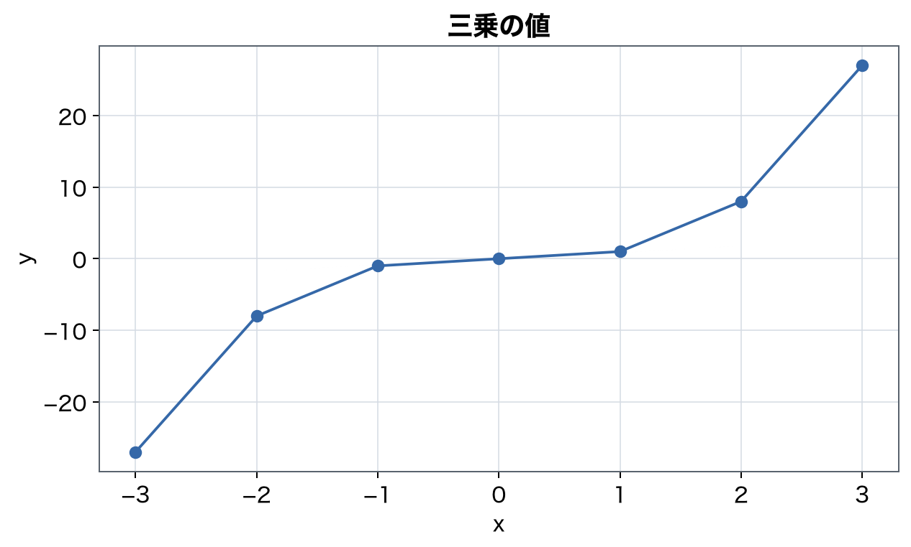
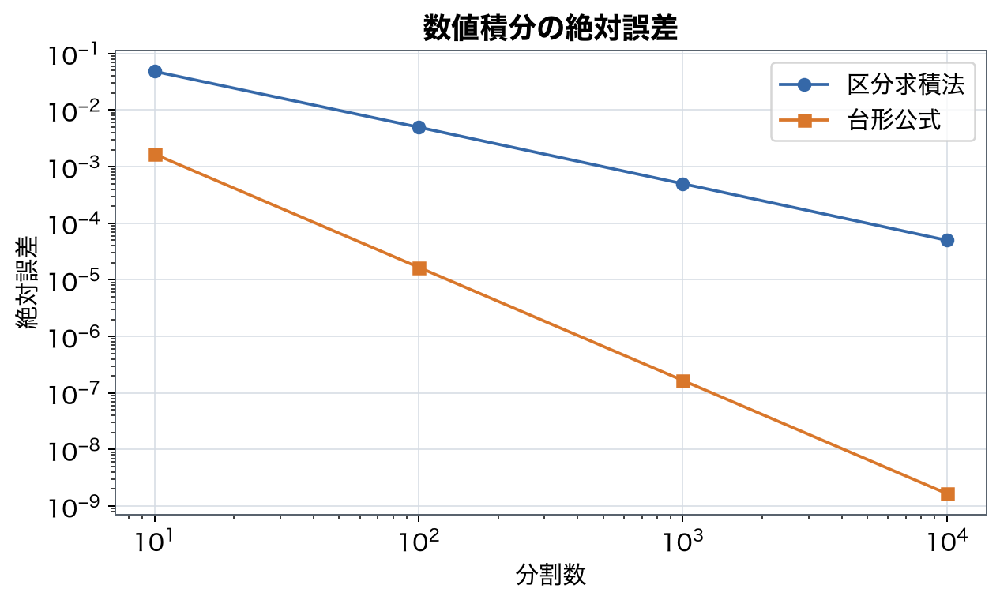
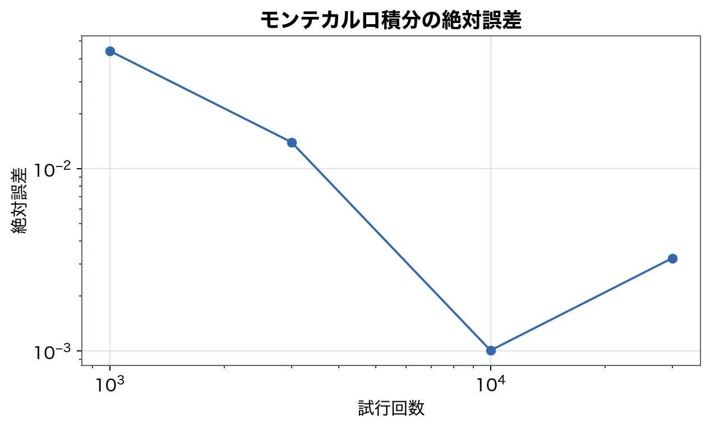

# 第9回　可視化

### 到達目標

- **グラフの選択**：確認したい内容に応じて，折れ線グラフ，散布図，棒グラフ，ヒストグラムを選択できる．
- **Matplotlibの基本操作**：データをグラフとして表示し，軸ラベル，タイトル，凡例，グリッドを設定できる．
- **データの比較**：複数のデータを同じ座標上に表示し，対数目盛を使って桁の異なる値を比較できる．
- **グラフの解釈**：グラフから読み取れる傾向を，軸が表す量や数値を根拠として説明できる．

### 前回の復習

第8回では，Google Colabで乱数とモンテカルロ法を扱った．次のコードは，モンテカルロ積分で$\int_0^\pi \sin x\,dx$を近似する．

```python
import math
import random

def monte_carlo_integral(f, a, b, trials):
    total = 0

    for _ in range(trials):
        x = random.uniform(a, b)
        total = total + f(x)

    return (b - a) * total / trials

def f(x):
    return math.sin(x)

random.seed(2026)
value = monte_carlo_integral(f, 0, math.pi, 1000)
error = abs(value - 2)

print(f"{value:.12f}")
print(f"{error:.12f}")
```

````{dropdown} コードの補足
- `monte_carlo_integral`は，区間$[a,b]$から`trials`個の点を一様に選び，関数値の標本平均へ区間の幅を掛けて定積分を近似する．
- $\int_0^\pi \sin x\,dx=2$であるため，`abs(value - 2)`は近似値の絶対誤差を表す．
- 同じシードと同じ実行順序を使うと，同じ疑似乱数列から同じ結果を再現できる．
````

````{dropdown} 出力例
```text
2.044193081754
0.044193081754
```
````

数値の一覧だけでも計算結果は確認できる．今回は，**数値をグラフへ変換し，変化，関係，分布，項目間の差を読み取る**．

### 前回の課題の解答例

1. [課題1「12面体サイコロのシミュレーション」の解答例](./8_numerical3_colab.md#assignment-8-1-answer)
2. [課題2「モンテカルロ積分とCSVファイルへの保存」の解答例](./8_numerical3_colab.md#assignment-8-2-answer)

## Google Colabの準備

第8回に続いてGoogle Colabを使用する．

1. [Google Colab](https://colab.research.google.com/)を開き，第8回と同じGoogleアカウントでログインする．
2. Notebookを新規作成し，ファイル名を`第9回_<学籍番号>_<氏名>.ipynb`へ変更する．
3. Markdownセルを追加し，`# 第9回　可視化`，学籍番号，氏名を記入する．
4. 第8回にダウンロードした`monte_carlo.csv`を用意する．CSVは課題2で使用する．

### 日本語表示の準備

Matplotlibのグラフへ日本語を表示するため，最初のCodeセルで次を実行する．

```python
!pip install japanize-matplotlib

import matplotlib.pyplot as plt
import japanize_matplotlib
```

````{dropdown} コードの補足
- `!pip install japanize-matplotlib`は，Colabのランタイムへ日本語表示用のライブラリをインストールする命令である．行頭の`!`は，Pythonのコードではなく，ランタイムのOSに対する命令を実行する記号である．
- `matplotlib.pyplot`は，グラフを作成する機能をまとめたモジュールである．この講義では`plt`という短い名前で使用する．
- `japanize_matplotlib`を読み込むと，日本語を表示できるフォントがMatplotlibへ設定される．
````

```{tip} 注意：ランタイムを再起動した場合
Colabのランタイムを再起動すると，インストールしたライブラリと読み込んだモジュールの状態は失われる．再起動後は，上のセルから順に実行する．
```

### CSVファイルのアップロード

第8回の`monte_carlo.csv`は，次の手順でColabのランタイムへアップロードする．

1. 画面左側のフォルダアイコンをクリックする．
2. ファイル一覧の上部にあるアップロードボタンをクリックする．
3. 第8回にダウンロードした`monte_carlo.csv`を選択する．
4. ファイル一覧に`monte_carlo.csv`が表示されたことを確認する．

```{tip} 注意：CSVファイルの保存場所
アップロードしたCSVはランタイム内へ一時的に保存される．ランタイムが削除された場合は，再度アップロードする．
```

## 可視化とグラフの選択

**可視化**：データをグラフや図で表し，数値の変化，関係，分布，項目間の差を読み取りやすくすること．

グラフを選ぶときは，最初に**何を確認するのか**を決める．次に，横軸と縦軸が表す量を決める．

| 確認したい内容 | 適したグラフ | 例 |
| --- | --- | --- |
| 時間や順序に伴う値の変化 | 折れ線グラフ | 試行回数に対する誤差の変化 |
| 二つの数値の関係 | 散布図 | 身長と歩幅の関係 |
| 項目ごとの値の比較 | 棒グラフ | サイコロの各出目の回数 |
| 数値データの分布 | ヒストグラム | テスト得点の分布 |

- **折れ線グラフ**：順序をもつ点を線で結び，値の変化を表すグラフ．
- **散布図**：二つの数値を横軸と縦軸に取り，各データを点で表すグラフ．
- **棒グラフ**：項目ごとの値を棒の長さで表し，項目間の大きさを比較するグラフ．
- **ヒストグラム**：数値データをいくつかの区間に分け，各区間に入るデータの個数を表すグラフ．

```{tip} 注意：棒グラフとヒストグラムの違い
棒グラフの横軸は，サイコロの出目や商品名のような**項目**を表す．ヒストグラムの横軸は，身長や得点のような**数値の区間**を表す．見た目が似ていても，表す内容は異なる．
```

## Matplotlibの基本

**Matplotlib**：Pythonでグラフを作成するためのライブラリ．

次のコードは，$y=x^2$の折れ線グラフを作成する．

```python
x = [1, 2, 3, 4, 5]
y = [1, 4, 9, 16, 25]

fig, ax = plt.subplots()
ax.plot(x, y, marker="o", label="$y=x^2$")
ax.set_xlabel("x")
ax.set_ylabel("y")
ax.set_title("二乗の値")
ax.legend()
ax.grid()
plt.show()
```

````{dropdown} コードの補足
- `plt.subplots()`は，図全体を表す`fig`と，グラフを描く領域を表す`ax`を作成する．
- `ax.plot(x, y)`は，`x`と`y`の対応する値を点として置き，順番に線で結ぶ．`marker="o"`は各点を丸印で示す指定である．
- `label`で線の説明を設定し，`ax.legend()`で凡例を表示する．
- `ax.set_xlabel`，`ax.set_ylabel`，`ax.set_title`は，それぞれ横軸ラベル，縦軸ラベル，タイトルを設定する．
- `ax.grid()`は，値を読み取りやすくするためのグリッドを表示する．`plt.show()`は完成した図を表示する．
````


````{note} 演習1
$-3\leq x\leq3$における$y=x^3$の折れ線グラフを作成せよ．次の`____`を埋め，軸ラベル，タイトル，グリッドを表示せよ．

```python
x = [-3, -2, -1, 0, 1, 2, 3]
y = []

for value in x:
    y.append(____)

fig, ax = plt.subplots()
ax.plot(____)
ax.set_xlabel("x")
ax.set_ylabel("y")
ax.set_title("三乗の値")
ax.grid()
plt.show()
```

**出力例**


````

````{hidden-answer} 解答例
```python
x = [-3, -2, -1, 0, 1, 2, 3]
y = []

for value in x:
    y.append(value ** 3)

fig, ax = plt.subplots()
ax.plot(x, y, marker="o")
ax.set_xlabel("x")
ax.set_ylabel("y")
ax.set_title("三乗の値")
ax.grid()
plt.show()
```

`x`の各値を3乗して`y`へ追加する．`ax.plot(x, y)`では，同じ添字の$x$と$y$を一つの点として表示する．
````

## 散布図

二つの数値の関係を確認するには，`ax.scatter`で散布図を作成する．次のコードは，学習時間と確認テストの得点を点で表す．

```python
hours = [1, 2, 3, 4, 5, 6]
scores = [48, 55, 63, 70, 78, 84]

fig, ax = plt.subplots()
ax.scatter(hours, scores)
ax.set_xlabel("学習時間")
ax.set_ylabel("得点")
ax.set_title("学習時間と得点")
ax.grid()
plt.show()
```

````{dropdown} コードの補足
- `ax.scatter(hours, scores)`は，学習時間と得点の組を一つずつ点として表示する．線では結ばない．
- このデータでは，学習時間が長い点ほど得点も高い位置にあり，右上がりの傾向が見られる．
- 散布図は二つの数値の関係を確認するために使う．点の並びだけから，一方が他方の原因であるとは断定できない．
````


```{tip} 注意：相関関係と因果関係
二つの値がともに増減する関係を**相関関係**という．一方の変化が他方の変化を引き起こす関係を**因果関係**という．散布図に相関関係が見えても，それだけで因果関係があるとは判断できない．
```

````{note} 演習2
身長`[150, 155, 160, 165, 170, 175]`と歩幅`[60, 62, 65, 67, 70, 72]`の散布図を作成せよ．次の`【　】`へ，散布図，軸ラベル，タイトル，グリッドを設定する処理をまとめて記入せよ．グラフから読み取れる傾向をMarkdownセルに1文で記述せよ．

```python
heights = [150, 155, 160, 165, 170, 175]
steps = [60, 62, 65, 67, 70, 72]

fig, ax = plt.subplots()

【身長と歩幅の散布図を作成し，表示項目を設定する処理を記入】

plt.show()
```

**出力例**


````

````{hidden-answer} 解答例
```python
heights = [150, 155, 160, 165, 170, 175]
steps = [60, 62, 65, 67, 70, 72]

fig, ax = plt.subplots()
ax.scatter(heights, steps)
ax.set_xlabel("身長（cm）")
ax.set_ylabel("歩幅（cm）")
ax.set_title("身長と歩幅")
ax.grid()
plt.show()
```

このデータでは，身長が高くなるにつれて歩幅も長くなる傾向が見られる．
````

## 棒グラフ

項目ごとの値を比較するには，`ax.bar`で棒グラフを作成する．

```python
subjects = ["国語", "数学", "英語", "理科"]
scores = [72, 88, 76, 84]

fig, ax = plt.subplots()
bars = ax.bar(subjects, scores)
ax.set_xlabel("科目")
ax.set_ylabel("得点")
ax.set_title("科目ごとの得点")
ax.bar_label(bars)
plt.show()
```

````{dropdown} コードの補足
- `ax.bar(subjects, scores)`は，科目ごとの得点を棒で表す．横軸の科目は独立した項目であるため，棒を線で結ばない．
- 戻り値を`bars`へ代入し，`ax.bar_label(bars)`へ渡すと，各棒の上へ値を表示できる．
- 棒の高さと数値の両方を示すことで，項目間の差と正確な値を同時に確認できる．
````


````{note} 演習3
第8回課題1で得た12面体サイコロの出目ごとの回数を棒グラフで表示せよ．次の`【　】`へ，棒グラフ，軸ラベル，タイトル，各棒の値を設定する処理をまとめて記入せよ．

```python
faces = [1, 2, 3, 4, 5, 6, 7, 8, 9, 10, 11, 12]
counts = [415, 448, 410, 381, 443, 432, 420, 429, 430, 383, 400, 409]

fig, ax = plt.subplots()

【出目ごとの回数を棒グラフで表示する処理を記入】

plt.show()
```

**出力例**


````

````{hidden-answer} 解答例
```python
faces = [1, 2, 3, 4, 5, 6, 7, 8, 9, 10, 11, 12]
counts = [415, 448, 410, 381, 443, 432, 420, 429, 430, 383, 400, 409]

fig, ax = plt.subplots()
bars = ax.bar(faces, counts)
ax.set_xlabel("出目")
ax.set_ylabel("回数")
ax.set_title("12面体サイコロを5000回振った結果")
ax.set_xticks(faces)
ax.bar_label(bars)
plt.show()
```

横軸には12個の出目という項目，縦軸には各項目の回数を置く．`ax.set_xticks(faces)`は，横軸へ1から12までの目盛を明示する．
````

## ヒストグラム

数値データの分布を確認するには，`ax.hist`でヒストグラムを作成する．次のコードでは，平均0，標準偏差1の正規分布に従う疑似乱数を1000個生成する．

- **正規分布**：平均の近くに多くの値が集まり，平均から離れるほど値が現れにくくなる，左右対称の連続確率分布．
- **標準偏差**：値が平均からどの程度離れているかを表す指標．標準偏差が大きいほど，値は広い範囲に分布する．

```python
import random

random.seed(2026)
data = []

for _ in range(1000):
    data.append(random.gauss(0, 1))

fig, ax = plt.subplots()
ax.hist(data, bins=20, edgecolor="white")
ax.set_xlabel("値")
ax.set_ylabel("度数")
ax.set_title("正規乱数の分布")
plt.show()
```

````{dropdown} コードの補足
- `random.gauss(0, 1)`は，平均0，標準偏差1の正規分布に従う疑似乱数を一つ生成する．
- `ax.hist(data, bins=20)`は，データの範囲を20個の区間へ分け，各区間に入る値の個数を棒の高さで示す．
- `bins`は区間の個数である．同じデータでも，`bins`を変えると分布の細かさと見え方が変化する．
- `edgecolor="white"`は，隣り合う棒の境界を白線で見やすくする指定である．
````


````{note} 演習4
上の`data`を使い，`bins=10`と`bins=30`のヒストグラムをそれぞれ表示せよ．次の`____`を埋め，二つのグラフで分布の見え方がどのように変化するかをMarkdownセルに2文で記述せよ．

```python
for bins in [____]:
    fig, ax = plt.subplots()
    ax.hist(____)
    ax.set_xlabel("値")
    ax.set_ylabel("度数")
    ax.set_title(f"正規乱数の分布：区間数{bins}")
    plt.show()
```

**出力例**


````

````{hidden-answer} 解答例
```python
for bins in [10, 30]:
    fig, ax = plt.subplots()
    ax.hist(data, bins=bins, edgecolor="white")
    ax.set_xlabel("値")
    ax.set_ylabel("度数")
    ax.set_title(f"正規乱数の分布：区間数{bins}")
    plt.show()
```

区間数10では分布の全体的な形を捉えやすい．区間数30では細かな増減を確認できる一方，各区間の度数のばらつきが目立つ．
````

## 複数のデータと対数目盛

複数のデータを同じ座標上で比較するには，`ax.plot`を複数回実行して凡例を付ける．次のコードは，第7回で扱った区分求積法と台形公式の絶対誤差を比較する．

```python
n_values = [10, 100, 1000, 10000]
riemann_errors = [0.0483333, 0.00498333, 0.000499833, 0.0000499983]
trapezoidal_errors = [0.00166667, 0.0000166667, 0.000000166667, 0.00000000166667]

fig, ax = plt.subplots()
ax.plot(n_values, riemann_errors, marker="o", label="区分求積法")
ax.plot(n_values, trapezoidal_errors, marker="s", label="台形公式")
ax.set_xlabel("分割数")
ax.set_ylabel("絶対誤差")
ax.set_title("数値積分の絶対誤差")
ax.set_xscale("log")
ax.set_yscale("log")
ax.legend()
ax.grid()
plt.show()
```

````{dropdown} コードの補足
- 2回の`ax.plot`は同じ`ax`へ線を追加する．`label`で各線の説明を設定し，`ax.legend()`で凡例を表示する．
- **対数目盛**は，10倍，100倍のように桁が変わる値を比較するための目盛である．`set_xscale("log")`と`set_yscale("log")`で横軸と縦軸を対数目盛にする．
- 分割数は10倍ずつ増え，絶対誤差は複数の桁にわたって小さくなる．両方の軸を対数目盛にすると，二つの方法の誤差の減り方を同じ図で比較しやすい．
````



```{tip} 注意：対数目盛で扱える値
対数目盛では0以下の値を表示できない．誤差を対数目盛で表示するときは，データがすべて正であることを確認する．
```

````{note} 演習5
次の二つの計算時間を同じグラフに表示せよ．横軸と縦軸を対数目盛にし，軸ラベル，タイトル，凡例，グリッドを設定せよ．`【　】`には複数行の処理をまとめて記入する．

```python
sizes = [10, 100, 1000, 10000]
method_a = [0.00001, 0.0001, 0.001, 0.01]
method_b = [0.00002, 0.0004, 0.04, 4.0]

fig, ax = plt.subplots()

【二つの計算時間を両対数グラフで比較する処理を記入】

plt.show()
```

**出力例**


````

````{hidden-answer} 解答例
```python
sizes = [10, 100, 1000, 10000]
method_a = [0.00001, 0.0001, 0.001, 0.01]
method_b = [0.00002, 0.0004, 0.04, 4.0]

fig, ax = plt.subplots()
ax.plot(sizes, method_a, marker="o", label="方法A")
ax.plot(sizes, method_b, marker="s", label="方法B")
ax.set_xlabel("データ数")
ax.set_ylabel("計算時間（秒）")
ax.set_title("二つの方法の計算時間")
ax.set_xscale("log")
ax.set_yscale("log")
ax.legend()
ax.grid()
plt.show()
```

方法Aの計算時間は，データ数が10倍になると約10倍になる．方法Bの計算時間は，データ数が10倍になると約100倍になり，データ数の増加に対して方法Aより急速に増える．
````

## グラフからの読み取り

グラフの説明では，見た目の印象だけでなく，軸と数値を根拠にする．次の順序で記述すると，読み取った内容を整理しやすい．

1. **対象**：横軸と縦軸が何を表すかを示す．
2. **傾向**：増減，ばらつき，最大・最小，項目間の差を示す．
3. **根拠**：具体的な値や範囲を示す．
4. **限界**：グラフだけでは判断できないことを区別する．

```{tip} 例：棒グラフの説明
横軸は12面体サイコロの出目，縦軸は5000回中の出現回数を表す．出現回数は381回から448回までの範囲にあり，2の出目が最も多い．各棒の高さには違いがあるが，一回のシミュレーションだけからサイコロに偏りがあるとは断定できない．
```

## エラーが出たときの確認

- **`NameError`**：`plt`，`random`などを読み込むセルや，使用する変数を定義するセルを先に実行したか確認する．
- **`ModuleNotFoundError`**：`japanize_matplotlib`をインストールしたセルが実行済みか確認する．ランタイムを再起動した場合は，インストールからやり直す．
- **`FileNotFoundError`**：ファイル一覧に`monte_carlo.csv`が表示されているか，ファイル名の大文字・小文字や拡張子が一致しているか確認する．
- **`ValueError`**：横軸と縦軸へ渡したリストの要素数が同じか確認する．たとえば，`x`が5個，`y`が4個では対応する点を作れない．
- **日本語が四角で表示される場合**：`import japanize_matplotlib`を実行した後で，グラフを作成するセルを再実行する．
- **対数目盛で点が表示されない場合**：横軸と縦軸のデータに0以下の値が含まれていないか確認する．

## 課題

````{warning} 課題1
第8回課題1の12面体サイコロを5000回振るシミュレーションを再実行し，出目ごとの回数を棒グラフで可視化せよ．シードは2026とし，軸ラベル，タイトル，各棒の回数を表示すること．棒グラフを選んだ理由と結果の特徴をMarkdownセルに3文程度で記述せよ．

次のテンプレートを基に完成させよ．`【　】`は，説明に対応する複数行の処理を記述する箇所を表す．

```python
# 課題1
import random

random.seed(2026)
counts = [0] * 12

【12面体サイコロを5000回振り，各出目の回数を数える処理を記入】

faces = list(range(1, 13))
fig, ax = plt.subplots()

【棒グラフを作成し，表示項目と各棒の回数を設定する処理を記入】

plt.show()
```

**出力例**


````

(assignment-9-1-answer)=
````{hidden-answer} 課題1の解答例
```python
# 課題1
import random

random.seed(2026)
counts = [0] * 12

for _ in range(5000):
    value = random.randint(1, 12)
    counts[value - 1] = counts[value - 1] + 1

faces = list(range(1, 13))
fig, ax = plt.subplots()
bars = ax.bar(faces, counts)
ax.set_xlabel("出目")
ax.set_ylabel("回数")
ax.set_title("12面体サイコロを5000回振った結果")
ax.set_xticks(faces)
ax.bar_label(bars)
plt.show()
```

**考察例**

横軸は12面体サイコロの出目，縦軸は5000回中の出現回数を表す．項目ごとの回数を比較するため，棒グラフを選んだ．出現回数は381回から448回までの範囲にあり，理論上の期待回数$5000/12\approx416.7$の周りにばらついている．
````

````{warning} 課題2
第8回課題2で作成した`monte_carlo.csv`をcsvモジュールで読み込み，試行回数と絶対誤差の関係を折れ線グラフで可視化せよ．横軸と縦軸を対数目盛とし，軸ラベル，タイトル，点，グリッドを表示すること．折れ線グラフと対数目盛を選んだ理由，絶対誤差の変化をMarkdownセルに3文程度で記述せよ．

次のテンプレートを基に完成させよ．`【　】`は，説明に対応する複数行の処理を記述する箇所を表す．

```python
# 課題2
import csv

trials_values = []
errors = []

【monte_carlo.csvから試行回数と絶対誤差を読み込む処理を記入】

fig, ax = plt.subplots()

【試行回数と絶対誤差の関係を両対数グラフで表示する処理を記入】

plt.show()
```

**出力例**


````

(assignment-9-2-answer)=
````{hidden-answer} 課題2の解答例
```python
# 課題2
import csv

trials_values = []
errors = []

with open("monte_carlo.csv", "r", encoding="utf-8") as file:
    reader = csv.reader(file)
    next(reader)

    for row in reader:
        trials_values.append(int(row[0]))
        errors.append(float(row[2]))

fig, ax = plt.subplots()
ax.plot(trials_values, errors, marker="o")
ax.set_xlabel("試行回数")
ax.set_ylabel("絶対誤差")
ax.set_title("モンテカルロ積分の絶対誤差")
ax.set_xscale("log")
ax.set_yscale("log")
ax.grid()
plt.show()
```

**考察例**

横軸は試行回数，縦軸はモンテカルロ積分の絶対誤差を表す．試行回数という順序をもつ量に対する絶対誤差の変化を確認するため，折れ線グラフを選んだ．試行回数が増えると全体として絶対誤差は小さくなるが，10000回から30000回では増加しており，毎回単調に減少するわけではない．
````

### 提出方法

WebClassの「第9回課題」から，次のファイルを提出する．

| 提出ファイル | 内容 |
| --- | --- |
| `第9回_<学籍番号>_<氏名>.ipynb` | 課題1・2のコード，実行結果，グラフ，Markdownセルによる考察 |

- Notebookを上から順に実行し，課題1・2のグラフが表示されていることを確認する．
- 軸ラベルとタイトルが日本語で表示されていることを確認する．
- 課題1・2の後に，指定された考察のMarkdownセルがあることを確認する．
- Google Colabの「ファイル」→「ダウンロード」→「.ipynbをダウンロード」から提出用ファイルを保存する．

### 提出期限

<span style="color: red; ">11月27日(金)23:59まで</span>

質問等がある場合には

- メール kkagawa@josai.ac.jp
- Teamsのチャット
- WebClassのメッセージ

などで連絡してください．

## まとめ

- **確認する内容に応じたグラフの選択**：変化には折れ線グラフ，二つの数値の関係には散布図，項目間の比較には棒グラフ，数値の分布にはヒストグラムを使う．
- **図の情報の明示**：軸ラベルとタイトルを付け，複数のデータを比較するときは凡例を付ける．
- **桁の異なる値の比較**：正の値が複数の桁にわたる場合は，対数目盛を使うと変化を比較しやすい．
- **根拠に基づく解釈**：軸が表す量と具体的な値を示し，グラフから読み取れることと断定できないことを区別する．

次回は，第1回から第9回までの学習内容を確認するテストを行う．
